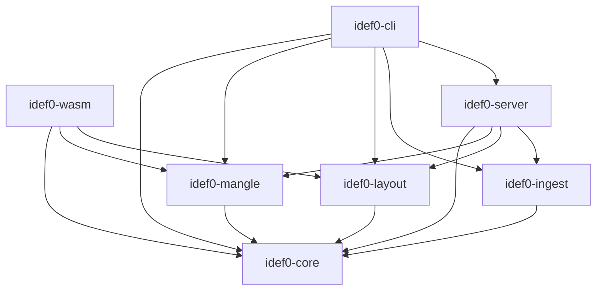

# idef0-rs: System Architecture

| Field | Value |
|---|---|
| Status | DRAFT v0.2 (2026-10-15) |
| Part of | idef0-rs spec set; index: [docs/PRD.md](PRD.md) |
| Normative references | [PRD decisions D1–D15](PRD.md); [metamodel](spec/metamodel.md); [validation](spec/validation.md); [layout](spec/layout.md); [editor UX](spec/editor-ux.md); [ingestion](spec/ingestion.md); [agents](spec/agents.md); [testing](testing.md); [CLI](cli.md); [glossary](glossary.md) |
| Scope | Crates and their boundaries, architecture principles, the determinism contract, key types, runtime state, persistence and concurrency, HTTP/WS API, server security, observability, scale limits, performance budgets, dependencies, toolchain, CI, release and licensing. |

Requirement IDs are stable. This document introduces **FR-SEC-01..FR-SEC-16** (server security), **NFR-OBS-01** (observability), **NFR-SCALE-01** (scale limits) and **NFR-DET-02..04** (determinism enforcement). The range FR-SEC-01..FR-SEC-19 is reserved for this document; agent and LLM threats in [agents.md](spec/agents.md) use FR-SEC-20 and up.

---

## 1. Scope

This document owns the architecture principles and determinism contract (§2), the crate map (§3), illustrative shared types (§4), browser state (§5), persistence and concurrency (§6), the WASM ↔ BFF split and API (§7), server security (§8), observability, scale limits and budgets (§9–§11), and dependencies, toolchain, dev setup, lints, CI, release and licensing (§12–§17).

| Not owned here | Owner |
|---|---|
| Metamodel, DSL grammar, identity rules, editing semantics, `.idef0/` layout, format versioning | [metamodel](spec/metamodel.md) |
| Mangle rules, extractor contract, diagnostic registry, Mangle backend gate (old §2.6, D2) | [validation](spec/validation.md#11-engine-backends-and-the-m31-spike-gate) |
| Layout algorithms, geometry checker | [layout](spec/layout.md) |
| Keyboard FSM, browser matrix, offline autosave, accessibility | [editor UX](spec/editor-ux.md) |
| Scanner fast path, sync semantics | [ingestion](spec/ingestion.md) |
| LLM/agent threat model, proposals, MCP | [agents](spec/agents.md) |
| Test strategy, fixture inventory | [testing](testing.md) |

---

## 2. Architecture principles

### 2.1 Principles

| # | Principle | Consequence |
|---|---|---|
| P1 | **Sources of truth are disjoint.** The model file owns structure. Code owns the existence of mechanisms. The PRD owns requirement text. | Sync never silently rewrites any of them; every cross-source change is a reviewed `SyncPlan` ([ingestion](spec/ingestion.md#6-synchronization-semantics)). |
| P2 | **The `.idef0` text file is canonical** (D3). JSON exists only on the wire and in caches. | The server persists by formatting the model to DSL; caches (`.idef0/cache/`) are always rebuildable. |
| P3 | **Determinism** (D6): identical model bytes produce identical facts, diagnostics, Scene and SVG on native and wasm32. PNG is excluded. | §2.2 lists the enforcement rules. |
| P4 | **Logic lives in pure Rust libraries; the UI is thin** (D4). | `idef0-wasm` translates DOM events to `Input`s and draws a `Scene`. It contains no model, layout or validation logic. |
| P5 | **Every change is a `Command`.** Pointer drags, key chords, CLI edits, sync and agent proposals all become `Command`s applied by `core::apply`. | Geometry is never stored; layout is always recomputed (D5). Undo, rebase and audit work on one representation. |
| P6 | **Local-first.** The browser app works without a server for model editing, layout, structural validation and model search. | The server adds file persistence, PRD/code facts, workspace search and AI proposals. No network call leaves the machine unless `[ai]` is enabled ([agents](spec/agents.md#7-threat-model-and-privacy)). |
| P7 | **Single writer per workspace.** At most one process writes model files at a time. | §6.3: advisory lock `.idef0/run/write.lock`; CLI and MCP writes route through a running server. |
| P8 | **Never destroy user bytes.** A file that fails to parse is never overwritten. | §6.4: read-only-error mode. |
| P9 | **Agent writes need human acceptance** (D15). | Agent-origin writes become pending proposals, not applied patches ([agents](spec/agents.md#63-writes-pending-proposals-d15)). |
| P10 | **Stable, deterministic identity** (D14). Parsing never mints random ids. | Box keys, arrow ids and call targets are derived or explicit ([metamodel](spec/metamodel.md#3-identity-fr-id)). |

### 2.2 Determinism contract

**Statement (NFR-DET-01, D6):** for identical input bytes (model files, rule files, config, external facts), idef0-rs produces byte-identical fact dumps, diagnostic reports (human, JSON, SARIF), Scenes (JSON), SVG and ASCII renders, contract cards and search rankings, on every supported native target and on `wasm32-unknown-unknown`. PNG output is excluded because rasterizers may differ in anti-aliasing.

| ID | Rule | Enforcement |
|---|---|---|
| NFR-DET-02 | Output paths iterate only ordered collections (`BTreeMap`, `BTreeSet`, `Vec` sorted by an explicit total order, or `IndexMap` in insertion order). | `clippy::disallowed_types` bans `std::collections::{HashMap, HashSet}` in core, mangle and layout (§2.3). |
| NFR-DET-03 | Core, mangle and layout never read the clock, the environment or a random source. Time and new keys come from an injected `Clock` and `KeyMinter` (§4.6). | `clippy::disallowed_methods` bans `Instant::now`, `SystemTime::now`, `Ulid::new`, `getrandom::*`, `rand::*`, `std::env::var*` in those crates; CI dependency audit (§15) bans `getrandom`, `rand` and `ulid` from their wasm32 dependency tree. |
| NFR-DET-04 | Geometry is integer grid units (`i32` gu). Floats appear only at the SVG serialization boundary, formatted with exactly 2 decimals by one function (`svg::fmt2`). Transcendental float functions are not used in output paths. | `disallowed_methods` bans `f32/f64::{sin, cos, tan, powf, exp, ln, log10, atan2}` in layout; fillets and bridges are emitted as SVG arc commands, so no trig is needed ([layout](spec/layout.md#8-fillets)). |
| — | All sorts on output data use a total order; ties break by element key. | Code review; property tests compare 100 repeated runs ([testing §4](testing.md#4-cross-target-determinism)). |
| — | Parallelism (rayon) exists only in `idef0-ingest`; results are sorted before they leave the crate. | Crate dependency rules (§3.2). |
| — | Text width uses `unicode-width` over grapheme clusters (`unicode-segmentation`); both tables are compiled in, so native and wasm agree. Browser font rendering is outside the contract; see [layout](spec/layout.md#33-text-metrics-sr-49) for kerning and ligature control. | Golden tests. |
| — | Serde JSON output uses struct field order and `BTreeMap` for maps; `serde_json`'s `preserve_order` and `arbitrary_precision` features are off. | Golden tests. |
| — | Time is needed only in the UI (debounce, status line) and the server. In wasm it comes from `web-time`; `std::time::Instant` panics on `wasm32-unknown-unknown`. | `disallowed_types` bans `std::time::Instant` in `idef0-wasm`. |
| — | If randomness is ever needed in the browser, only the `idef0-wasm` binary crate enables `getrandom`'s `wasm_js` feature (getrandom 0.4). Libraries never enable it. | Dependency audit. |

- Cross-target equality is tested by comparing native golden JSON with wasm32 output ([testing §4](testing.md#4-cross-target-determinism)).
- A determinism failure is a release blocker. Tests guarding it are never weakened to make a change pass.

### 2.3 Clippy configuration (normative)

Clippy reads the `clippy.toml` nearest to each crate's manifest. The three wasm-safe crates carry a strict file; the other crates use the root file.

```toml
# crates/idef0-core/clippy.toml (identical in idef0-mangle and idef0-layout)   (normative)
disallowed-types = [
  { path = "std::collections::HashMap", reason = "D6: iteration order; use BTreeMap or IndexMap" },
  { path = "std::collections::HashSet", reason = "D6: iteration order; use BTreeSet" },
  { path = "std::time::Instant",        reason = "D6 and wasm32 panic; inject Clock" },
  { path = "std::time::SystemTime",     reason = "D6 and wasm32 panic; inject Clock" },
]
disallowed-methods = [
  { path = "std::time::Instant::now",    reason = "inject Clock" },
  { path = "std::time::SystemTime::now", reason = "inject Clock" },
  { path = "ulid::Ulid::new",            reason = "D14: parsing never mints random ids" },
  { path = "std::env::var",              reason = "core is environment-free" },
  { path = "std::env::var_os",           reason = "core is environment-free" },
  { path = "f64::sin", reason = "NFR-DET-04" }, { path = "f64::cos",   reason = "NFR-DET-04" },
  { path = "f64::tan", reason = "NFR-DET-04" }, { path = "f64::powf",  reason = "NFR-DET-04" },
  { path = "f64::exp", reason = "NFR-DET-04" }, { path = "f64::ln",    reason = "NFR-DET-04" },
  { path = "f64::atan2", reason = "NFR-DET-04" },
]
```

- `HashMap` used purely as an internal lookup table (never iterated into output) requires `#[expect(clippy::disallowed_types, reason = "...")]` at the use site, so every exception is visible in review.
- Crates that do not depend on `ulid` simply never trigger that entry; it guards against the dependency creeping in.
- Clippy's resolution of primitive inherent methods (`f64::sin`) in `disallowed-methods` is verified at M0.2; if unsupported, a source grep in the `lint` job replaces those entries.

---

## 3. Crate map

### 3.1 Workspace layout

```
idef0-rs/                                                       (illustrative)
├── Cargo.toml              # [workspace], [workspace.package], [workspace.dependencies], [workspace.lints]
├── rust-toolchain.toml     # exact stable pin + wasm32-unknown-unknown target (§12.2)
├── clippy.toml             # native crates
├── deny.toml               # cargo-deny licenses, bans, advisories (§17)
├── .cargo/config.toml      # target-scoped rustflags for wasm32 (§13)
├── CLAUDE.md               # short map + conventions (D13)
├── CHANGELOG.md
├── docs/                   # PRD.md, architecture.md, testing.md, cli.md, glossary.md, spec/*, adr/*
├── fixtures/               # inventory in testing.md §9
├── fuzz/                   # cargo-fuzz targets + corpora (testing.md §8)
├── crates/
│   ├── idef0-core/         # metamodel, identity, DSL parse/format, commands, undo, editor FSM, lints, search, API DTOs
│   ├── idef0-mangle/       # fact extraction, rules/*.mg, RuleEngine + backends, Validator, SARIF
│   ├── idef0-layout/       # sizing, placement, routing, Scene; SVG + ASCII renderers; geometry checker
│   ├── idef0-ingest/       # Markdown/PRD parser, tree-sitter code scanner, sync and rename engine (native)
│   ├── idef0-wasm/         # Leptos 0.8 CSR app built by Trunk; DOM → Input adapter; Scene → SVG/<pre>
│   ├── idef0-server/       # Axum BFF (lib + bin): workspace store, API, WS, proposals, security middleware
│   └── idef0-cli/          # clap: the `idef0` binary (subcommands in cli.md)
└── .github/workflows/      # ci.yml, nightly.yml, release.yml (dist-generated)
```

### 3.2 Dependency graph



| Rule | Enforcement |
|---|---|
| `idef0-core`, `idef0-mangle` and `idef0-layout` compile for `wasm32-unknown-unknown` with default features, do no file I/O, spawn no threads, and use no clock or randomness. | CI `wasm-build` job; §2.3; dependency audit (§15). |
| `idef0-wasm` never depends on `idef0-ingest`, `idef0-server`, `tokio` or any crate that compiles C. | Dependency audit: `cargo tree --target wasm32-unknown-unknown -p idef0-wasm` must not contain `cc`, `tree-sitter*`, `tokio`, `mio`, `ring`. |
| `idef0-mangle` and `idef0-layout` do not depend on each other. | `cargo tree` check. |
| `idef0-ingest` and `idef0-server` are native-only. | They are excluded from the wasm32 build. |
| Only `idef0-core` defines DTOs shared by wasm and server (`idef0_core::api`). | Code review. |

- `idef0-mangle` depends on `mangle-rs` (git, pinned rev) behind the `RuleEngine` trait, or on the in-tree `MiniEngine` fallback. The gate and backend decision are owned by [validation](spec/validation.md#11-engine-backends-and-the-m31-spike-gate) (D2).
- An optional `idef0-attr` proc-macro crate for code tags is planned by [ingestion](spec/ingestion.md#4-code-tagging-standard). It is not part of the v1 workspace until that epic lands.
- The random valid-model generator lives in `idef0-core` behind the non-default `testkit` feature, so the workspace stays at seven crates ([testing §3](testing.md#3-random-valid-model-generator)).

### 3.3 Crate responsibilities

| Crate | Owns | Public entry points (illustrative) |
|---|---|---|
| `idef0-core` | Metamodel types, identity and key minting, DSL parse/format (lossless, comments preserved per [metamodel](spec/metamodel.md#14-persistence-and-workspace-fr-ws)), type check (`E-*`), lints (`L-*`), `Command`/`Patch`/`apply`, undo, editor FSM, model search index, element → span map, API DTOs | `dsl::parse`, `dsl::format`, `apply`, `lint::check`, `editor::step`, `search::SearchIndex` |
| `idef0-mangle` | Fact extraction, embedded rule files, `RuleEngine` trait, backends, `Validator`, report formatting incl. SARIF 2.1.0 | `facts::extract`, `Validator::validate`, `report::{human, json, sarif}` |
| `idef0-layout` | Box sizing, staircase placement, routing, fillets, bundles, bridges, labels, Auto-Arrange search, `Scene`, SVG and ASCII renderers, geometry checker (`G-*`) | `layout`, `arrange`, `svg::render`, `ascii::render`, `check` |
| `idef0-ingest` | PRD Markdown parsing, tree-sitter code scanning, trace facts, `SyncPlan`, rename rewriting, `tantivy` PRD/code index | `prd::parse`, `code::scan`, `sync::plan`, `rename::rewrite` |
| `idef0-wasm` | Leptos components, key and pointer adapters, signals, client validation scheduling, File System Access integration, optional Web Worker | `main` (Trunk entry) |
| `idef0-server` | `WorkspaceStore`, lock, watcher, HTTP/WS API, security middleware, proposals service, PNG export | `pub fn router(state: AppState) -> axum::Router`, `pub async fn serve(cfg: ServeConfig)` |
| `idef0-cli` | `idef0` binary; argument parsing; output formats `human|json|sarif`; exit codes; server discovery for writes | `main` |

---

## 4. Key types (illustrative)

All code blocks in this section are **illustrative**. They show shape and ownership so crates agree; the [metamodel](spec/metamodel.md) is normative for fields and semantics, and wins on any conflict.

### 4.1 Identity and strings

```rust
// (illustrative) idef0-core::id
pub struct NonEmptyString(CompactString);        // trimmed, len >= 1; constructor returns Result
impl NonEmptyString { pub fn new(s: impl AsRef<str>) -> Result<Self, EmptyName>; }

pub struct ModelAbbrev(CompactString);           // "FAC"; required [Extension], unique per workspace
pub struct BoxKey(CompactString);                // slug, explicit `key=` in the file; never changes on rename/renumber
pub struct ConceptKey(CompactString);
pub struct ArrowId(CompactString);               // explicit key, or structural "A0:1O1->2I1#0"; leaves "<trunk>/<i>"

pub enum NodeId {                                 // Display: "A-0", "A-1", "A0", "A21"
    Context { level: u8 },                        // A-0 = 0, A-1 = 1, ... (diagram node numbers)
    Node(SmallVec<[u8; 8]>),                      // box-number path; [] = A0, [2,1] = A21; digits 1..=max per profile
}
pub struct NodeRef { model: Option<ModelAbbrev>, node: NodeId, sheet: Option<SheetSuffix> }   // "SEC/A21", "A321F"
pub enum   Side { I, C, O, M }
pub enum   PortCode { Icom(u8), Border(u8) }      // I2 | [I1] (uncoded border tunnel, local ordinal)
pub struct PortRef { node: NodeRef, side: Side, code: PortCode }   // canonical "A21/I1"; FIPS "A21I1" accepted
```

- `NonEmptyString` makes "a box or concept without a name" unrepresentable: `FunctionBox::name` and `Concept::name` have that type, so construction without a name fails to compile, and deserialization of `""` fails with a typed error (SR-37).
- `BoxKey` minting (slug of name, `-2`, `-3` on collision) goes through `KeyMinter` (§4.6). Parsing a file without keys derives them deterministically in declaration order ([metamodel](spec/metamodel.md#3-identity-fr-id)).

### 4.2 Model

```rust
// (illustrative) idef0-core::model
pub struct Model {
    meta: Meta,
    concepts: BTreeMap<ConceptKey, Concept>,
    diagrams: BTreeMap<NodeId, Arc<Diagram>>,     // structural sharing: a command clones only touched diagrams
    hints: LayoutHints,                           // see layout.md; never raw coordinates (D5)
}
pub struct Meta { name: NonEmptyString, abbrev: ModelAbbrev, description: String, purpose: String,
                  viewpoint: String, scope: Option<String>, author: Option<String>, project: Option<String>,
                  profile: Profile, lang: LangTag }
pub enum Profile { Extended, Fips183 }

pub struct Diagram {
    node: NodeId, kind: DiagramKind, title: Option<String>,   // decomposition title derives from parent box name
    description: String, cnumber: Option<CNumber>, status: Status,
    boxes: Vec<FunctionBox>,                      // order = box number (D5: semantic)
    arrows: Vec<Arrow>, bundles: Vec<Bundle>, boundary: Vec<BoundaryPort>, notes: Vec<ModelNote>,
}
pub enum DiagramKind { Context, HigherContext, Decomposition }
pub enum Status { Working, Draft, Recommended, Publication }

pub struct FunctionBox {
    key: BoxKey, name: NonEmptyString, description: String,
    dre: Option<Dre>,                             // detail reference expression
    call: Option<CallArrow>,                      // 0 or 1 call arrows (FR-CALL-01)
}
pub enum Dre { NodeNumber(NodeRef), CNumber(CNumber), Page(PageNo), ModelNote(NoteNo) }  // v1 emits the first two

pub struct Arrow {
    id: ArrowId, src: Endpoint, dst: Endpoint,
    concept: Option<ConceptKey>,                  // None only on an unlabeled rel=all branch (inherits trunk)
    label: Option<String>,                        // display alias; must resolve to the same concept
    tunnel: Tunnel, code: Option<CodeRef>, mech_kind: Option<MechKind>,
}
pub enum Endpoint { Box { key: BoxKey, side: Side, rank: u8 }, Boundary { side: Side, code: PortCode } }
pub struct Bundle { trunk: ArrowId, kind: BundleKind /* Fork | Join */, branches: Vec<(ArrowId, Rel)> }
pub enum Rel { All, KindOf, PartOf }

pub struct CallArrow {
    targets: NonEmpty<CallTarget>,                // >1 only with a model note (FR-CALL-05)
    note: Option<NoteNo>,
    map: Vec<CallPortMap>,
}
pub struct CallTarget { model: Option<ModelAbbrev>, key: BoxKey }   // "@verify-token" | "SEC/@verify-token" (D14)
// The FIPS reference label ("A5.2", "SEC/A2.1") is computed for display from the target's current node number.

pub struct Concept { key: ConceptKey, name: NonEmptyString, description: String, synonyms: Vec<NonEmptyString>,
                     kind_of: Vec<ConceptKey>, part_of: Vec<ConceptKey>, examples: Vec<String>, sources: Vec<DocRef> }
```

### 4.3 Commands and patches

```rust
// (illustrative) idef0-core::command
pub enum Command {
    // boxes
    AddBox { diagram: NodeId, at: u8, name: NonEmptyString, description: String },
    RenameBox { key: BoxKey, name: NonEmptyString },
    MoveBox { key: BoxKey, to: u8 },              // reorder on the diagonal; renumbers
    DeleteBox { key: BoxKey, cascade: Cascade },  // cascade rules: metamodel §editing
    Decompose { key: BoxKey },
    SetCall { key: BoxKey, call: CallArrow },  ClearCall { key: BoxKey },
    // arrows and ports
    AddArrow { diagram: NodeId, src: Endpoint, dst: Endpoint, concept: ConceptKey },
    Retarget { id: ArrowId, end: End, to: Endpoint },
    DeleteArrow { id: ArrowId },
    SetLabel { id: ArrowId, label: Option<String> },
    SetRel { id: ArrowId, rel: Rel },
    SetTunnel { id: ArrowId, tunnel: Tunnel },
    Fork { trunk: ArrowId, branches: Vec<BranchSpec> },  Join { target: Endpoint, sources: Vec<ArrowId> },
    ReorderPorts { key: BoxKey, side: Side, order: Vec<ArrowId> },   // re-codes the child diagram atomically
    // text and metadata
    SetDescription { subject: SubjectRef, text: String },
    SetMeta { field: MetaField, value: String },
    SetStatus { diagram: NodeId, status: Status },
    // concepts
    DefineConcept { key: ConceptKey, name: NonEmptyString, description: String },
    RenameConcept { key: ConceptKey, name: NonEmptyString },          // key/name semantics: metamodel §editing
    RelateConcepts { child: ConceptKey, rel: ConceptRel, parent: ConceptKey },
    BindArrowConcept { id: ArrowId, concept: ConceptKey },
}

pub struct Patch {
    base_rev: Rev,
    commands: Vec<Command>,                       // originating commands, kept for rebase (SR-23)
    ops: Vec<Op>, inverse: Vec<Op>,               // atomic, invertible
    rename: RenameMap,
    origin: Origin,                               // User | Cli | Sync | Agent{proposal} | External
}
pub struct RenameMap {                            // consumed by sync to rewrite node-number tags
    nodes: BTreeMap<NodeId, NodeId>,
    ports: BTreeMap<PortRef, PortRef>,
    arrows: BTreeMap<ArrowId, ArrowId>,           // structural ids change on retarget
}
pub fn apply(model: &Model, cmd: &Command, env: &mut Env<'_>) -> Result<(Model, Patch), CommandError>;
```

- `Op` is a low-level, invertible mutation (insert/remove/replace of one element). Ops are what undo inverts; Commands are what rebase re-applies.
- Delete cascades, renumbering, `ReorderPorts` child re-coding and concept rename semantics are specified in [metamodel §editing semantics](spec/metamodel.md#13-editing-semantics-fr-edit).

### 4.4 Diagnostics and source spans

```rust
// (illustrative) idef0-core::diag
pub struct Diagnostic { code: Code, severity: Severity, subject: SubjectRef, message: String,
                        detail: Option<Detail>, fix: Option<FixHint> }
pub enum SubjectRef { Box(BoxKey), Diagram(NodeId), Edge(ArrowId), Port(PortRef), Concept(ConceptKey),
                      CodeRef(CodeRef), DocRef(DocRef), Model(ModelAbbrev) }   // one kind per code (registry)

pub struct SourceMap {                            // built by dsl::parse; kept beside the Model (SR-53)
    file: Utf8PathBuf,
    spans: BTreeMap<ElementRef, Span>,            // element -> declaration span
}
pub struct Span { start: u32, end: u32, line: u32, col: u32 }   // byte offsets; 1-based line/col (UTF-8 columns)
```

- The span map is rebuilt on every parse and updated by `format` after each write, so it always matches the bytes on disk.
- SARIF results set `locations[].physicalLocation` from the span of the subject and `partialFingerprints["idef0ElementKey/v1"]`, a blake3 hash over the code, model abbrev and element key, defined in validation (the authority for the SARIF mapping). Because the fingerprint uses keys, not node numbers, alerts survive renumbering. The SARIF mapping is specified in [validation §output](spec/validation.md#8-diagnostics-output).

### 4.5 Scene

```rust
// (illustrative) idef0-layout::scene
#[derive(Clone, PartialEq, Eq, Serialize)]
pub struct Scene { frame: Frame, boxes: Vec<BoxGeom>, arrows: Vec<ArrowGeom>, labels: Vec<LabelGeom>,
                   squiggles: Vec<SquiggleGeom> }
#[derive(Clone, PartialEq, Eq, Serialize)]
pub struct ArrowGeom { key: ElementKey, fp: Fingerprint, polyline: Vec<IPoint>, fillets: Vec<Fillet>,
                       bumps: Vec<Bump>, branches: Vec<BranchGeom>, head: Arrowhead, tunnel: TunnelGlyphs }
pub struct Fingerprint(u64);                      // deterministic hash of the element's geometry and text
```

Every Scene element carries its `ElementKey` (the `data-key` in SVG) and a `Fingerprint`. The fingerprint drives fine-grained DOM updates (§5.2).

### 4.6 Injected environment

```rust
// (illustrative) idef0-core::env
pub trait Clock { fn today(&self) -> Date; }                      // diagram DATE fields, C-number history
pub trait KeyMinter { fn box_key(&mut self, name: &str, taken: &dyn Fn(&BoxKey) -> bool) -> BoxKey; }
pub struct Env<'a> { pub clock: &'a dyn Clock, pub keys: &'a mut dyn KeyMinter }
// Native CLI/server: SystemClock (chrono-free, from SystemTime). Browser: WebClock (web-time).
// Tests: FixedClock("2026-01-01"), DeterministicMinter (slug rule).
```

---

## 5. State management (browser)

### 5.1 Signals

```
          ┌──────────────── idef0-wasm (browser) ───────────────────────────────┐
DOM event │ KeyAdapter/PointerAdapter → Input ─▶ editor::step(state, doc, input) │
          │                                       │                               │
          │                                       ├─ Effect::Apply(Command) ─▶ core::apply ─▶ Patch
          │   RwSignal<Doc{model: Arc<Model>, rev, pending, undo, redo}> ◀────────┘
          │        │ Memo<Arc<Scene>> per visible diagram (PartialEq)              │
          │        ├─▶ layout::layout ─▶ Scene ─▶ keyed <For> SVG / <pre> view     │
          │        └─▶ debounce 50 ms ─▶ Validator::validate ─▶ RwSignal<Report>   │
          │   RwSignal<EditorState> (mode, selection, render mode, overlays)       │
          └───────────────┬────────────────────────────────────────────────────────┘
                          │ POST /api/models/{abbrev}/ops {base_rev, commands}; WS events
          ┌───────────────▼─────── idef0-server ─────────────────────────────────┐
          │ WorkspaceStore · lock · watcher · Validator (+ code/PRD facts)       │
          │ ingest indexes · proposals · security middleware                     │
          └──────────────────────────────────────────────────────────────────────┘
```

- **Two sources of truth:** `Doc` (model, `rev`, pending commands, undo/redo) and `EditorState` (FSM). Everything visual is a `Memo` derived from them. No component holds a copy of model data.
- `Doc.model` is an `Arc<Model>`; with `Arc<Diagram>` sharing, a Memo for an untouched diagram compares equal by pointer first and does not recompute.

### 5.2 Fine-grained rendering (SR-52)

Leptos updates only what changes **if** the view is keyed at element level. A per-diagram `Memo<Arc<Scene>>` alone would re-render the whole SVG on every keystroke.

| Rule | Detail |
|---|---|
| Keyed lists | Boxes, arrows, labels and squiggles are rendered with `<For each=… key=…>`. |
| Key = element key + fingerprint | The key is `(ElementKey, Fingerprint)`. Unchanged elements keep their DOM nodes; a changed element gets a new key and its single `<g>`/`<path>` is replaced. Leptos `<For>` does not re-render an item whose key is unchanged, so the fingerprint is required for correctness, not only speed. |
| Element-level equality | `Scene` elements derive `PartialEq + Eq`; the Memo suppresses downstream work when the Scene is equal. |
| Selection and highlight | Selection, hover and search highlight are separate signals applied as CSS classes keyed by `ElementKey`; they never invalidate the Scene. |
| Alternative | `reactive_stores` keyed fields may replace the fingerprint scheme if M7.2 measurement favors it; the choice is recorded in an ADR. |

The 16 ms keystroke budget (NFR-PERF-01) assumes this scheme. M7.2 acceptance includes a DOM test that editing one box label replaces at most the DOM nodes of that box, its label and attached arrows ([testing §7](testing.md#7-dom-smoke-and-end-to-end-tests)).

### 5.3 Client validation and the Web Worker

- Structural validation (type check, lints, Mangle with structural facts plus any server-pushed external facts) runs **50 ms after the last patch** (debounced). Results replace `RwSignal<Report>` atomically.
- **Worker policy:** decided after the M3.1 measurement. If full structural validation of `fixtures/large/` (60 diagrams) exceeds **16 ms p95** in wasm on the reference machine (the NFR-PERF-02 budget), validation moves to a dedicated Web Worker via `gloo-worker` by default. The `Validator` API is unchanged; only the transport differs. The decision is recorded in the M3.1 ADR ([validation §backend](spec/validation.md#112-spike-m31)).
- Auto-Arrange search, when requested from the UI, always runs off the main thread (Worker) with a progress indicator ([layout §Auto-Arrange](spec/layout.md#12-auto-arrange)).
- Offline autosave (IndexedDB journal, `beforeunload`; OPFS is not used in v1) and the browser matrix are owned by [editor UX](spec/editor-ux.md#113-offline-autosave).

---

## 6. Persistence and concurrency

### 6.1 Write path

1. The client sends `POST /api/models/{abbrev}/ops` with `{ base_rev, commands, origin }`.
2. The server checks `base_rev == rev`. If not, it returns `409` with the current model and `rev`.
3. It applies the commands via `core::apply` with the server's `Env`, formats the model to canonical DSL, and writes it atomically (temp file in the same directory, fsync, rename).
4. Before the rename, it re-hashes the file on disk. If the hash differs from the last-read hash (an external edit the watcher has not yet reported), it aborts, reloads, and returns `409`.
5. It increments `rev`, returns `{ rev, patch }`, and broadcasts `ModelChanged { rev, origin }` on the model's WS channel.

`origin = agent` writes are diverted to the proposal store and return `202 { proposal_id }` (D15, [agents](spec/agents.md#63-writes-pending-proposals-d15)).

### 6.2 Conflicts and rebase (SR-23)

| Situation | Behavior |
|---|---|
| `409` on `POST /ops` | The client takes the server model, re-applies its **pending Commands** in order (not Patches), and re-posts. A Command that no longer applies is dropped and reported in a conflict notice listing what was lost. |
| `ModelChanged` from another origin while the client has no pending commands | The client fetches the model and replaces `Doc.model`. |
| `ModelChanged` while the client has pending commands | Same as `409`: rebase pending Commands onto the new model; failures open the conflict view ("keep mine" re-posts the surviving commands; "take theirs" discards pending). |
| Two browser tabs | Two independent clients with their own `Doc`; they converge through `rev` and `ModelChanged`. There is no cross-tab lock. |
| Real-time multi-user editing | Out of scope for v1. |

### 6.3 Single writer (P7)

| Rule | Detail |
|---|---|
| Lock file | `idef0 serve` creates `.idef0/run/write.lock` with `O_EXCL`, containing `{ pid, port, token, started }`, permissions `0600` (owner-only ACL on Windows). It is also the server run file (there is no separate `server.json`). The file is gitignored. |
| Stale lock | A lock whose `pid` is not alive, or whose port does not answer `GET /api/health` with the same token, is stale and may be replaced. |
| CLI writes | `idef0 fmt`, `idef0 sync --apply`, `idef0 arrange --apply` and other writing subcommands read `.idef0/run/write.lock`. If a live server exists, they send their Commands to it (authenticated with the lock token) instead of writing files. Otherwise they take the lock for the duration of the write. |
| MCP writes | `idef0 mcp` uses the same discovery. Agent writes become proposals in either case (D15). |
| Read-only commands | `check`, `validate`, `render`, `facts`, `contract`, `search` never take the lock. |

### 6.4 Parse failure and external edits (P8)

- When the watcher sees a model file change, the server reparses it. On success it bumps `rev` and broadcasts `ModelChanged { origin: External }`.
- If the file **fails to parse** (or exceeds an input limit, §8.3), the server marks the model **read-only-error**: `GET` returns the last good model plus the parse diagnostics with spans; `POST /ops` returns `423 Locked` with the same diagnostics; WS broadcasts `ModelError { diagnostics }`. The server never writes the file in this state.
- The UI shows an error view with the spans and keeps any pending commands in memory (and in the autosave journal). When the file parses again, the server leaves the error state and clients rebase as in §6.2.
- The server never "repairs" a file it did not successfully parse. `idef0 fmt` refuses to write a file with parse errors.

### 6.5 Undo history across reloads

| Event | Undo/redo stacks |
|---|---|
| Own successful write | Retained. |
| Rebase after `409` or remote change | Retained. Each entry stores its Commands and inverse; undo applies the inverse as a new Command batch through §6.1. If it no longer applies, the entry is dropped with a notice. |
| "Take theirs" in the conflict view | Cleared. |
| Page reload or server restart | Empty. v1 does not persist undo history; the autosave journal restores unsent commands only. |
| Model enters read-only-error | Frozen until the model parses again. |

Undo scope (per model) and navigation on undo are specified in [editor UX](spec/editor-ux.md#47-selection-repair-invariant-fr-ux-09) and [metamodel §editing semantics](spec/metamodel.md#13-editing-semantics-fr-edit).

---

## 7. WASM ↔ BFF boundary and API

### 7.1 Capability split

| Capability | WASM (client) | BFF (server) | Rationale |
|---|---|---|---|
| Editing, FSM, undo | yes | — | Latency |
| Layout and SVG/ASCII render | yes | yes (headless export, CI artifacts) | Same crate (D6) |
| PNG export | — | yes (`resvg`) | Native rasterizer; excluded from D6 |
| Structural validation | yes | yes | Same rules, same results |
| Traceability validation | yes (external facts pushed by server) | yes | Code/PRD facts originate server-side |
| Model search | yes (`idef0_core::search`) | yes | Offline-capable |
| PRD/code search | — | yes (`tantivy`) | Native-only index |
| PRD indexing, code scanning | — | yes | File access; tree-sitter is C |
| AI proposal generation | — | yes | API keys never reach the browser |
| Proposal review and acceptance | yes | yes (CLI `idef0 proposals`) | D15 |
| Persistence | local file (File System Access API, download fallback) | workspace files | P2 |

### 7.2 HTTP API

JSON over HTTP; DTOs in `idef0_core::api`. `{abbrev}` is the model id (SR-18). All `/api/*` and `/ws/*` routes require the session token (§8).

| Method & path | Purpose |
|---|---|
| `GET /api/health` | Liveness and lock-token check (used by CLI discovery) |
| `GET /api/models` | List models in the workspace (abbrev, path, status, error state) |
| `GET /api/models/{abbrev}` | Model JSON + `rev` (+ parse diagnostics if read-only-error) |
| `POST /api/models/{abbrev}/ops` | Apply `{base_rev, commands, origin}` → `{rev, patch}`, `409`, `423`, or `202 {proposal_id}` for agent origin |
| `GET /api/models/{abbrev}/diagnostics` | Full validation including code/PRD facts |
| `GET /api/models/{abbrev}/facts` | External facts for client-side validation |
| `GET /api/models/{abbrev}/render/{node}.{svg,txt,png}` | Headless render |
| `GET /api/models/{abbrev}/contract/{node}` | Contract card ([agents](spec/agents.md#2-contract-cards)); lands with M10 |
| `GET /api/models/{abbrev}/sync` | Sync plan (proposed patches + file edits) |
| `GET /api/search?q=…&scope=model\|prd\|code\|all` | Workspace search |
| `POST /api/ingest/prd` · `POST /api/scan` | Trigger (re)index |
| `POST /api/propose` | AI decomposition proposal ([agents](spec/agents.md#5-ai-decomposition-proposals-fr-ai)) |
| `GET /api/proposals` · `POST /api/proposals/{id}/accept` · `POST /api/proposals/{id}/reject` | Pending proposals (D15); accept and reject also require the UI capability token (FR-SEC-15, FR-SEC-16) |
| `GET /api/session` | Dev mode only (§13.3): returns the session token and the UI capability token to the allowlisted dev origin |
| `GET /ws/models/{abbrev}` | Events: `ModelChanged{rev, origin}`, `ModelError{diagnostics}`, `IndexUpdated`, `Diagnostics`, `ProposalCreated{id}` |

- The contract endpoint is listed for completeness; it is implemented with M10.4 (contract cards), and the server returns `501` before then.
- Error bodies use one shape: `{ "error": { "kind": "...", "message": "...", "diagnostics": [...] } }`.

---

## 8. Server security (SR-24)

The BFF is a localhost server that can write files. A loopback bind alone does not stop DNS rebinding, cross-site request forgery or cross-site WebSocket hijacking from a web page open in the same browser.

### 8.1 Requirements

| ID | Requirement |
|---|---|
| FR-SEC-01 | The server binds `127.0.0.1` by default; binding another address requires `--bind <addr>` and prints a warning. |
| FR-SEC-02 | Every request's `Host` header must match the allowlist `localhost:<port>`, `127.0.0.1:<port>`, `[::1]:<port>` plus configured names; others get `403` (DNS-rebinding defense). |
| FR-SEC-03 | Every mutating request (`POST`, `PUT`, `PATCH`, `DELETE`) and every WS upgrade must carry an `Origin` equal to the server's own origin (or the dev origin under `--dev`); others get `403`. |
| FR-SEC-04 | The server generates a 256-bit random session token per launch and injects it into the served `index.html` as `<meta name="idef0-session" content="…">`. |
| FR-SEC-05 | Every `/api/*` request must send `X-Idef0-Session: <token>`; every WS upgrade must offer subprotocol `idef0.v1` plus `idef0.token.<token>` (browsers cannot set WS headers; this keeps the token out of URLs and logs). |
| FR-SEC-06 | Request bodies must be `Content-Type: application/json`; others get `415`. This also blocks "simple" cross-site form posts. |
| FR-SEC-07 | Every path from a request, config or tag is canonicalized and must stay inside the workspace root; symlinks resolving outside are rejected. |
| FR-SEC-08 | CORS headers are emitted only under `--dev`, only for the configured dev origin. |
| FR-SEC-09 | Markdown (descriptions, PRD excerpts) is rendered with raw HTML disabled, in the UI and in SVG `<desc>`/`<title>` (text only, XML-escaped); link URLs are restricted to `http`, `https`, `mailto` and relative links (as agents FR-SEC-23 and ingestion FR-IO-27). |
| FR-SEC-10 | Parser input limits (§8.3) apply to every file the server or CLI reads. |
| FR-SEC-11 | Secrets (LLM API keys) are read from env or user config on the server and never sent to the client, logged or written to the workspace. |
| FR-SEC-12 | The lock file and session token are owner-readable only; the token is never logged. |
| FR-SEC-13 | Responses set `X-Content-Type-Options: nosniff`, `Referrer-Policy: no-referrer` and a CSP of `default-src 'self'; script-src 'self' 'nonce-<per-request>' 'wasm-unsafe-eval'; style-src 'self'; img-src 'self' data:; connect-src 'self'` (dev: plus the dev origin). The nonce is injected into Trunk's loader script together with the token (Trunk nonce support: verify at M8.4). |
| FR-SEC-14 | Request bodies are capped at 8 MiB and WS messages at 1 MiB. |
| FR-SEC-15 | **UI capability token (D15):** the server generates a second 256-bit random token per launch, held only in server memory and injected into the served `index.html` for the browser session (`<meta name="idef0-ui-cap" content="…">`). It is never written to `write.lock` or anywhere on disk, and never logged. `POST /api/proposals/{id}/accept` and `…/reject` require it in `X-Idef0-Ui-Cap` in addition to the session token. |
| FR-SEC-16 | The session (lock-file) token alone cannot authorize accept or reject: such requests get `403`. CLI acceptance is gated by its own interactive confirmation instead ([agents FR-SEC-31](spec/agents.md#73-requirements-fr-sec)). The residual same-user risk is recorded in [agents §7.4](spec/agents.md#74-residual-risks) (RR-2). |

- Markdown sanitization: `pulldown-cmark` events `Html` and `InlineHtml` are dropped (rendered as escaped text) before HTML generation. Native exports that emit HTML additionally pass through `ammonia` as defense in depth. The wasm build does not include `ammonia`.
- The rule-evaluation sandbox (time and memory caps for project `.mg` rules) is owned by [validation](spec/validation.md#9-project-rules).
- LLM and agent threats (prompt injection through PRD text, untrusted text in contract cards, data egress) are owned by [agents §threat model](spec/agents.md#7-threat-model-and-privacy).

### 8.2 Middleware order

```
(illustrative)  TraceLayer → HostAllowlist → BodyLimit → OriginCheck(mutating, ws) → SessionToken(/api, /ws)
                → ContentTypeJson(bodies) → UiCapability(proposal accept/reject) → routes
```

Static assets (`/`, `/*.wasm`, `/*.js`, `/*.css`) pass Host checks only. `index.html` is rendered per request with the token.

### 8.3 Input limits (NFR-SCALE-01, hard limits)

| Input | Hard limit | On exceed |
|---|---|---|
| `.idef0` file size | 8 MiB | `E-LIMIT-01`; model read-only-error |
| Line length | 64 KiB | `E-LIMIT-01` |
| Diagrams per model | 1,000 | `E-LIMIT-01` |
| Boxes per diagram | profile max (7 extended, 6 fips183), enforced by `NodeId` digits and `R-BOX` | parse error / rule |
| Arrows per diagram | 500 | `E-LIMIT-01` |
| Decomposition depth | 16 levels below A0 | `E-LIMIT-01` |
| Concepts per model | 20,000 | `E-LIMIT-01` |
| Description length | 16 KiB | `E-LIMIT-01` |
| Name length | 256 characters | `E-LIMIT-01` (FR-NAME-01's 60-character limit is a lint) |
| Markdown nesting depth (PRD, descriptions) | 64 | section truncated; ingestion diagnostic |
| PRD file size | 4 MiB | file skipped with a diagnostic ([ingestion](spec/ingestion.md)) |

`E-LIMIT-01` is a parse error with a span at the point the limit was crossed. These limits are about safety, not readability; readability budgets are in §10.

---

## 9. Observability (SR-33, NFR-OBS-01)

| Aspect | Rule |
|---|---|
| Spans | Every pipeline stage opens a `tracing` span: `idef0.parse`, `idef0.typecheck`, `idef0.lint`, `idef0.facts`, `idef0.eval`, `idef0.layout`, `idef0.render`, `idef0.search`, `idef0.scan`, `idef0.sync`, `idef0.propose`. Fields: model abbrev, node, counts. |
| CLI logging | `--log-format text\|json` (default text, to stderr); `-v`/`-q` or `IDEF0_LOG` (an `EnvFilter` directive) select levels. Logs never go to stdout, which carries command output. |
| Rule timings | `idef0 validate --timings` prints per-stage and per-rule evaluation time (sorted, human or JSON). The flag is not called `--profile` because `profile` already names the `extended`/`fips183` validation profile. |
| Server | One request log line per request (method, path template, status, duration, model abbrev); token and bodies are never logged. |
| Browser | In debug builds a `tracing` subscriber writes to the console and `performance.measure`; release builds compile out spans below `warn` (`tracing` `release_max_level_warn`). |
| Determinism | Timings are never part of any golden output; `--timings` output is excluded from snapshot tests. |
| Telemetry | **None by default.** No usage data leaves the machine. Opt-in local counters (`[telemetry] local_counters = true`) append to `.idef0/cache/counters.jsonl` for the NORTHSTAR supporting signals; they are never transmitted ([PRD FR-METRIC](PRD.md#7-requirement-index)). |

---

## 10. Scale limits (SR-33, NFR-SCALE-01)

The budgeted size is the size at which every performance budget in §11 must hold. Beyond it the tool keeps working, but budgets are not guaranteed.

| Dimension | Budgeted | Soft limit (warning) | Hard limit (§8.3) |
|---|---|---|---|
| Diagrams per model | 60 | 60 | 1,000 |
| Boxes per diagram | 3–7 extended, 3–6 fips183 | — (rule `R-BOX`) | profile max |
| Arrows per diagram | 40 | 60 | 500 |
| Boxes + arrows per model | about 2,000 | 3,000 | — |
| Decomposition depth below A0 | 6 | 8 | 16 |
| Concepts per model | 1,000 | 2,000 | 20,000 |
| Models per workspace | 50 | 100 | 1,000 |
| Repository files scanned | 100,000 | — | — |

- Exceeding a model-level soft limit emits **`L-SCALE-01`** (warning, subject `model`); exceeding arrows per diagram emits **`L-SCALE-02`** (warning, subject `diagram`). The message names the dimension, and the UI status line shows "large model: budgets not guaranteed".
- The old PRD used both 50 and 60 diagrams for budgets. **60 is the single budgeted size**; `fixtures/large/` is a 60-diagram generated model ([testing §9](testing.md#9-fixture-inventory)).
- 60 arrows per diagram is a readability ceiling: FIPS diagrams with more arrows are usually better split, and the layout budget is set at 40.

---

## 11. Performance budgets

Consolidated from the old NFR-PERF rows, §3.10 and FR-SEARCH-10. NFR-PERF-01..03 keep their IDs; the scan and server-search halves of the old 02 and 03 became NFR-PERF-05 and -06, and layout (old §3.10) became NFR-PERF-04. Wall-clock budgets are measured on the **reference machine** (§15.3); CI gates use instruction counts ([testing §6](testing.md#6-benchmarks-and-performance-gates)).

| ID | Operation | Size | Budget |
|---|---|---|---|
| NFR-PERF-01 | Keystroke → re-render (p95), Chromium | 7 boxes / 40 arrows | ≤ 16 ms |
| NFR-PERF-02 | Structural validation, full recompute, wasm32 | 60 diagrams | ≤ 16 ms (to be confirmed by the M3.1 spike; drives the Worker decision, §5.3) |
| NFR-PERF-03 | Model search per keystroke, wasm32 | 60 diagrams, ~2k elements, 1k concepts | ≤ 16 ms; index build ≤ 50 ms; incremental update ≤ 1 ms per patch |
| NFR-PERF-04 | Full layout of one diagram | 7 boxes / 40 arrows | ≤ 5 ms native, ≤ 15 ms wasm32 |
| NFR-PERF-05 | PRD/code scan of a 100k-file repo | — | ≤ 10 s cold, ≤ 1 s warm (warm path uses `(path, mtime, size)`, see [ingestion](spec/ingestion.md#43-scanner-pipeline-idef0-ingestcode)) |
| NFR-PERF-06 | Server PRD/code search | 100k-file repo | ≤ 50 ms |
| NFR-PERF-07 | Diagnostic visible after an imbalancing edit (UI) | 60 diagrams | ≤ 100 ms (debounce 50 ms + validation + render) |
| NFR-WASM-01 | Initial wasm bundle, gzip, Mangle backend included | — | ≤ 2.5 MB, measured in CI (`trunk build --release`, `wasm-opt -Oz`) |

- Auto-Arrange has its own budget and progress UI ([layout §Auto-Arrange](spec/layout.md#12-auto-arrange)); it is not part of the keystroke budget.
- A budget that fails at its milestone is fixed or renegotiated in an ADR; it is never silently relaxed.

---

## 12. Dependencies and toolchain (SR-32)

### 12.1 Workspace manifest

Versions below were checked on crates.io on 2026-10-15. They are caret requirements; `Cargo.lock` is committed and pins exact versions. "verify at M0.2" marks entries whose version or feature set must be confirmed when the manifest is first built.

```toml
# Cargo.toml (root)                                                              (illustrative)
[workspace]
resolver = "3"
members  = ["crates/*"]

[workspace.package]
edition      = "2024"
rust-version = "1.90"
license      = "MIT OR Apache-2.0"
repository   = "https://github.com/<org>/idef0-rs"   # verify at M0.2

[workspace.dependencies]
# internal
idef0-core   = { path = "crates/idef0-core" }
idef0-mangle = { path = "crates/idef0-mangle" }
idef0-layout = { path = "crates/idef0-layout" }
idef0-ingest = { path = "crates/idef0-ingest" }
idef0-server = { path = "crates/idef0-server" }
# data and text (wasm-safe)
serde                = { version = "1.0.228", features = ["derive", "rc"] }
serde_json           = "1.0.145"
winnow               = "1.0"
smallvec             = { version = "1.15", features = ["serde", "union"] }
compact_str          = { version = "0.9", features = ["serde"] }      # 0.10 is new; verify at M0.2
nonempty             = { version = "0.12", features = ["serialize"] }  # feature name: verify at M0.2
indexmap             = { version = "2.13", features = ["serde"] }
unicode-segmentation = "1.12"
unicode-width        = "0.2"
thiserror            = "2.0"
# search (wasm-safe)
levenshtein_automata = "0.2.1"
rust-stemmers        = "1.2"
libm                 = "0.2"                                           # IDF scores on both targets (editor-ux search); verify at M0.2
rstar                = "0.13"
blake3               = { version = "1.8", default-features = false, features = ["pure"] }  # `pure` wherever wasm builds it
# markdown
pulldown-cmark       = { version = "0.13", default-features = false }
ammonia              = "4.1"                                           # native exports only
# wasm UI
leptos               = { version = "0.8.21", features = ["csr"] }
wasm-bindgen         = "0.2.126"                                       # must equal wasm-bindgen-cli in CI
web-sys              = "0.3.103"
js-sys               = "0.3.103"
gloo-worker          = "0.6"                                           # verify Leptos 0.8 compatibility at M0.2
web-time             = "1.1"
getrandom            = { version = "0.4", features = ["wasm_js"] }    # idef0-wasm only, and only if needed
# server and native
tokio                = { version = "1.51", features = ["rt-multi-thread", "macros", "net", "fs", "signal", "sync"] }
axum                 = { version = "0.8.6", features = ["ws"] }
tower                = "0.5"
tower-http           = { version = "0.6", features = ["trace", "compression-gzip", "cors", "fs", "limit", "set-header"] }  # 0.7 (2026-06) has breaking changes; evaluate at M0.2
rust-embed           = "8.9"
notify               = "8.2"
notify-debouncer-full = "0.6"
ignore               = "0.4.31"
globset              = "0.4"                                           # config path globs (ingestion); verify at M0.2
rayon                = "1.11"
memchr               = "2.8"
regex                = "1.12"
tantivy              = "0.26"
tree-sitter          = "0.27"                                          # MSRV 1.90; grammar ABI compatibility: verify at M0.2
tree-sitter-rust       = "0.24"
tree-sitter-python     = "0.25"
tree-sitter-typescript = "0.23"
tree-sitter-go         = "0.25"
tree-sitter-java       = "0.23"
resvg                = "0.48"
tiny-skia            = "0.12"                                          # via resvg
fontdb               = "0.24"                                          # must match usvg's fontdb requirement
clap                 = { version = "4.5", features = ["derive", "env"] }
serde-sarif          = "0.8"
tracing              = "0.1.41"
tracing-subscriber   = { version = "0.3.20", features = ["env-filter", "json"] }
reqwest              = { version = "0.12", default-features = false, features = ["rustls-tls", "json", "stream"] }  # server/cli only (Anthropic client, agents FR-AI-03); verify at M0.2
camino               = "1"                                             # verify at M0.2
# test and bench (dev-dependencies)
insta                = { version = "1.47", features = ["json", "glob", "redactions"] }
proptest             = "1.9"
criterion            = { version = "0.8", default-features = false, features = ["cargo_bench_support"] }
gungraun             = "0.20"                                          # successor of iai-callgrind; verify runner install at M0.3
wasm-bindgen-test    = "0.3.76"  
chromiumoxide        = { version = "0.9", default-features = false, features = ["tokio-runtime"] }  # features: verify at M0.2
axum-test            = "21"                                            # optional; tower::ServiceExt is enough
arbitrary            = { version = "1.4", features = ["derive"] }
libfuzzer-sys        = "0.4"
jsonschema           = { version = "0.58", default-features = false }  # SARIF/contract schema checks; verify features at M0.2

[workspace.lints.rust]
unsafe_code           = "forbid"
missing_debug_implementations = "warn"
unreachable_pub       = "warn"

[workspace.lints.clippy]
all       = { level = "deny", priority = -1 }
pedantic  = { level = "warn", priority = -1 }
module_name_repetitions = "allow"
must_use_candidate      = "allow"
dbg_macro = "deny"
todo      = "warn"
unwrap_used = "warn"          # deny in core/mangle/layout via crate attribute
```

- For `0.x` crates a caret requirement pins the minor version (`"0.26"` means `>=0.26, <0.27`), so minor upgrades of `0.x` crates are explicit PRs. Floors stay one minor behind where the newest minor is very recent or breaking (tower-http 0.7, compact_str 0.10). M0.2 may raise them.
- `mangle-rs` is a git dependency pinned by revision; it is added by M3.1 ([validation](spec/validation.md#11-engine-backends-and-the-m31-spike-gate)).
- Tools that are not library dependencies, pinned in CI: `trunk 0.21.14` (0.22 is in release candidate), `wasm-bindgen-cli` (same version as the `wasm-bindgen` crate in `Cargo.lock`), `wasm-opt` (binaryen, via Trunk), `cargo-deny 0.20`, `cargo-insta`, `cargo-fuzz 0.13` (nightly toolchain), `dist 0.33` (formerly `cargo-dist`), `valgrind` (for gungraun).
- No `ulid` dependency: proposal ids are sequential `P<nnnn>` ([agents §6.4](spec/agents.md#64-proposal-lifecycle)). No `fst` in v1 ([editor-ux](spec/editor-ux.md)).
- MCP protocol revision: pin at M12.1 (verify). `idef0 mcp` speaks only that revision ([agents §6.1](spec/agents.md#61-transport)).

### 12.2 Toolchain and MSRV

```toml
# rust-toolchain.toml                                                           (normative)
[toolchain]
channel    = "1.96.0"
components = ["rustfmt", "clippy"]
targets    = ["wasm32-unknown-unknown"]
profile    = "minimal"
```

| Policy | Rule |
|---|---|
| Pin | The toolchain is an exact stable version. Developers and CI use the same compiler. |
| Bumps | A toolchain bump is its own PR (`chore: toolchain 1.x.y`), with snapshots re-run on native and wasm. Bumps happen at most once per 6-week release cycle and stay at least one stable release behind the newest (1.99.1 is current on 2026-10-15). |
| MSRV | `rust-version = "1.90"` in `[workspace.package]`. It is driven by dependency floors (Leptos 0.8.21, ignore 0.4.31 and gungraun 0.20 need 1.88; tree-sitter 0.27 needs 1.90) and is ≥ 1.85, the minimum for edition 2024. A CI job builds the native crates on the MSRV toolchain (§15). Raising MSRV is a minor-version change and is noted in the CHANGELOG. |
| Nightly | Used only for `cargo fuzz` (pinned `nightly-YYYY-MM-DD` in the fuzz job). No crate requires nightly features. |

---

## 13. Dev setup

### 13.1 Files

```toml
# crates/idef0-wasm/Trunk.toml                                                  (illustrative)
[build]
target = "index.html"
dist   = "dist"

[watch]
watch = ["src", "index.html", "style", "../idef0-core/src", "../idef0-layout/src", "../idef0-mangle/src", "../idef0-mangle/rules"]

[serve]
addresses = ["127.0.0.1"]
port = 8080

[[proxy]]
backend = "http://127.0.0.1:7878/api/"

[[proxy]]
backend = "ws://127.0.0.1:7878/ws/"
ws = true
```

```html
<!-- crates/idef0-wasm/index.html (illustrative) -->
<!doctype html>
<html lang="en">
<head>
  <meta charset="utf-8">
  <meta name="viewport" content="width=device-width, initial-scale=1">
  <meta name="idef0-session" content="{{IDEF0_SESSION}}">  <!-- replaced by the server per request -->
  <title>idef0-rs</title>
  <link data-trunk rel="css" href="style/main.css">
  <link data-trunk rel="copy-dir" href="assets/fonts">
  <link data-trunk rel="rust" data-wasm-opt="z" data-bin="idef0-wasm">
</head>
<body></body>
</html>
```

```toml
# .cargo/config.toml                                                            (normative)
[target.wasm32-unknown-unknown]
rustflags = ["--cfg=web_sys_unstable_apis"]   # File System Access API bindings in web-sys
```

Scoping the flag to the wasm target means native builds keep their cache when wasm is built. If `getrandom` is ever needed in the browser, only the `wasm_js` feature on `idef0-wasm` is required (getrandom 0.4); no extra `--cfg` is needed.

### 13.2 How `idef0 serve` finds the UI

| Build | Behavior |
|---|---|
| Release (`idef0` from `dist`) | `crates/idef0-wasm/dist/` is embedded in `idef0-server` with `rust-embed` at compile time. The release pipeline runs `trunk build --release` before `cargo build --release`. |
| `idef0 serve --dev` | Serves `crates/idef0-wasm/dist/` from disk with `tower-http::ServeDir` (or a path given by `--ui-dir`), so `trunk build --watch` output is picked up without rebuilding the server. |
| No UI built | `idef0 serve` without embedded assets starts the API only and prints how to build the UI. |

### 13.3 Dev loop

1. Terminal 1: `idef0 serve --dev --port 7878` (API + WS; CORS and `GET /api/session` enabled for the dev origin `http://127.0.0.1:8080` only).
2. Terminal 2: `cd crates/idef0-wasm && trunk serve` (hot rebuild; proxies `/api` and `/ws` to 7878).
3. In dev mode, `index.html` is served by Trunk, so the token is fetched once from `GET /api/session`, which checks Host and Origin. `--dev` is for a single-user machine only, and the server prints that warning.

---

## 14. Lints and code conventions (SR-48)

- **`unsafe_code = "forbid"` workspace-wide, with no exceptions.** `forbid` cannot be overridden by a later `allow`, which is the point. If a future need for `unsafe` arises, it goes into a separate, audited crate outside this workspace, or an ADR changes the decision.
- M0.2 verifies that `forbid` compiles with the proc macros in use (`leptos::view!`, `#[wasm_bindgen_test]`). Lint-level checks on external proc-macro expansions are normally suppressed; if one of them trips `forbid`, the M0.2 ADR records the fallback (`deny` workspace-wide, with each `#[allow(unsafe_code)]` requiring review).
- Every crate sets `[lints] workspace = true`. Crate-level additions (`#![deny(clippy::unwrap_used)]` in core/mangle/layout) are attributes, because a crate that inherits workspace lints cannot also override them in its manifest.
- Requirement IDs are cited in code and tests (`// FR-CALL-05`). Diagnostic codes are constants in one registry module per namespace ([validation](spec/validation.md#7-diagnostic-registry)).
- `cargo fmt --check` and `cargo clippy --workspace --all-targets -- -D warnings` are required for every commit; core/mangle/layout are also linted for `--target wasm32-unknown-unknown`.

---

## 15. CI (SR-32)

### 15.1 Pull-request pipeline

| Job | Runner | Steps | Budget |
|---|---|---|---|
| `lint` | ubuntu-24.04 | fmt; clippy native; clippy wasm32 (core, mangle, layout, wasm); `cargo deny check`; dependency audit (§3.2, §2.2) | 5 min |
| `test-linux` | ubuntu-24.04 | `cargo test --workspace` (unit, property at PR depth, insta with `--check --unreferenced=reject`, conformance, FSM scripts, geometry checker, API/security integration, fuzz-corpus replay) | 10 min |
| `test-macos` | macos-14 (arm64) | build + test native crates | 12 min |
| `test-windows` | windows-2022 (MSVC) | build + test native crates; tree-sitter grammars need the MSVC C toolchain | 15 min |
| `wasm` | ubuntu-24.04 | `cargo build --target wasm32-unknown-unknown -p idef0-core -p idef0-mangle -p idef0-layout`; `wasm-bindgen-test` in headless Chrome (cross-target goldens, DOM smoke); `trunk build --release` + bundle-size check (NFR-WASM-01) | 10 min |
| `e2e` | ubuntu-24.04 + Chrome stable | `idef0 serve` + chromiumoxide scenarios + accessibility-tree assertions | 10 min |
| `bench-gate` | ubuntu-24.04 | gungraun instruction counts vs committed baseline | 8 min |
| `msrv` | ubuntu-24.04 | `cargo +1.90 check` of native crates | 5 min |
| `dogfood` | ubuntu-24.04 | `idef0 validate --locked --fail-on error` on `fixtures/dogfood/` and (from M10.7) on the repo itself; SARIF uploaded to code scanning | 3 min |

### 15.2 Nightly pipeline

Deep proptest (10k cases per property, including the model generator), `cargo fuzz` time-boxed runs (10 min per target), criterion wall-clock benches (informative), wasm timing of NFR-PERF budgets on the reference machine, large-model performance, and macOS/Windows e2e smoke. Failures open an issue; they do not block merges.

### 15.3 Caching and reference machine

- `Swatinem/rust-cache` keyed by job, target and `Cargo.lock`; separate caches for native and wasm32 targets. Tool binaries (trunk, wasm-bindgen-cli, cargo-deny, cargo-insta, gungraun-runner) are installed from prebuilt releases at pinned versions and cached.
- `wasm-bindgen-cli` is installed at exactly the `wasm-bindgen` version in `Cargo.lock`; a mismatch fails the job early.
- **Reference machine** for wall-clock budgets: the GitHub-hosted `ubuntu-24.04` standard runner (4 vCPU) with Chrome stable, recorded with CPU model in each benchmark report. Instruction-count gates do not depend on runner noise.

---

## 16. Release and versioning (SR-54)

| Artifact | Versioning |
|---|---|
| `idef0` CLI and crates | SemVer, one workspace version. Breaking CLI flags, exit codes or JSON output shapes require a major bump (minor while `0.x`). |
| `.idef0` DSL format | The file header carries the format version ([metamodel §versioning](spec/metamodel.md#14-persistence-and-workspace-fr-ws)). Readers accept older versions; `idef0 migrate` upgrades files. A new format version is a minor CLI release at least. |
| Contract card schema | `idef0.contract.vN` (`schemas/contract.vN.json`), SemVer per schema; additive fields are minor ([agents](spec/agents.md#2-contract-cards)). |
| SARIF / JSON report schema | Versioned in the report (`schema_version`; schema id `idef0.report.v1`). |
| Diagnostic codes | **Never reused.** A retired code stays in the registry marked retired. Renames keep the old code as an alias for one minor release. |

- **Release tooling:** `dist` (formerly `cargo-dist`) generates `.github/workflows/release.yml` and builds archives and installers for the NFR-PORT-01 targets on tag push (`v*`). The release job runs `trunk build --release` first so the UI is embedded.
- **CHANGELOG.md** in Keep a Changelog format; every user-visible change adds a line under "Unreleased" in the same PR.
- **ADRs:** `docs/adr/NNNN-title.md` (four digits, never renumbered), with Status (Proposed, Accepted, Superseded by NNNN), Context, Decision, Consequences. Required for: backend choice (0001, M3.1), Worker default, toolchain or MSRV policy changes, relaxing any budget, any change to §2 principles.

---

## 17. License and portability

### 17.1 License (D12, NFR-LIC-01)

- Every crate sets `license = "MIT OR Apache-2.0"` via `[workspace.package]`. The repo has `LICENSE-MIT` and `LICENSE-APACHE`.
- `deny.toml` allowlist: MIT, Apache-2.0, Apache-2.0 WITH LLVM-exception, BSD-2-Clause, BSD-3-Clause, ISC, Zlib, Unicode-3.0, CC0-1.0, Unlicense. `rust-stemmers` (MIT/BSD-3-Clause), `tiny-skia` (BSD-3-Clause), `notify` (CC0-1.0) and `blake3` (CC0-1.0 OR Apache-2.0) are covered by it. Any addition needs a PR that names the crate. Copyleft licenses are denied.
- **Fonts:** bundled fonts must be SIL OFL 1.1 or more permissive. Liberation Serif (OFL 1.1) is used for the `classic` theme. The retro VGA-style UI font must also meet this rule; OFL texts and attributions are shown in About and shipped in `assets/fonts/LICENSES/`.
- The verb lexicon used by `L-TITLE-01` must have a compatible license and recorded source before it is bundled ([validation](spec/validation.md#72-l-codes-rust-lints)).

### 17.2 Portability (NFR-PORT-01, SR-51)

| Target | Support |
|---|---|
| CLI and server | macOS arm64 and x86_64, Linux x86_64 and arm64 (glibc), Windows x86_64 (MSVC) |
| Browser app | Chromium-based browsers for full functionality (File System Access API); others with the `<input type=file>`/download fallback ([editor UX §browser matrix](spec/editor-ux.md#111-support-matrix)) |
| Libraries | `idef0-core`, `idef0-mangle`, `idef0-layout` on `wasm32-unknown-unknown` |

- **Wording:** idef0-rs is a **Rust codebase; the native ingest crate links C tree-sitter grammars; core, mangle and layout are pure Rust and wasm-safe.** Do not describe the product as "100% Rust" or "pure Rust" without that qualification.
- `blake3` is built with its `pure` feature wherever it is compiled for wasm; native builds may use its SIMD C/assembly paths, which do not change hash values.
- Building `idef0-ingest` requires a C compiler (clang/gcc on Unix, MSVC on Windows) because of the tree-sitter grammars.
