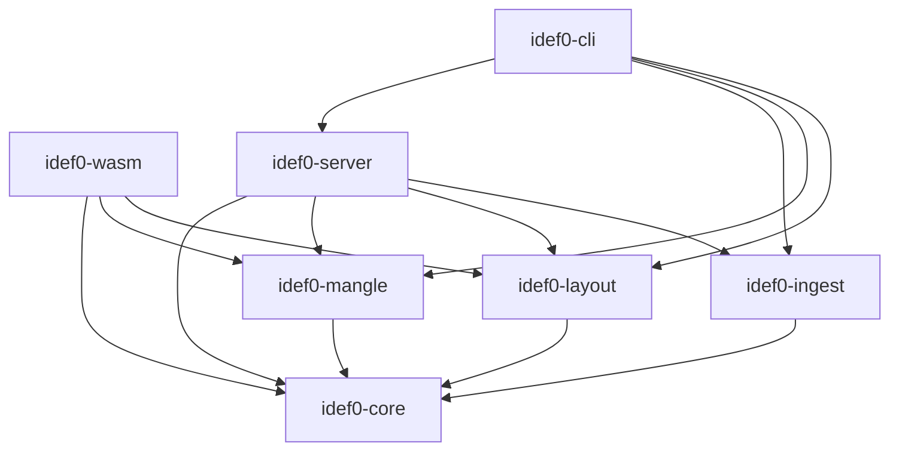
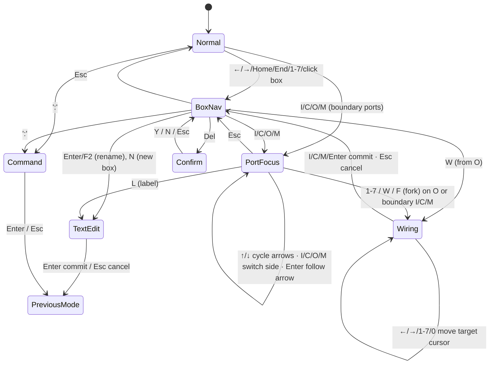

# idef0-rs — PRD v0.1 (ARCHIVED, superseded by the v0.2 spec set; see docs/PRD.md)

| Field | Value |
|---|---|
| Status | DRAFT v0.1 (2026-10-15) |
| Owner | Arthur Keen |
| Audience | Engineers and Claude Code sessions implementing `idef0-rs` |
| Companion | [NORTHSTAR.md](NORTHSTAR.md) (vision, principles, north star metric). This PRD is subordinate to it on questions of priority. |
| Normative references | **FIPS PUB 183**, *Integration Definition for Function Modeling (IDEF0)*, NIST, 21 Dec 1993. Local copy: [docs/research/fipspub183.pdf](research/fipspub183.pdf). Section numbers cited as "FIPS §3.3.3-8" mean section 3.3.3, rule 8. Also: Mangle language docs (mangle.readthedocs.io); `mangle-rs` (codeberg.org/TauCeti/mangle-rs). |
| Informative references | [Wikipedia: IDEF0](https://en.wikipedia.org/wiki/IDEF0). FIPS 183 was withdrawn as a *federal* standard on 2008-09-02 in favor of open standards; its successor is IEEE Std 1320.1-1998, adopted as ISO/IEC/IEEE 31320-1. FIPS 183 remains the freely available reference and is the baseline here. |

Requirement IDs (`FR-*`, `NFR-*`, `R-*` for Mangle rules) are stable. Code, tests and commits should cite them (`// FR-ML-03`). Where this document departs from FIPS 183, it says so explicitly with a **[Deviation]** marker.

---

## 0. Decisions Log

| ID | Decision | Rationale |
|---|---|---|
| D1 | **Leptos 0.8.x (CSR)** for the WASM UI, built with **Trunk** | Fine-grained signals update individual SVG `<path>` nodes without VDOM diffing. Dioxus is viable but adds nothing we need. The UI is deliberately thin (see D4), so swapping frameworks later is cheap. |
| D2 | **Mangle via `mangle-rs`** (Codeberg, pinned git rev), wrapped behind an `idef0-mangle::RuleEngine` trait | Upstream has a pure-Rust interpreter (`mangle-interpreter`) and a `wasm32-unknown-unknown` browser build (`mangle-wasm`), so one rule set runs in the browser and natively. The crates' crates.io status and their parity on negation and aggregation are **unverified**. Milestone M3.1 is a gated spike with a fallback evaluator (§2.6). |
| D3 | Canonical on-disk format is a **line-oriented text DSL** (`*.idef0`), with JSON as the wire/interchange format | LLMs write and diff text well, and an AI-first tool should speak a compact language that agents can author directly. JSON (serde) is used for WASM↔BFF DTOs. Grammar: Appendix A. |
| D4 | **All editor logic is pure Rust in `idef0-core`.** That covers the model, commands, undo, the keyboard FSM and structural lints. Layout and render-to-display-list are pure Rust in `idef0-layout`. | The same behavior runs headless (CLI/CI/tests) and in the browser. The UI only translates DOM events into `Input`s and draws a `Scene`. |
| D5 | **Layout is fully automatic and FIPS-driven; box order and port order are semantic** | Geometry is always computed by the auto-layout engine from FIPS 183 rules (§3.0); there is no free-form drawing. Box numbers and ICOM codes derive from box and port order, and balance and code tags depend on them, so *geometric* layout never reorders them implicitly. **Auto-Arrange** (§3.4a) computes FIPS-optimal box and port order as an explicit, previewed, undoable patch. It atomically propagates ICOM re-coding to child diagrams and emits a RenameMap for tags. |
| D6 | **Determinism contract**: identical model bytes produce identical facts, diagnostics, layout coordinates and SVG bytes, on native and on wasm32 | Enables golden tests, CI gating and reproducible AI repair loops. No `HashMap` iteration in output paths, integer grid geometry, fixed-precision float formatting. |
| D7 | Add a 7th crate, **`idef0-ingest`** (PRD parser + code scanner) | tree-sitter grammars are C and should stay out of the WASM bundle. Ingest runs only in the server and CLI. |
| D8 | Box-count limit is a **profile**: `extended` (3–7, default) or `fips183` (3–6) | **[Deviation]** FIPS 183 specifies 3–6 boxes. The product brief requires 3–7. |
| D9 | **Every function and every concept has a name and a description** (§1.5.10). Concepts are first-class, model-level glossary entities, and arrows reference them. | A label alone is ambiguous. Agents and reviewers need a definition of what each function does and what each ICOM carries. Shared concepts make cross-level consistency checkable (balance, bundles). |
| D11 | **IDEF0 = FIPS 183.** Every metamodel rule traces to a FIPS 183 clause (conformance matrix, §1.7). Every departure is a profiled **[Deviation]**: under `profile = fips183`, idef0-rs behaves strictly per the standard. | The standard is the contract. Extensions (7 boxes, `[ ]` notation, concepts ontology, code mechanisms) must never silently change FIPS semantics. |
| D10 | Conventions fixed by the repo's `claude.md` take precedence: `[ ]` tunnels at the parent and `( )` at the child; the **vertical** arrow carries the bridge at crossings; fillet radius 6–10 px; `Tab`/`Shift-Tab` cycle port arrows; mechanisms map to code; no JS/TS in the product (tests included where practical) | Single source of conventions. This PRD elaborates them and does not override them. |

---

## 1. Executive Summary & Metamodel Specification

### 1.1 Problem

LLM coding agents are good at producing code locally and bad at keeping **compositional interface contracts**: what each unit consumes, what governs it, what it guarantees to produce, and which concrete code implements it. Requirements documents state these contracts loosely, and code states them implicitly. IDEF0 was designed by the USAF ICAM program to state exactly these contracts, recursively and unambiguously, through the ICOM discipline (Input, Control, Output, Mechanism).

### 1.2 Product Vision

`idef0-rs` is an AI-first, keyboard-fast ("retro-mod") IDEF0 modeling system. It descends from the KBSI DOS ASCII tool and AI0Win. It:

1. Lets analysts author IDEF0 models at DOS-era speed (keyboard FSM), with modern vector rendering or a faithful ANSI/ASCII mode.
2. Validates models deductively with Mangle (Datalog), using the same rules in the browser and in CI.
3. Binds every leaf function to the PRD sections that justify it and to the source code that implements it (`@implements idef0:A21`).
4. Exports **contract cards**: per-box ICOM contracts with requirement and code traceability. AI agents consume them as precise, compositional context (CLI, HTTP, MCP).
5. Proposes A0 decompositions from ingested requirement text and repairs them against the rule engine.

### 1.3 Personas

| Persona | Primary jobs |
|---|---|
| Systems analyst / architect | Author and decompose models, enforce balance, publish diagrams |
| AI coding agent (Claude Code) | Pull contract cards, implement leaf functions, tag code, run `idef0 validate` |
| Reviewer / CI | Gate PRs on rule violations, traceability gaps and PRD/code drift (SARIF output) |

### 1.4 Goals and Non-Goals (v1)

**Goals:** full IDEF0 syntax (boxes, ICOMs, bundles, tunnels, call arrows, node trees, FIPS diagram form metadata); named and described functions and concepts (model glossary); full-text search across models, PRDs and code tags; Mangle validation; deterministic layout with channel routing; keyboard FSM; SVG and ASCII renderers; PRD and code traceability; AI decomposition proposals; contract export.

**Non-goals (v1):** real-time multi-user collaboration (CRDT), IDEF1X/IDEF3, FOG/glossary-driven model publishing beyond Markdown/SVG, hosted multi-tenant SaaS, print-exact FIPS forms (we approximate the form; pixel-exact print is v2).

### 1.5 Formal Metamodel

#### 1.5.1 Model

```
Model     = ⟨Meta, Concepts, Diagrams, LayoutHints⟩
Meta      = ⟨name, abbrev, description, purpose, viewpoint, scope, context, author, project, profile⟩
abbrev    = unique model-name abbreviation used in node references, e.g. "MFG" → "MFG/A42" (FIPS §3.4.5, §3.3.4.3)
Concepts  = model-level glossary of Concept entities (§1.5.10)
profile   ∈ {extended, fips183}
```

`purpose` and `viewpoint` are **required** (error `L-META-01`). FIPS requires them as statements on the A-0 diagram (§3.3.1.1, Annex A.2). `name` and `abbrev` are required (§3.4.5). `scope` is recommended (warning). FIPS treats scope as established by the A-0 box and its arrows, not as a separate statement.

#### 1.5.2 Node numbers

```
NodeId     ::= "A-" N | "A0" | "A" Digit+          Digit ∈ {1..7}   (extended)   {1..6} (fips183)
NodeRef    ::= (Abbrev "/")? NodeId Suffix?        Suffix ::= ("F" | "T" | "G") Page?    e.g. "MFG/A42", "QA/A321F1"
PortRef    ::= NodeRef ("/" | "")  ("I"|"C"|"O"|"M") K        e.g. "A21/I1" ≡ "A21I1" (FIPS "Used At" form)
```

- `A-0` is the **required context diagram** (FIPS §3.3.3-2). It contains exactly one box, the **top box**, whose **box number is 0** and node number is `A0` (§3.3.3-3, §3.3.4.2).
- **Optional higher context diagrams** `A-1, A-2, …` (§3.4.2–3.4.3) are syntactically ordinary 3–6-box diagrams in which the A0 box (or the `-(n−1)` box) replaces one numbered box. v1 parses, stores and validates them. Layout support is milestone M5 (stretch).
- The A-0 diagram carries **no ICOM codes and no tunneling** at unconnected arrow ends (§3.4.2). Its parental context is `TOP`.
- The diagram that decomposes box `X` has diagram node number `X` (the parent box and its child diagram share a node number). Its box *k* has node number `X·k` ("box 2 on diagram A25 is A252", §3.3.4.2). The children of `A0` are `A1..An`, not `A01`.
- Examples: `A0 → A1..A6` (FIPS) or `A1..A7` (extended); `A1 → A11..A16`; `A12 → A121..A126`.
- **Input tolerance:** dotted forms (`A1.2`, `A2.1.3`) are accepted everywhere (DSL, PRD tags, code tags) and normalized to the canonical undotted form. This matches FIPS reference notation, where an embedded period means "look specifically at": `A21.3` is box 3 on diagram A21, which is node A213 (§3.3.4.5). Box numbers are single digits, so the mapping is unambiguous. Display style is configurable.
- **Node index:** `idef0 index` emits the indented node index (node numbers with diagram titles and box names, §3.3.4.2.1). It is the required table-of-contents form (§3.4.6-4).
- **Stable keys:** every box also has an immutable `key` (slug, e.g. `validate-order`; a ULID if none is given). Node numbers change when boxes are reordered; keys never change. Tags may reference either (`idef0:A21` or `idef0:@validate-order`). Renumbering emits a `RenameMap` that `idef0 sync --fix` uses to rewrite node-number tags (§5.4).

#### 1.5.3 Diagram

```
Diagram = ⟨id: NodeId, kind ∈ {context, decomposition}, title, description, cnumber, status, revision,
           boxes: [Box; n], arrows: [Arrow], boundary: [BoundaryPort]⟩
status  ∈ {working, draft, recommended, publication}            (FIPS Annex C.4.1.3)
cnumber = 2–3 initials + author sequence, e.g. "AK14"; version history "AK15(AK14)" (Annex C.4.5.1)
```

- **Title:** for a decomposition diagram, the title **must equal the parent box's name** (Annex C.4.4). The core derives it, and the DSL may restate it, but a mismatch is error `E-TITLE-MATCH`. The A-0 title is free-form.
- **Status semantics** (Annex C.4.1.3): `working` means a major change that restarts approval; `draft` means a minor change, accepted by some readers; `recommended` means the diagram *and its supporting text* were approved by review and are not expected to change; `publication` means ready to print as is. A major edit to a diagram at `draft` or above prompts a reset to `working`.
- **Box count:** `kind = context ⇒ n = 1` for A-0; `kind = decomposition ⇒ min ≤ n ≤ max` per profile (`R-BOX-01`; FIPS §3.3.3-4).
- **Placement:** FIPS says boxes are *normally* on the diagonal and permits off-diagonal boxes, numbered after the diagonal ones, counter-clockwise from the lower right (§3.3.4.1). **[Deviation]** idef0-rs v1 enforces a strict staircase (`claude.md`), so off-diagonal boxes are not supported.
- The diagram form (Annex C.4) carries working fields (AUTHOR/DATE/PROJECT, READER NOTES, STATUS, READER/DATE, CONTEXT sketch of the parent with parent box highlighted, or `TOP` for A-0; USED AT) and identification fields (NODE = full node reference, TITLE, NUMBER = C-number or page number). The modern renderer draws the form. Working fields are dropped for `publication` exports.

#### 1.5.4 Box (function)

```
Box = ⟨key, number ∈ 0..n, node: NodeId (derived), name, description, dre: Option<DRE>, call: Option<CallArrow>⟩
```

- **Name and description:** required by FR-NAME-01 (§1.5.10). The name is displayed as the box title. "Title" in FIPS terms and in the Mangle schema means the function name.
- **Name form:** an active verb phrase, `Verb Noun-phrase` ("Validate Order", not "Order Validation"). Enforced by lint `L-TITLE-01` using a curated verb lexicon (bundled, about 1,500 verbs) plus a nominalization detector (`-tion/-ment/-ing` heads). This is a warning, not an error.
- **Placement:** boxes are ordered by `number` along the diagonal from top-left to bottom-right. Dominance is implied (box 1 dominates). Reordering renumbers.
- **DRE** (Detail Reference Expression): drawn under the box's lower-right corner. It is the child diagram's node id or C-number when decomposed.
- **Call arrow:** zero or one per box. It is a special mechanism arrow pointing *down out of* the box, meaning the box is detailed by another box elsewhere. Full specification in §1.5.5a.
- **Structural minimums** (FIPS 183): every box has at least 1 control and at least 1 output (`R-CTL-01`, `R-OUT-01`). Inputs are optional.

#### 1.5.5 ICOM roles and sides

| Role | Side | Semantics | Consumed? |
|---|---|---|---|
| **I**nput | Left | Data or material transformed by the function into outputs | Yes (transformed) |
| **C**ontrol | Top | Conditions, rules, specs, policies or signals that govern execution | No |
| **O**utput | Right | Data, objects, events or state changes produced | n/a (produced) |
| **M**echanism | Bottom | Resources that perform the function. Per `claude.md`, mechanisms map to **source code files/functions/types** or execution components. A mechanism on a leaf box must be code-bound or explicitly marked `kind=resource` (people, external systems); see `R-MECH`. | No |

FIPS Figure 3 ("Arrow Positions and Roles") is the canonical picture: Control enters the top, Input the left, Output leaves the right, Mechanism enters the bottom pointing **up**, and Call leaves the bottom pointing **down**, drawn to the right of the mechanisms.

#### 1.5.5a Call arrows (FR-CALL)

FIPS §3.2.2.1 and §3.3.2.10: "Call arrows enable the sharing of detail between models (linking them together) or between portions of the same model."

```
CallArrow = ⟨targets: NonEmpty<CallTarget>, note: Option<ModelNoteNo>, map: Vec<CallPortMap>⟩
CallTarget = NodeRef of the diagram containing the called box + called box number,
             written in FIPS reference notation:  "A42.3"  (same model)  |  "TLS/A34.2"  (model TLS)
CallPortMap = ⟨caller: (Side, k), callee: (Side, k)⟩            # e.g. caller I1 ↔ callee I2
```

| ID | Requirement | FIPS basis |
|---|---|---|
| FR-CALL-01 | A box has **0 or 1** call arrows. It leaves the **bottom** side pointing **down** and is drawn to the right of any mechanism arrows. | §3.3.3-11; §3.2.2.3-2e; Fig. 3 |
| FR-CALL-02 | A caller box has **no child diagram of its own**. It is detailed entirely by the called box and its descendants, in the same or another model. Its DRE position shows nothing, and the call label carries the reference. | §3.3.2.10 |
| FR-CALL-03 | The call arrow is labeled with the **reference expression** of the called box, not with a noun phrase or concept. It is the one arrow exempt from FR-NAME-03 and FIPS §3.2.2.3-3. | §3.2.2.3-2e, -3 |
| FR-CALL-04 | **Many callers may call the same box.** The called diagram's **Used At** field lists every caller node reference. It is computed automatically from a model-wide and workspace-wide reverse index. | §3.3.2.10; Annex C.4.1.6 |
| FR-CALL-05 | A caller calls exactly one box per activation. If it may select among several, the label lists **all** possible called references and a **model note** must state the selection conditions. | §3.3.2.10 |
| FR-CALL-06 | The called box's arrows may differ from the caller's in number or meaning. In that case a **model note or explicit `CallPortMap`** must state the correspondence. Without either, idef0-rs checks correspondence by concept: every caller ICOM concept must equal, or `kind_of`/`part_of`-refine, some callee ICOM concept. | §3.3.2.10 |
| FR-CALL-07 | Call resolution spans models. `TLS/A34.2` resolves through the workspace index of other `.idef0` models. An unresolved target is an error. | §3.3.4.3 |
| FR-CALL-08 | A call must not expand into itself: no box may call a box in its own subtree, directly or through chains of calls (infinite detail). | idef0-rs (well-formedness) |
| FR-CALL-09 | The call arrow is **not** a numbered mechanism ICOM (it never appears on a child diagram, since callers have no child). It is excluded from M-code numbering. | §3.3.2.10 |
| FR-CALL-10 | **Software semantics (AI-first):** a call arrow models **shared, reusable detail**: a library function, shared module, service, or another repo's model. The caller is *implemented by* the callee's implementation: grounding propagates through calls (`R-CALL`), the caller's contract card embeds the callee's contract (§5.6), and `idef0 scaffold` on a caller emits a thin delegation stub to the callee's code. | idef0-rs extension |
| FR-CALL-11 | **Reuse detection:** when two boxes in different branches have near-identical names and descriptions, `L-REUSE-01` (info) suggests replacing one subtree with a call arrow. AI proposals (§5.7) prefer a call to an existing box over re-decomposing equivalent detail. | idef0-rs extension |

#### 1.5.6 Arrow typing rules

An arrow is a directed connection `src → dst` that **carries a Concept** (§1.5.10). Its label defaults to the concept's name and may show a display alias, which must resolve to the same concept. An unlabeled `rel=all` branch inherits its trunk's concept.

| Source endpoint | Allowed destination endpoints |
|---|---|
| `box.O` | `box'.I`, `box'.C`, `box'.M`, `boundary.O` |
| `boundary.I` / `boundary.C` / `boundary.M` | `box.I`, `box.C`, `box.M` |

**Role change is legal.** FIPS §3.3.2.8 and Figure 15: "a control arrow on a parent box may be either an input or a control arrow for boxes on its child diagram". ICOM codes match on the parent's side and number, not on the child-side role. Role changes are reported only as info (`L-ROLE-01`), for reviewer awareness.

Everything else is a **type error** rejected by the core (`E-TYPE-*`), before Datalog runs. That covers a source of `box.I/C/M` or `boundary.O`, and boundary-to-boundary pass-through. Output-to-self (`box.O → box.C|I`) is legal feedback. **Call arrows** are outside this table. They have no destination endpoint on the diagram, only a reference expression to the called box (§1.5.5a).

- **ICOM codes:** for box *B* and side *S*, each attached arrow has a 1-based **port rank** *k*. Rank runs top→bottom on the left/right sides and left→right on the top/bottom sides. The arrow attaches at code `S k` (e.g. `I2`). Port rank is part of the model (D5). Default rank is DSL declaration order.
- **Boundary ports** on a child diagram are labeled with the parent ICOM code they map to: `I1`, `C2`, `O1`, `M1`.

#### 1.5.7 Bundling (branch / join) semantics

- A **fork** splits one arrow into branches. A **join** merges branches into one arrow.
- FIPS basis (§3.3.2.5): branches "may represent either the same thing or portions of the same thing". A fork may denote *unbundling*, and a join *bundling*, "the combining of separate meanings into a more general category". All contents follow all branches unless a branch label says otherwise.
- **Mapping:** `all` = "the same thing"; `part_of` = "portions of the same thing"; `kind_of` = specialization of a "more general category". Splitting FIPS's "more general category" into explicit taxonomy (`kind_of`) and partonomy (`part_of`) is an idef0-rs refinement. Under `profile = fips183`, both render identically as labeled branches.
- Each branch carries a relation to its trunk:
  - `rel = kind_of` (**taxonomy**): the branch content is a subtype of the trunk content ("Rush Order" kind-of "Order").
  - `rel = part_of` (**partonomy**): the branch content is a component of the trunk ("Shipping Address" part-of "Order").
  - `rel = all` (default, unlabeled branch): the branch carries the trunk's full content.
- One fork or join must not mix `kind_of` and `part_of` siblings (`R-BUN-02`). A labeled branch must declare `rel` (`L-BUN-01`).
- **Fact flattening:** for validation, each fork/join is flattened into leaf edges, each running from the true source to the true destination, plus `bundle(Trunk, Leaf)` facts. All leaves of a fork share the source's output port rank.

#### 1.5.8 Tunneling

| Notation | Position | Meaning | Fact |
|---|---|---|---|
| `( )` around the arrow end at a **box** | connected end | **Tunneled at the child:** hidden on that box's child diagram (not decomposed further); resolves at the parent | `tunnel(E, /at_box)` |
| `[ ]` around the arrow end at the **diagram border** | unconnected end | **Tunneled at the parent:** hidden on the parent diagram; appears on this child (and below) | `tunnel(E, /at_border)` |

**[Deviation]** FIPS 183 uses parentheses at both ends. idef0-rs follows the `claude.md` convention (KBSI/AI0Win style): square brackets at the border end, so the two directions are visually distinct. Under `profile = fips183` the renderer draws parentheses at both ends, and the semantics are unchanged.

Tunneled ends are excluded from balance checking in the corresponding direction (§1.6, R-BAL). Per FIPS §3.3.2.9:
- An arrow tunneled at its **connected** end keeps its ICOM code on the parent. It may reappear lower in the hierarchy, tunneled at the unconnected end.
- An arrow tunneled at its **unconnected** end has **no ICOM code**. It may carry a model note giving the node reference and ICOM code of the tunnel's other end. ICOM coding resumes on later child diagrams.
- Tunneling at unconnected ends is forbidden on A-0 (`context_tunnel`).

#### 1.5.8a Notes

- **Model notes** (FIPS §3.3.4.4) are normative, numbered `1..n` consecutively per diagram, and drawn as a boxed number (or `|n|`). They may attach by squiggle to several points *on the same diagram*. Uses include tunnel back-references and call-arrow selection conditions (§3.3.2.10).
- **Reader notes** (Annex B/C) are informative review comments, drawn as a circled number. In idef0-rs they map to review comments in the UI and server, and never affect validation. The full Kit Cycle workflow is v2.

#### 1.5.9 Arrow balance (ICOM consistency)

For box *P* decomposed by diagram *D*:

- **Downward:** every arrow at *P*'s side *S*, rank *k*, that is **not** tunneled at the box end, has a boundary port `S k` on *D*.
- **Upward:** every boundary port `S k` on *D* whose arrow is **not** tunneled at the border has a matching arrow at *P* side *S* rank *k*.
- A bundle on either level may map to multiple branches on the other, provided the branches are related to the trunk by `bundle` facts. Balance is checked on ICOM codes first. **Concept compatibility** is checked second: the child port's concept must equal the parent arrow's concept, or be its `kind_of`/`part_of` refinement (`balance_concept_mismatch`, warning).

#### 1.5.10 Names and descriptions: functions and concepts (FR-NAME)

| ID | Requirement |
|---|---|
| FR-NAME-01 | Every **function** (box) has a `name` and a `description`. The name is an active verb phrase, unique among sibling boxes (error) and preferably unique model-wide (warning), at most 60 characters. The description is 1–3 sentences stating *what the function does*: what it transforms into what, under what governance. It is definitional, not narrative. Suggested template: "*Name* transforms ‹inputs› into ‹outputs› under ‹controls›." The editor can draft it from the box's ICOMs. |
| FR-NAME-02 | Every **concept** has a stable `key`, a `name` and a `description`. The name is a singular noun phrase, unique model-wide including synonyms (error). The description is a definition, preferably genus–differentia: "A ‹genus› that ‹differentia›." Optional fields: `synonyms`, `kind_of` / `part_of` parent concepts, `examples`, `sources` (DocRefs). |
| FR-NAME-03 | Concepts are **model-level** and shared. The same concept may appear on many arrows across diagrams and levels. Every arrow references exactly one concept, either directly or via its `rel=all` trunk. Unresolved labels are errors (`unknown_concept`). `idef0 check --fix` creates stub concepts with empty descriptions for review. |
| FR-NAME-04 | The concept ontology (`kind_of`, `part_of`) is the **authority for bundle semantics**. A branch with `rel=kind_of` must carry a concept that is (transitively) `kind_of` the trunk concept, and likewise for `part_of`. A `rel=all` branch carries the trunk concept itself. |
| FR-NAME-05 | The model and every diagram also have a `description`. The diagram description is the IDEF0 text-page analogue: what the decomposition shows and why. |
| FR-NAME-06 | **Status gate:** on a diagram with status `working` or `draft`, missing descriptions are warnings. At `recommended` or `publication`, every box on the diagram and every concept carried by its arrows must be described (error). |
| FR-NAME-07 | Descriptions are Markdown (inline subset), recommended at most 600 characters. Lint `L-DESC-02` flags descriptions that merely restate the name, are shorter than 20 characters, or (for concepts) lack a genus (info). |
| FR-NAME-08 | Names and descriptions are surfaced everywhere: the status-bar info line for the focused element, the SVG `<title>`/`<desc>` elements (accessibility, hover), the inspector panel, contract cards (§5.6), scaffolds (§5.4) and AI proposals (§5.7). |

### 1.6 Mangle Datalog Schema and Rules

#### 1.6.1 Fact extraction contract

`idef0-mangle::facts::extract(&Model, &ExternalFacts) -> FactSet` emits the EDB below, sorted lexicographically (D6). Identifiers:

- Box id = canonical node id string (`"A12"`).
- Diagram id = canonical node id of the box it decomposes (`"A1"`); the context diagram is `"A-0"`.
- Boundary port id = `"<diag>:<code>"`, e.g. `"A1:I2"`.
- Edge id = stable arrow key (ULID string). Leaf edges of bundles are `"<trunk>#<n>"`.
- Code ref id = `"<path>::<symbol>"`, e.g. `"crates/idef0-layout/src/route.rs::assign_tracks"`.
- Doc ref id = `"<path>#<slug>"`.

#### 1.6.2 Declarations (`crates/idef0-mangle/rules/schema.mg`)

```mangle
# ---------- Structural EDB (from the model) ----------
Decl diagram(DiagId, Kind)
  descr [doc("Kind is /context or /decomposition.")]
  bound [/string, /name].

Decl box(DiagId, BoxId, Title)
  bound [/string, /string, /string].

Decl box_key(BoxId, Key)
  bound [/string, /string].

Decl decomposes(BoxId, DiagId)
  descr [doc("Diagram DiagId is the decomposition of box BoxId.")]
  bound [/string, /string].

Decl icom(EdgeId, Type, Source, Target)
  descr [doc("Type is the role at the destination: /input, /control, /mechanism, or /output when Target is a boundary O port. Source/Target are box ids or boundary port ids.")]
  bound [/string, /name, /string, /string].

Decl icom_code(EdgeId, BoxId, Role, K)
  descr [doc("Arrow EdgeId attaches to BoxId's side Role at port rank K. Role includes /output for the source side.")]
  bound [/string, /string, /name, /number].

Decl boundary(DiagId, PortId, Role, K)
  bound [/string, /string, /name, /number].

Decl model(Abbrev)
  bound [/string].

Decl tunneled_boundary(DiagId, PortId, Role)
  descr [doc("Boundary arrow tunneled at its unconnected end: hidden on the parent, carries NO ICOM code (FIPS 3.3.2.9).")]
  bound [/string, /string, /name].

Decl edge_in(EdgeId, DiagId)
  bound [/string, /string].

Decl tunnel(EdgeId, End)
  descr [doc("End is /at_box or /at_border.")]
  bound [/string, /name].

Decl bundle(Trunk, Leaf)
  bound [/string, /string].

Decl bundle_kind(Trunk, Kind)          # /fork | /join
  bound [/string, /name].

Decl bundle_rel(Trunk, Leaf, Rel)      # /kind_of | /part_of | /all
  bound [/string, /string, /name].

Decl call(CallerBox, Model, CalleeNode)
  descr [doc("CallerBox has a call arrow to node CalleeNode of model Model (abbrev). One fact per listed alternative (FR-CALL-05).")]
  bound [/string, /string, /string].

Decl call_note(CallerBox)
  descr [doc("The call arrow has an attached model note (selection conditions / ICOM correspondence).")]
  bound [/string].

Decl call_map(CallerBox, CallerRole, CallerK, CalleeRole, CalleeK)
  bound [/string, /name, /number, /name, /number].

Decl ext_box(Model, Node)
  descr [doc("A box that exists in another workspace model (from the workspace index).")]
  bound [/string, /string].

Decl mech_binding(EdgeId, CodeRef)
  descr [doc("Mechanism arrow EdgeId names a concrete code element.")]
  bound [/string, /string].

Decl mech_kind(EdgeId, Kind)           # /code | /component | /resource
  bound [/string, /name].

# ---------- Names, descriptions, concepts (FR-NAME) ----------
Decl described(Subject)
  descr [doc("Subject (box id, concept key, diagram id) has a non-empty description.")]
  bound [/string].

Decl concept(ConceptKey, Name)
  bound [/string, /string].

Decl concept_rel(Child, Parent, Rel)   # /kind_of | /part_of
  bound [/string, /string, /name].

Decl arrow_concept(EdgeId, ConceptKey)
  bound [/string, /string].

Decl diagram_status(DiagId, Status)    # /working | /draft | /recommended | /publication
  bound [/string, /name].

# ---------- Traceability EDB (from idef0-ingest) ----------
Decl code_ref(CodeRef, Path, Symbol, Lang)
  bound [/string, /string, /string, /name].
Decl code_exists(CodeRef)
  bound [/string].
Decl implements(CodeRef, BoxId)
  bound [/string, /string].
Decl consumes(CodeRef, BoxId, Role, K)
  bound [/string, /string, /name, /number].
Decl doc_ref(DocRef, Path, Slug)
  bound [/string, /string, /string].
Decl traces(DocRef, BoxId)
  bound [/string, /string].
Decl doc_stale(DocRef)
  bound [/string].

# ---------- Configuration EDB ----------
Decl profile_box_limits(Min, Max)
  bound [/number, /number].
Decl severity(Code, Level)             # /error | /warning | /info
  bound [/name, /name].

# ---------- Output IDB ----------
Decl violation(Code, Subject)
  bound [/name, /string].
```

The user-supplied base schema (`box/3`, `icom/4`, `bundle/2`, `implements/2`) is preserved verbatim. The remaining predicates are refinements needed to state the rules decidably.

#### 1.6.3 Rules (`crates/idef0-mangle/rules/idef0.mg`)

All rules are stratified (negation applies only to fully computed lower strata). Negated atoms only use variables bound by positive atoms (Mangle safety condition). Comparison uses the builtins `:lt/2` and `!=`.

```mangle
# ===== Helpers =====
is_box(B)        :- box(_, B, _).
is_port(R)       :- boundary(_, R, _, _).
is_port(R)       :- tunneled_boundary(_, R, _).
endpoint_ok(R)   :- is_box(R).
endpoint_ok(R)   :- is_port(R).
decomposed(B)    :- decomposes(B, _).
leaf_box(B)      :- is_box(B), !decomposed(B).
has_box(D)       :- box(D, _, _).
has_output(B)    :- icom(_, _, B, _), is_box(B).
has_control(B)   :- icom(_, /control, _, B).
port_used(R)     :- icom(_, _, R, _).
port_used(R)     :- icom(_, _, _, R).

# ===== R-BOX-01: 3..max boxes per decomposition, exactly 1 on context =====
box_count(D, N) :- box(D, _, _) |> do fn:group_by(D), let N = fn:count().

violation(/box_count_low, D)  :- diagram(D, /decomposition), box_count(D, N),
                                 profile_box_limits(Min, _), :lt(N, Min).
violation(/box_count_high, D) :- diagram(D, /decomposition), box_count(D, N),
                                 profile_box_limits(_, Max), :lt(Max, N).
violation(/empty_diagram, D)  :- diagram(D, _), !has_box(D).
violation(/context_box_count, D) :- diagram(D, /context), box_count(D, N), N != 1.

# ===== R-CTL-01 / R-OUT-01: FIPS minimums =====
violation(/no_control, B) :- is_box(B), !has_control(B).
violation(/no_output, B)  :- is_box(B), !has_output(B).

# ===== R-DNG-*: dangling ICOMs =====
violation(/dangling_source, E) :- icom(E, _, S, _), !endpoint_ok(S).
violation(/dangling_target, E) :- icom(E, _, _, T), !endpoint_ok(T).
violation(/unlinked_boundary, R) :- is_port(R), !port_used(R).

# ===== R-LOCK-01: cyclic control lock =====
# A box is control-live if at least one control reaches it from the diagram
# boundary, or from the output of a box that is itself control-live.
# Boxes whose controls all originate inside a closed feedback cycle can never
# be enabled.
ctrl_live(B) :- icom(_, /control, S, B), is_port(S).
ctrl_live(B) :- icom(_, /control, S, B), ctrl_live(S).

violation(/control_lock, B) :- has_control(B), !ctrl_live(B).

# Diagnostic aid: report the cycle membership for UI highlighting.
ctrl_dep(A, B)   :- icom(_, /control, A, B), is_box(A).
ctrl_reach(A, B) :- ctrl_dep(A, B).
ctrl_reach(A, C) :- ctrl_reach(A, B), ctrl_dep(B, C).
lock_cycle(A, B) :- violation(/control_lock, A), ctrl_reach(A, B), ctrl_reach(B, A).

# ===== R-BAL-*: parent/child ICOM balance =====
parent_port(P, Role, K) :- decomposes(P, _), icom_code(E, P, Role, K), !tunnel(E, /at_box).

# Only coded boundary ports participate. Border-tunneled ports are tunneled_boundary/3 and carry no code.
child_port(D, Role, K) :- boundary(D, _, Role, K).

balanced_down(P, Role, K) :- parent_port(P, Role, K), decomposes(P, D), child_port(D, Role, K).
balanced_up(D, Role, K)   :- child_port(D, Role, K), decomposes(P, D), parent_port(P, Role, K).

imbalance(P, Role, K, /missing_in_child)  :- parent_port(P, Role, K), !balanced_down(P, Role, K).
imbalance(P, Role, K, /missing_in_parent) :- decomposes(P, D), child_port(D, Role, K),
                                             !balanced_up(D, Role, K).
violation(/icom_imbalance, P) :- imbalance(P, _, _, _).

# ===== R-BUN-*: bundles =====
bundle_reach(A, B) :- bundle(A, B).
bundle_reach(A, C) :- bundle_reach(A, B), bundle(B, C).
violation(/bundle_cycle, E) :- bundle_reach(E, E).

violation(/fork_source_mismatch, L) :- bundle_kind(T, /fork), bundle(T, L),
    icom(L, _, S1, _), bundle(T, L2), icom(L2, _, S2, _), S1 != S2.
violation(/join_target_mismatch, L) :- bundle_kind(T, /join), bundle(T, L),
    icom(L, _, _, T1), bundle(T, L2), icom(L2, _, _, T2), T1 != T2.
violation(/mixed_bundle_relation, T) :- bundle_rel(T, _, /kind_of), bundle_rel(T, _, /part_of).

# ===== R-MECH-*: code grounding =====
grounded(B) :- implements(C, B), code_exists(C).
mech_bound(E) :- mech_binding(E, C), code_exists(C).
mech_ok(E)    :- mech_bound(E).
mech_ok(E)    :- mech_kind(E, /resource).
code_mech(B)  :- leaf_box(B), icom(E, /mechanism, _, B), mech_binding(E, _).

violation(/unbound_mechanism, E)    :- icom(E, /mechanism, _, B), leaf_box(B), !mech_ok(E).
violation(/ungrounded_mechanism, B) :- code_mech(B), !grounded(B).
violation(/stale_mech_binding, E)   :- mech_binding(E, _), !mech_bound(E).
violation(/stale_code_ref, C)       :- implements(C, _), !code_exists(C).
violation(/implements_unknown_box, C) :- implements(C, B), !is_box(B).
violation(/implements_non_leaf, C)  :- implements(C, B), decomposed(B).   # warning

has_port(B, Role, K) :- icom_code(_, B, Role, K).
violation(/consumes_unknown_port, C) :- consumes(C, B, Role, K), !has_port(B, Role, K).

# ===== R-TRC-*: requirements traceability =====
traced(B) :- traces(_, B).
violation(/untraced_leaf, B)  :- leaf_box(B), !traced(B).                 # info
violation(/stale_trace, D)    :- traces(D, _), doc_stale(D).               # warning
violation(/trace_unknown_box, D) :- traces(D, B), !is_box(B).

# ===== R-CALL-*: call arrows (FR-CALL) =====
violation(/call_and_decomposed, B) :- call(B, _, _), decomposed(B).                 # FR-CALL-02

calls_local(B, N) :- call(B, M, N), model(M).
call_resolved(B, M, N) :- call(B, M, N), model(M), is_box(N).
call_resolved(B, M, N) :- call(B, M, N), ext_box(M, N).
violation(/call_unresolved, B) :- call(B, M, N), !call_resolved(B, M, N).           # FR-CALL-07

call_alternatives(B, K) :- call(B, _, _) |> do fn:group_by(B), let K = fn:count().
violation(/call_alternatives_without_note, B) :- call_alternatives(B, K), :lt(1, K), !call_note(B).  # FR-CALL-05

# Subtree containment: X is N or a descendant of N.
parent_box(C, P) :- box(D, C, _), decomposes(P, D).
in_subtree(N, N) :- is_box(N).
in_subtree(X, N) :- parent_box(X, P), in_subtree(P, N).

# FR-CALL-08: a call must not expand into itself.
expands(B, X) :- calls_local(B, N), in_subtree(X, N).
expands(B, X) :- expands(B, Y), calls_local(Y, N), in_subtree(X, N).
violation(/call_recursive, B) :- expands(B, B).

# FR-CALL-06: ICOM correspondence by concept unless a model note or explicit map exists.
callee_accepts(B, C) :- calls_local(B, N), icom_code(E, N, _, _), arrow_concept(E, C2), concept_compatible(C, C2).
call_port_mapped(B, R, K) :- call_map(B, R, K, _, _).
call_port_unmatched(B, R, K) :- calls_local(B, _), icom_code(E, B, R, K), arrow_concept(E, C),
                                !callee_accepts(B, C), !call_port_mapped(B, R, K).
violation(/call_interface_mismatch, B) :- call_port_unmatched(B, _, _), !call_note(B).

# FR-CALL-04: Used At reverse index (rendered on the callee diagram form).
used_at(N, B) :- calls_local(B, N).

# FR-CALL-10: grounding propagates through calls.
grounded(B) :- calls_local(B, N), in_subtree(X, N), implements(C, X), code_exists(C).

# ===== R-CTX-*: context diagram (FIPS 3.3.3-2, 3.4.2) =====
has_a0(M) :- model(M), diagram("A-0", /context).
violation(/missing_context, M) :- model(M), !has_a0(M).
violation(/context_tunnel, E)  :- edge_in(E, "A-0"), tunnel(E, /at_border).

# ===== R-UNIQ-01: unique labels on a diagram; same data forks/joins (FIPS A.2, 3.3.3-14) =====
# Two arrows on one diagram carrying the same concept must be branches of one bundle.
bundled_leaf(L) :- bundle(_, L).
arrow_root(E, E) :- icom(E, _, _, _), !bundled_leaf(E).
arrow_root(L, T) :- bundle(T, L), icom(L, _, _, _).
violation(/duplicate_arrow_concept, E1) :- edge_in(E1, D), edge_in(E2, D),
    arrow_concept(E1, K), arrow_concept(E2, K), arrow_root(E1, R1), arrow_root(E2, R2), R1 != R2.

# ===== R-NAME-*: names, descriptions, concepts (FR-NAME) =====
is_concept(K)   :- concept(K, _).
has_concept(E)  :- arrow_concept(E, _).

violation(/undescribed_function, B) :- is_box(B), !described(B).
violation(/undescribed_concept, K)  :- is_concept(K), !described(K).
violation(/undescribed_diagram, D)  :- diagram(D, _), !described(D).
violation(/unknown_concept, E)      :- arrow_concept(E, K), !is_concept(K).
violation(/conceptless_arrow, E)    :- icom(E, _, _, _), !has_concept(E).

# Status gate (FR-NAME-06): released diagrams must be fully described.
released(D) :- diagram_status(D, /recommended).
released(D) :- diagram_status(D, /publication).
concept_on(D, K) :- edge_in(E, D), arrow_concept(E, K).
violation(/undescribed_on_release, B) :- released(D), box(D, B, _), !described(B).
violation(/undescribed_on_release, K) :- released(D), concept_on(D, K), !described(K).

# Concept ontology closure (per relation).
concept_isa(C, P, R) :- concept_rel(C, P, R).
concept_isa(C, Q, R) :- concept_isa(C, P, R), concept_rel(P, Q, R).
violation(/concept_cycle, C) :- concept_isa(C, C, _).

# FR-NAME-04: bundle relations must agree with the ontology.
bundle_ok(T, L) :- bundle_rel(T, L, /all), arrow_concept(T, K), arrow_concept(L, K).
bundle_ok(T, L) :- bundle_rel(T, L, R), R != /all,
                   arrow_concept(T, KT), arrow_concept(L, KL), concept_isa(KL, KT, R).
violation(/bundle_concept_mismatch, L) :- bundle_rel(T, L, _), !bundle_ok(T, L).

# Balance by concept (warning): child port concept equals or refines the parent's.
parent_concept(P, Role, K, C) :- decomposes(P, _), icom_code(E, P, Role, K), arrow_concept(E, C).
port_concept(D, Role, K, C)   :- boundary(D, R, Role, K), icom(E, _, R, _), arrow_concept(E, C).
port_concept(D, Role, K, C)   :- boundary(D, R, Role, K), icom(E, _, _, R), arrow_concept(E, C).
concept_compatible(A, A) :- is_concept(A).
concept_compatible(A, B) :- concept_isa(A, B, _).
compatible_port(P, Role, K) :- decomposes(P, D), parent_concept(P, Role, K, CP),
                               port_concept(D, Role, K, CC), concept_compatible(CC, CP).
violation(/balance_concept_mismatch, P) :- decomposes(P, D), parent_concept(P, Role, K, _),
                                           port_concept(D, Role, K, _), !compatible_port(P, Role, K).
```

#### 1.6.4 Severity table (`rules/severity.mg`, overridable per project)

| Code | Default | FIPS basis |
|---|---|---|
| `box_count_low/high`, `context_box_count`, `empty_diagram` | error | 3–6 boxes (profiled) |
| `no_control`, `no_output` | error | every function has a control and an output |
| `dangling_source/target` | error | arrows connect |
| `unlinked_boundary` | error | boundary arrows connect |
| `control_lock` | error | (idef0-rs semantic rule) |
| `icom_imbalance` | error | ICOM coding / balance |
| `bundle_cycle`, `fork_source_mismatch`, `join_target_mismatch`, `mixed_bundle_relation` | error | branch semantics |
| `unbound_mechanism`, `ungrounded_mechanism`, `stale_mech_binding`, `stale_code_ref`, `implements_unknown_box`, `consumes_unknown_port` | error in CI, warning in editor | traceability (`claude.md`: mechanisms map to code) |
| `unknown_concept`, `conceptless_arrow`, `concept_cycle`, `bundle_concept_mismatch`, `undescribed_on_release` | error | FR-NAME-03/04/06 |
| `undescribed_function`, `undescribed_concept`, `undescribed_diagram`, `balance_concept_mismatch` | warning | FR-NAME-01/02/05 |
| `implements_non_leaf`, `stale_trace`, `trace_unknown_box` | warning | — |
| `untraced_leaf` | info | — |
| `call_and_decomposed`, `call_unresolved`, `call_recursive`, `call_alternatives_without_note` | error | §3.3.2.10 (FR-CALL-02/05/07/08) |
| `call_interface_mismatch` | warning | §3.3.2.10: model notes must state the correspondence (FR-CALL-06) |
| `missing_context`, `context_tunnel` | error | §3.3.3-2, §3.4.2 |
| `duplicate_arrow_concept` | warning | Annex A.2 (label uniqueness), §3.3.3-14 ("unless this results in an unreadable diagram") |

#### 1.6.5 Diagnostics pipeline

1. **Core type check** (Rust, `E-TYPE-*`): arrow typing table §1.5.6, NodeId validity, duplicate keys. It fails fast, and Datalog never sees ill-typed models.
2. **Core lints** (Rust, `L-*`): name verb-noun (`L-TITLE-01`), reserved words: box names and arrow labels must not consist solely of *function, activity, process, input, output, control, mechanism* or *call* (`L-NAME-03`, error; FIPS §3.2.2.3-5, §3.3.3-15), sibling-unique function names (`L-NAME-01`, error), model-wide duplicate function names (`L-NAME-02`, warning), concept name/synonym collisions (`L-CONCEPT-01`, error), description quality (`L-DESC-02`), metadata presence, role shift. Lints are emitted as `Diagnostic`s directly. Lints that benefit from composition are also emitted as facts (`lint(Code, Subject)`), so custom rules can use them.
3. **Mangle evaluation** (`R-*`): query `violation(Code, Subject)`. `imbalance/4` and `lock_cycle/2` are queried for detail payloads.
4. **Project rules:** every `.idef0/rules/*.mg` file is appended to the program and may derive additional `violation/2` facts. Example: "every box under A3 must have a control labeled with a security policy". This is the extensibility point for organization-specific methodology.
5. Results are mapped to `Diagnostic { code, severity, subject: SubjectRef, message, detail, fix: Option<FixHint> }`, sorted by (severity, node, code, subject).

Output formats: human (TTY), JSON, **SARIF 2.1.0** (GitHub code scanning), and Mangle text (`idef0 facts`, for debugging with any Mangle interpreter).

---

### 1.7 FIPS 183 Conformance Matrix

Every normative FIPS 183 clause maps to an enforcement point. `profile = fips183` turns every **[Deviation]** off.

| FIPS clause | Requirement (abridged) | idef0-rs enforcement |
|---|---|---|
| §3.2.1.3 Boxes | Sized to fit the name; rectangular, square corners; solid lines | Sizing §3.2; renderer; geometry check `G-BOX` |
| §3.2.1.3 Arrows | Bends use 90° arcs only; solid; horizontal/vertical; ends touch the perimeter without entering; attach at sides, not corners | §3.5–3.6; geometry checks `G-ORTHO`, `G-ARC`, `G-PERIM`, `G-CORNER` |
| §3.2.2.3-1, §3.2.2.2 | Box name is an active verb / verb phrase | `L-TITLE-01` |
| §3.2.2.3-2, Fig. 3 | I left, C top, O right, M bottom pointing up; call arrows point down (right of mechanisms), labeled with the called reference | Typing §1.5.6; §1.5.5a; route templates §3.4 |
| §3.2.2.3-3 | Arrow segments labeled with noun phrases (except call arrows) | Concepts: `conceptless_arrow`, `unknown_concept` (FR-NAME-03) |
| §3.2.2.3-4 | Squiggle links a label to its arrow unless obvious | Label placement §3.9 |
| §3.2.2.3-5, §3.3.3-15 | Names and labels not solely reserved words | `L-NAME-03` |
| §3.3.1.1, Annex A.2 | A-0 states purpose and viewpoint | `L-META-01` |
| §3.3.1.4, §3.4.6 | Text accompanies the diagram and is not redundant; glossary defines key terms (per node; alphabetical for publication) | Diagram descriptions (FR-NAME-05), concepts (FR-NAME-02), `L-DESC-02`; T/G page export |
| §3.3.2.6 | 3–6 boxes; diagonal "staircase"; each parent arrow appears on the child unless tunneled | `R-BOX-01` (profiled); §3.3; `imbalance/missing_in_child` |
| §3.3.2.7 | Child boundary arrows correspond to parent arrows | `imbalance/missing_in_parent` |
| §3.3.2.8 | ICOM codes by position (left→right, top→bottom); roles may change parent→child | §1.5.6; `L-ROLE-01` (info only) |
| §3.3.2.9 | Tunneling at connected and unconnected ends; uncoded border tunnels | §1.5.8; `tunneled_boundary/3`; **[Deviation]** `[ ]` glyph |
| §3.3.2.10 | Call arrows: caller has no child; label = called reference; many callers per callee; alternatives need a model note; interface differences need model notes | FR-CALL-01..09; `call_and_decomposed`, `call_unresolved`, `call_alternatives_without_note`, `call_interface_mismatch`, `call_recursive`; Used At auto-index |
| §3.3.3-1..3 | Context diagrams `A-n`; A-0 required with a single box numbered 0 | NodeId grammar; `missing_context`; `context_box_count`; `E-TYPE` |
| §3.3.3-4 | Non-context diagram has 3–6 boxes | `R-BOX-01`; **[Deviation]** 7 in `extended` |
| §3.3.3-5, §3.3.4.1 | Box number in the lower-right inside corner, in diagonal order | Renderer; numbering = order; **[Deviation]** no off-diagonal boxes |
| §3.3.3-6 | DRE beneath a detailed box | Renderer: node number by default; C-number on `working`/`draft` per Annex B.2.2.1-4 |
| §3.3.3-7 | Horizontal/vertical segments only | Layout invariant + `G-ORTHO` |
| §3.3.3-8 | At least one control and one output per box | `no_control`, `no_output` |
| §3.3.3-9..11 | 0+ inputs, 0+ mechanisms, 0–1 call arrows | Type system (`call: Option<…>`) |
| §3.3.3-12 | Control feedback "up and over"; input and mechanism feedback "down and under" | **Hard** route templates §3.4; `G-FEEDBACK` |
| §3.3.3-13 | Boundary arrow has an ICOM code or is tunneled | By construction (codes auto-assigned) + `R-BAL` |
| §3.3.3-14 | Open boundary arrows for the same data fork/join | `duplicate_arrow_concept`; Auto-Arrange merge proposal |
| §3.3.4.2–3 | Node numbers, node index, node references `MFG/A42` | NodeId/NodeRef; `idef0 index` |
| §3.3.4.4 | Model notes, consecutive per diagram | §1.5.8a |
| §3.4.2 | A-0 has no ICOM codes or tunneling at unconnected ends; optional A-1 | Renderer; `context_tunnel` |
| §3.4.5 | Unique model name and abbreviation | `Meta.abbrev` (required) |
| Annex A.2 | Uniqueness of names and labels on a diagram | `L-NAME-01`; `duplicate_arrow_concept` |
| Annex B.2.2.1, B.2.4 | Layout guidance (dominance, arrow placement, arrow layout) | **FR-LAYOUT** (§3.0), Auto-Arrange (§3.4a) |
| Annex B.2.4.1-2, -3 | "When in doubt, make it control"; don't split one arrow into control *and* input of the same box | `L-SPLIT-CI` (warning) |
| Annex C.4 | Diagram form, status levels, C-numbers, context sketch, Used At | §1.5.3; renderer frame |

## 2. System & Crate Architecture

### 2.1 Monorepo layout

```
idef0-rs/
├── Cargo.toml                  # [workspace], [workspace.dependencies], [workspace.lints]
├── rust-toolchain.toml         # pinned stable + wasm32-unknown-unknown target
├── CLAUDE.md                   # conventions for Claude Code sessions (see §6.0)
├── docs/PRD.md                 # this document
├── fixtures/
│   ├── dogfood/idef0-rs.idef0  # idef0-rs modeled in itself (Appendix B)
│   ├── valid/*.idef0
│   └── invalid/<rule-code>/*.idef0   # one minimal fixture per violation code
├── crates/
│   ├── idef0-core/       # metamodel, NodeId, DSL parse/format, commands, undo, editor FSM, lints, API DTOs
│   ├── idef0-mangle/     # fact extraction, rules/*.mg, RuleEngine trait + backends, diagnostics
│   ├── idef0-layout/     # sizing, diagonal placement, channel routing, Scene; svg + ascii renderers
│   ├── idef0-ingest/     # Markdown/PRD parser, tree-sitter code scanner, sync & rename engine
│   ├── idef0-wasm/       # Leptos CSR app (Trunk); DOM → Input adapter; Scene → SVG/<pre>
│   ├── idef0-server/     # Axum BFF (lib + bin): workspace store, API, WS events, AI proposals
│   └── idef0-cli/        # clap: fmt, check, validate, render, facts, scan, sync, contract, propose, serve, mcp
└── .github/workflows/ci.yml
```

### 2.2 Dependency graph



**WASM-safety rule:** `idef0-core`, `idef0-mangle` and `idef0-layout` must compile for `wasm32-unknown-unknown` with default features. They do no file I/O, use no threads, and pull in no `std::time::Instant` (CI enforces this). `idef0-ingest` and `idef0-server` are native-only.

### 2.3 Crate responsibilities and key types

**`idef0-core`**

```rust
pub struct NodeId(SmallVec<[u8; 8]>);         // path of box numbers; Display = "A12", "A0", "A-0"
pub struct BoxKey(CompactString);
pub struct ArrowKey(Ulid);
pub enum   Side { I, C, O, M }
pub enum   Endpoint { Box { node: NodeId, side: Side, rank: Option<u8> }, Boundary { side: Side, code: u8 } }
pub struct ConceptKey(CompactString);
pub struct Concept { key: ConceptKey, name: String, description: String, synonyms: Vec<String>,
                     kind_of: Vec<ConceptKey>, part_of: Vec<ConceptKey>, examples: Vec<String>, sources: Vec<DocRef> }
pub struct FunctionBox { key: BoxKey, number: u8, name: String, description: String, call: Option<CallArrow> }
pub struct CallArrow { targets: NonEmpty<NodeRef>, note: Option<u16>, map: Vec<CallPortMap> }   // FR-CALL
pub struct Model { meta: Meta, concepts: BTreeMap<ConceptKey, Concept>, diagrams: BTreeMap<NodeId, Diagram>, hints: LayoutHints }

pub enum Command { AddBox{..}, RenameBox{..}, MoveBox{..}, DeleteBox{..}, AddArrow{..}, Retarget{..},
                   SetLabel{..}, SetTunnel{..}, Fork{..}, Join{..}, Decompose{..}, SetMeta{..},
                   SetDescription{ subject: Subject, text: String }, DefineConcept{..}, RenameConcept{..},
                   RelateConcepts{..}, BindArrowConcept{..}, ... }
pub struct Patch { ops: Vec<Op>, inverse: Vec<Op>, rename: RenameMap }   // atomic, invertible
pub fn apply(model: &Model, cmd: Command) -> Result<(Model, Patch), CommandError>;

pub mod dsl    { pub fn parse(&str) -> Result<Model, ParseErrors>; pub fn format(&Model) -> String; }
pub mod editor { /* FSM, §4 */ }
pub mod lint   { pub fn check(&Model) -> Vec<Diagnostic>; }
pub mod search { pub struct SearchIndex; impl SearchIndex { pub fn build(&Model) -> Self; pub fn apply(&mut self, &Patch);
                 pub fn query(&self, &Query) -> Vec<Hit>; } }                         // §4.7, wasm-safe
pub mod api    { /* serde DTOs shared by wasm and server */ }
```

- `Model` uses structural sharing: `Arc<Diagram>` per diagram, so a command clones only the diagrams it touches. Undo/redo is a stack of `Patch`es. A patch is the unit of persistence and network sync.
- Parser: `winnow` (no-alloc friendly, good errors). The formatter is canonical, and `format(parse(x))` is idempotent (property test).

**`idef0-mangle`**

```rust
pub trait RuleEngine {
    fn load_program(&mut self, sources: &[RuleSource]) -> Result<(), RuleError>;   // schema + rules + project rules
    fn evaluate(&mut self, facts: &FactSet) -> Result<Derived, EvalError>;
    fn query(&self, derived: &Derived, pred: &str) -> Vec<Tuple>;                   // sorted
}
pub struct Validator<E: RuleEngine> { engine: E, severities: SeverityTable }
impl<E: RuleEngine> Validator<E> { pub fn validate(&mut self, m: &Model, ext: &ExternalFacts) -> Report; }
```

- Backends: `MangleRsEngine` (feature `mangle-rs`, default) and `MiniEngine` (feature `mini`, fallback, §2.6).
- Rules are embedded with `include_str!`. A conformance suite runs every fixture in `fixtures/invalid/<code>/` against every enabled backend and asserts exactly the expected violation set.

**`idef0-layout`**: `fn layout(&Diagram, &LayoutHints, &Metrics) -> Scene`. Renderers are `svg::render(&Scene, &Theme) -> String` and `ascii::render(&Scene, Charset) -> Vec<String>`. `Scene` is a display list of boxes, paths (segments, fillets, bumps), labels, squiggles and the frame. Algorithm in §3.

**`idef0-ingest`**: `prd::parse(path, &str) -> PrdIndex`, `code::scan(root, &ScanConfig) -> CodeIndex`, `sync::plan(&Model, &PrdIndex, &CodeIndex) -> SyncPlan`, `rename::rewrite(&RenameMap, files) -> Vec<FileEdit>`. Spec in §5.

**`idef0-server`**: Axum 0.8, `tokio`, `tower-http` (static files, compression, CORS for dev), `notify` (file watching). It exposes `pub fn router(state: AppState) -> Router`, so the CLI can embed it.

**`idef0-cli`**: `clap` derive. Subcommands map 1:1 to library calls. All commands support `--format human|json|sarif` where meaningful, and exit non-zero on errors at or above `--fail-on`.

### 2.4 State management strategy

```
          ┌──────────────── idef0-wasm (browser) ───────────────────────────┐
DOM event │ KeyAdapter → Input ─▶ editor::step(state, model, input)          │
          │                        │                                         │
          │                        ├─ Effect::Apply(Command) ─▶ core::apply ─▶ Patch
          │                        │       │                                 │
          │   RwSignal<Doc{model: Arc<Model>, rev, undo, redo}>  ◀───────────┘
          │        │ Memo(per diagram)                                       │
          │        ├─▶ layout::layout ─▶ Scene ─▶ svg/<pre> view             │
          │        └─▶ (debounced 50 ms) Validator::validate ─▶ Diagnostics   │
          │   RwSignal<EditorState>  (mode, selection, render mode)          │
          └───────────────┬──────────────────────────────────────────────────┘
                          │ Patch batches (POST /ops, If-Match: rev), WS events
          ┌───────────────▼─────── idef0-server ────────────────────────────┐
          │ WorkspaceStore (files on disk, git-friendly) · Ingest indexes   │
          │ Validator (same crate, + code/PRD facts) · AI proposal service  │
          └─────────────────────────────────────────────────────────────────┘
```

- **Single source of truth:** `Doc` (the model plus undo history) and `EditorState` (the FSM). They are two signals. Everything visual is a `Memo` derived from them. No component holds its own copy of model data.
- **Persistence:** the browser sends patch batches with optimistic concurrency (`rev`). The server applies them via `core::apply`, writes the canonical DSL file, and returns the new `rev`. Conflict (`409`) returns the server model and the client rebases its unsent patches (commands are re-applied; failures are surfaced). Real-time multi-user editing is out of scope for v1.
- **Offline / serverless mode:** the WASM app runs fully standalone. It opens and saves `.idef0` files via the File System Access API, with a download fallback, and validates client-side with structural facts only. Code and PRD facts need the server or a pre-computed `.idef0/index.json` produced by `idef0 scan`.
- **Validation budget:** structural validation must finish in under 16 ms for a 50-diagram model in WASM. If profiling shows a breach, evaluation moves to a Web Worker (`gloo-worker`) with the same API; the trait boundary makes this a transport change only.

### 2.5 WASM ↔ BFF boundary

| Capability | WASM (client) | BFF (server) | Rationale |
|---|---|---|---|
| Editing, FSM, undo | ✅ | — | Latency |
| Layout + render | ✅ | ✅ (headless SVG/PNG export, CI artifacts) | Same crate, D6 |
| Structural validation | ✅ | ✅ | Same rules, same results |
| Traceability validation | ✅ (with facts pushed from server) | ✅ | Code/PRD facts originate server-side |
| PRD indexing | — | ✅ | File access, watching |
| Code AST scanning | — | ✅ | tree-sitter (C), repo access |
| AI proposals | — | ✅ | API keys never reach the browser |
| Persistence | Local file (offline) | Workspace FS | — |

**HTTP API** (JSON, DTOs in `idef0-core::api`):

| Method & path | Purpose |
|---|---|
| `GET /api/models` | List models in workspace |
| `GET /api/models/{id}` | Model JSON + `rev` |
| `POST /api/models/{id}/ops` | Apply patch batch (`If-Match: rev`) → new `rev` or `409` |
| `GET /api/models/{id}/diagnostics` | Full validation incl. code/PRD facts |
| `GET /api/models/{id}/facts` | External facts (code/PRD) for client-side validation |
| `GET /api/models/{id}/render/{node}.{svg,txt,png}` | Headless render |
| `GET /api/models/{id}/contract/{node}` | Contract card (§5.6) |
| `GET /api/search?q=…&scope=model\|prd\|code\|all` | Full-text search (§4.7) across workspace models, PRD sections and code tags |
| `POST /api/ingest/prd` · `POST /api/scan` | Trigger (re)index |
| `GET /api/models/{id}/sync` | Sync plan (proposed patches + file edits) |
| `POST /api/propose` | AI decomposition proposal (§5.7) |
| `GET /ws/models/{id}` | Server events: `ModelChanged{rev}`, `IndexUpdated`, `Diagnostics` |

Security: binds `127.0.0.1` by default. All paths are canonicalized and must stay inside the workspace root. The LLM key is read from env/config server-side only. CORS is enabled only in `--dev`.

### 2.6 Mangle backend risk and fallback

M3.1 is a time-boxed spike (one or two sessions). It pins `mangle-rs` by git revision and verifies four things:
1. `mangle-parse` + `mangle-analysis` accept `schema.mg` and `idef0.mg` unchanged.
2. `mangle-interpreter` evaluates stratified negation and `|> do fn:group_by` with `fn:count`.
3. It builds for `wasm32-unknown-unknown`, either directly or via the `mangle-wasm` crate API.
4. Results are identical native vs wasm on all fixtures.

**Gate:** if any check fails and cannot be patched upstream within the spike, implement `MiniEngine`. It is a semi-naive bottom-up evaluator for the exact Mangle subset used here: positive and negated atoms, stratification, `!=`, `:lt`, and `group_by` with `count`. It is about 1,000 lines. It parses the same `.mg` files, using `mangle-parse` if that crate works standalone and a `winnow` subset parser otherwise. The rule files stay Mangle-valid either way, so users can always run them under the Go `mg` interpreter. Rule files must not use features outside this subset without updating both backends.

---

## 3. Channel-Routing & Layout Algorithm

### 3.0 Auto layout per the IDEF0 standard (FR-LAYOUT)

**FR-LAYOUT-00:** The product lays out every diagram **automatically** according to FIPS 183. The user never positions boxes or draws arrow paths by hand. Mouse drags are interpreted as semantic commands: dragging a box past a neighbor is `MoveBox`, and dragging an arrow end to a port is `Retarget`. Small bounded nudges are stored as `LayoutHints`, which can never break a hard rule. The same engine produces identical output in the browser, CLI and server (D6).

Layout runs in two tiers:

| Tier | What | When | Changes the model? |
|---|---|---|---|
| **Geometric layout** (§3.1–3.9) | Box sizes and positions, channel routing, fillets, bundles, bridges, labels, ICOM codes, DREs, diagram form | On every model change, always | No |
| **Auto-Arrange** (§3.4a) | Box order (dominance), port order, bundling and merge proposals | On request (`=` key, `idef0 arrange`), and automatically for AI proposals, imports, and diagrams created by `Decompose` | Yes: a previewed, undoable patch (renumbering + RenameMap) |

**Rules derived from FIPS 183.** *Hard* rules are invariants: the layout engine must never emit a Scene violating them, and the geometry checker (`G-*`) verifies them on every snapshot test. *Soft* rules are terms in the optimization objective.

| ID | Rule | FIPS source | Kind | Where |
|---|---|---|---|---|
| FR-LAYOUT-01 | Boxes on the diagonal, upper-left to lower-right, in box-number order | §3.3.2.6; B.2.2.1-1 | Hard | §3.3 |
| FR-LAYOUT-02 | Upper-left boxes **dominate** lower-right boxes via control arrows. Box order should follow the constraint structure. | B.2.2.1-2; B.2.4 | Soft (Auto-Arrange) | §3.4a |
| FR-LAYOUT-03 | Box sized to fit its name; square corners; solid lines; box number in the lower-right inside corner; DRE beneath the lower-right corner | §3.2.1.3; §3.3.3-5/6 | Hard | §3.2 |
| FR-LAYOUT-04 | Arrows strictly horizontal/vertical; bends, forks and joins drawn with 90° arcs ("curved corners at joins, forks and bends") | §3.2.1.3; §3.3.3-7; B.2.4.3-9 | Hard | §3.5–3.7 |
| FR-LAYOUT-05 | Arrow ends touch the box perimeter and never enter it; attach at sides, never corners | §3.2.1.3 | Hard | §3.2 ports |
| FR-LAYOUT-06 | Side semantics: I enters left, C enters top, O leaves right, M enters bottom pointing up; call arrows leave the bottom pointing down | §3.2.2.3-2 | Hard | §3.4 templates |
| FR-LAYOUT-07 | Control feedback **up and over**; input feedback **down and under**; mechanism feedback **down and under** | §3.3.3-12; B.2.4.3-3 | Hard | §3.4 templates |
| FR-LAYOUT-08 | ICOM codes at unconnected ends of boundary arrows. Boundary arrows are ordered along the frame edge by code (I1 above I2; C1 left of C2). None on A-0. | §3.3.2.8; B.2.4.2-5; §3.4.2 | Hard | §3.3, §3.9 |
| FR-LAYOUT-09 | Corners, crossings and labels a reasonable distance from boxes | B.2.4.2-2 | Hard (`clear` ≥ 4 gu) | §3.1, §3.5 |
| FR-LAYOUT-10 | Parallel arrows spaced adequately | B.2.4.2-7 | Hard (`pitch`) | §3.5 |
| FR-LAYOUT-11 | **Minimize crossings** | B.2.4.3-5 | Soft (weight 40) | §3.4–3.5 |
| FR-LAYOUT-12 | **Minimize curves and corners** while keeping labeled segments clear | B.2.4.3-6 | Soft (weight 100/bend) | §3.4 |
| FR-LAYOUT-13 | A forked arrow feeding several boxes enters at the same relative ICOM position on each | B.2.4.3-4 | Soft (Auto-Arrange port order) | §3.4a |
| FR-LAYOUT-14 | Open boundary arrows representing the same data are connected through a fork or join | §3.3.3-14; B.2.4.2-6 | Soft (proposal) | §3.4a |
| FR-LAYOUT-15 | Bundle arrows with the same source and destination; use few arrows per box side | B.2.3.2-1; B.2.4.3-1/2 | Soft (proposal, `L-BUNDLE-SUGGEST`) | §3.4a |
| FR-LAYOUT-16 | Label every arrow segment with a noun phrase. Label long arrows twice. Use a squiggle where the label/arrow link isn't obvious. | §3.2.2.3-3/4; B.2.4.2-4 | Hard (label) / Soft (placement) | §3.9 |
| FR-LAYOUT-17 | Extra arrowheads along long arrows where needed for clarity | B.2.4.2-8 | Soft (segment > 40% of diagram width after a branch) | §3.9 |
| FR-LAYOUT-18 | **"To all" convention:** an arrow applying identically to every box is drawn as a labeled stub ("to all") instead of being routed to each box | B.2.4.3-8 | Soft (on when an arrow branches to all *n* boxes on the same side) | §3.7 |
| FR-LAYOUT-19 | Tunnel glyphs at the tunneled end; model-note glyphs attached by squiggle | §3.3.2.9; §3.3.4.4 | Hard | §3.9 |
| FR-LAYOUT-20 | Standard diagram form: working fields (author/date/project, reader notes, status, reader/date, context sketch, used-at) and identification fields (node, title, number). Working fields are omitted for publication. | Annex C.4 | Hard (modern mode); simplified in retro mode | §3.10 |
| FR-LAYOUT-21 | Routing order: boundary arrows first, then the most heavily used constraint arrows, then the rest | B.2.4 ("start with the most heavily used constraint arrows… draw all boundary arrows… then add the remaining arrows") | Hard (deterministic order) | §3.4 |

### 3.1 Coordinate system and metrics

- **Grid units (gu)**, integers (`i32`). All placement and routing decisions are in integer grid units, which gives determinism (D6).
- Modern mode: 1 gu = 4 CSS px at zoom 1. Retro mode: 1 column = 2 gu horizontally, 1 row = 4 gu vertically (a character cell aspect of about 1:2). Integer conversion keeps both renderers on the same Scene.
- Text metrics are **monospace and deterministic**: `text_w(s) = chars(s) · glyph_w`. Modern mode uses a monospace UI font as well, preserving parity with the retro aesthetic and avoiding font-measurement nondeterminism.
- Constants (in `Metrics`, overridable): `pitch = 6` (track spacing, 24 px), `port_pitch = 8`, `clear = 4` (clearance box↔track), `r_fillet = 2` (8 px), `r_bump = 2` (8 px), `r_branch = 2` (8 px), `box_min = (40, 24)`, `margin = 24`.
- **Radius rule (`claude.md`):** rendered fillet and branch radii are 6–10 px. At zoom 1 the default is 8 px. The router treats an interior segment shorter than 2 × 6 px as a cost penalty (it nudges tracks), so radii never fall below 6 px. Radii clamp to the [6, 10] px range in screen space at every zoom level.
- Invariant: `pitch ≥ 2·r_bump + 2`, so bumps on adjacent tracks never collide.

### 3.2 Phase 1: Box sizing

For box *i* with port counts `nI, nC, nO, nM`:

```
h_i = max(box_min.h, (max(nI, nO) + 1) · port_pitch, text_block_h(title_i))
w_i = max(box_min.w, (max(nC, nM) + 1) · port_pitch, text_w(wrap(title_i, w_max)) + 2·pad)
```

Titles wrap greedily at a maximum of 3 lines. Box number, DRE and C-number glyph positions are fixed relative to the box corners.

**Port positions** (for side length `L` and `n` ports, rank `k`): `offset_k = round(L · k / (n + 1))`, snapped to the grid. Ports are ordered by semantic rank (D5).

### 3.3 Phase 2: Diagonal (staircase) placement

```
x_1 = margin_L(boundary-tracks),   y_1 = margin_T(boundary-tracks)
x_{i+1} = x_i + w_i + gx_i
y_{i+1} = y_i + h_i + gy_i
```

- `gx_i` is the width of **vertical channel V_i**, between box *i*'s right edge and box *i+1*'s left edge. `gy_i` is the height of **horizontal channel H_i**, between box *i*'s bottom and box *i+1*'s top.
- `gx_i = 2·clear + max(1, demand(V_i)) · pitch`, and likewise for `gy_i`. Demand is the number of tracks assigned in that channel (Phase 4).
- **Two-pass fixpoint:** pass 1 estimates demand by counting arrow templates through each channel (upper bound). Route, then recompute the gaps from actual track assignment and re-place. Pass 2 is final. The result is deterministic and terminates in exactly 2 passes.
- Fit: if the staircase exceeds the frame's working area, step `pitch` and `port_pitch` down toward their minimums. If it still overflows, scale the scene uniformly and emit `L-LAYOUT-OVERFLOW`.
- User nudges (`LayoutHints`) add a bounded offset per box. The offset is clamped to preserve the strict staircase ordering, `x_{i+1} > x_i + w_i` and `y_{i+1} > y_i + h_i`.

**Lemma (staircase visibility).** In a strict staircase, every box's left side is visible from the left frame, its top from the top frame, its right side from the right frame and its bottom from the bottom frame. *Proof sketch:* for box *j*'s left side, the horizontal strip `[y_j, y_j+h_j]` to the left of `x_j` intersects only boxes `i < j`, and those satisfy `y_i + h_i < y_j`. The other sides are symmetric. ∎

*Consequence:* boundary arrows whose role matches the side they enter (I→left, C→top, M→bottom, O→right) are **straight lines with zero bends**. That is the classic IDEF0 look, guaranteed by construction.

### 3.4 Phase 3: Global routing (channel assignment)

The free space decomposes into **channels**:
- Vertical channels `V_0..V_n`: `V_0` is the left margin, `V_i` lies right of box *i*, and `V_n` is the right margin.
- Horizontal channels `H_0..H_n`: `H_0` is the top margin, `H_i` lies below box *i*, and `H_n` is the bottom margin.
- Each channel is a corridor. The column band of box *j*, outside the box's own rows, is also passable above and below the box (by the visibility lemma).

Each arrow is routed by a **template** chosen from its class `(src i, dst j, dst role)`. Each template is a channel sequence with free parameters (`c` is a vertical channel index, `r` a horizontal channel index):

| Class | Name | Template (segments) | Bends | Free params |
|---|---|---|---|---|
| `i<j`, I | forward input | E from O_i → V_c ↓ to y(I_j) → E into I_j | 2 | `c ∈ [i, j-1]` (prefer `j-1`) |
| `i<j`, C | forward control | E from O_i to x(C_j) → ↓ into C_j | 1 | — |
| `i<j`, M | forward mechanism | E → V_c ↓ to H_j → E to x(M_j) → ↑ into M_j | 3 | `c` |
| `i>j`, C | **feedback control** ("up and over") | E → V_i ↑ to H_{j-1} → W to x(C_j) → ↓ | 3 | `r ∈ [0, j-1]` (prefer `j-1`) |
| `i>j`, I | **feedback input** ("down and under") | E → V_i ↓ to H_i → W to V_{j-1} → ↑ to y(I_j) → E | 4 | `r ∈ [i, n]`, `c` |
| `i>j`, M | feedback mechanism | E → V_i ↓ to H_r → W to x(M_j) → ↑ | 3 | `r ∈ [i, n]` |
| `i=j`, C | self-control loop | E → V_i ↑ → H_{i-1} W → ↓ | 3 | — |
| `i=j`, I | self-input loop | E → V_i ↓ → H_i W → V_{i-1} ↑ → E | 4 | — |
| boundary, matching side | straight | single segment | 0 | — |
| boundary, role shift | dog-leg | via nearest channel | 1–2 | `c`/`r` |
| `i → boundary O` | output exit | E from O_i → V_c → E along a free row to the right frame | 0–2 | `c` (straight if the row is clear) |
| call arrow | call (FR-LAYOUT-06, FR-CALL-01) | ↓ from the **rightmost** bottom port of box *i* (after all mechanism ports) through H_i … to the bottom frame, arrowhead *down*, labeled with the called reference (`A42.3`, `TLS/A34.2`, or a list plus a model-note glyph) | 0–2 | `c` |
| "to all" | stub (FR-LAYOUT-18) | A short stub from the source to a label "to all ‹concept›"; no per-box routing | 0 | — |

**Cost function** (integers):

```
cost(route) = 100·bends + 1·length + 40·crossings + 25·overflow(channel) + 10·deviation_from_preferred
```

**Search** (deterministic):
1. Order arrows per FR-LAYOUT-21: boundary arrows first, then descending constraint weight (bundle leaf count × role weight, with control 3 > input 2 > mechanism 1), then class priority (forward C < forward I < feedback C < feedback I < M), then source rank, then arrow key.
2. For each arrow, enumerate template parameter choices (at most n² ≤ 49) and pick the minimum cost given already-placed arrows. Ties break by parameter tuple order.
3. **Rip-up and reroute:** up to `K = 3` passes, removing each arrow in order and re-inserting it at its best cost. Stop early when total cost does not decrease.

### 3.4a Auto-Arrange: semantic layout optimization (FR-LAYOUT-02, -13, -14, -15)

Auto-Arrange chooses **box order** and **port order**, the two degrees of freedom FIPS leaves to the author that change box numbers and ICOM codes. Because n ≤ 7, both are solved **exactly**, which makes the result deterministic and optimal.

**Step 1: box order by dominance.** Build the constraint multigraph *G* over the diagram's boxes. For each arrow `i.O → j.R`, add an arc with weight `w_R` (control 10, input 6, mechanism 6; multiplied by bundle leaf count). Enumerate all `n! ≤ 5040` permutations π and minimize:

```
cost(π) = Σ_{arcs i→j, π(i) > π(j)} w_R · 100        # feedback arcs: up-and-over / down-and-under (FIPS B.2.2.1-2: dominance)
        + Σ_{arcs i→j} w_R · |π(i) − π(j)|            # keep tightly coupled boxes adjacent
        + Σ_{boundary I/C arcs → j} π(j) · 2          # boxes fed from the boundary drift up-left
        + Σ_{boundary O arcs i →} (n − π(i)) · 2      # boxes feeding outputs drift down-right
        + layout_cost(π) / 10                         # geometric tie-breaker: bends + crossings from a fast routing pass
```

Ties keep the current order (stability). After that, lexical box keys decide. The cost is about 50 µs per permutation natively, so a full search takes well under 0.5 s in wasm and runs in a Web Worker when the UI requests it.

**Step 2: port order.** For each box side, choose the arrow order that minimizes crossings, given box positions from Step 1 and the barycenter of each arrow's other end. Add a FR-LAYOUT-13 penalty when a forked arrow lands at different relative ICOM positions on its destination boxes. Sides with ≤ 6 arrows are solved exactly by permutation. Larger sides use barycenter ordering followed by adjacent-swap sifting.

**Step 3: proposals** (each is offered, never auto-applied):
- *Merge* open boundary arrows carrying the same concept into one forked or joined boundary arrow (FR-LAYOUT-14).
- *Bundle* parallel arrows with the same source and destination under a more general concept (FR-LAYOUT-15). This picks an existing `kind_of`/`part_of` parent concept if one exists, or prompts for a new one.
- *"To all"* conversion when an arrow reaches every box on the same side (FR-LAYOUT-18).

**Output:** one `Patch` containing `MoveBox`/`ReorderPorts` commands plus the accepted proposals. `ReorderPorts` on a decomposed box **atomically re-codes the child diagram's boundary ports** (balance is preserved by construction) and adds port renames (`A21/I2 → A21/I1`) to the RenameMap, so `idef0 sync` can rewrite code and PRD tags (§5.4).

**UX:** pressing `=` shows a ghost preview of the arranged diagram with a delta summary in the status bar (`feedback arcs 3→1, crossings 7→2, bends 18→12`). `Enter` accepts and `Esc` discards. The CLI equivalent is `idef0 arrange <model> <node> [--apply]`, which prints the delta and the patch.

**Automatic triggers:** Auto-Arrange is applied without a prompt only where no external references can exist yet:
- AI decomposition proposals before review (§5.7)
- imported models without layout
- child diagrams freshly seeded by `Decompose`

Everywhere else it is a suggestion. When Auto-Arrange would improve a diagram by more than a configurable threshold, the info line shows `= arrange: −2 feedback, −5 crossings`.

### 3.5 Phase 4: Detailed routing (track assignment within channels)

Each channel holds a set of **channel segments**: the portion of a route that runs along the channel, as an interval `[a, b]` on the channel axis, plus its two exit directions.

1. **Interval packing (left-edge algorithm):** sort segments by `a`, then assign each to the lowest track whose last occupant ends before `a - clear`. This gives the minimum track count, equal to the channel density.
2. **Crossing-aware ordering (barycenter):** segments that overlap must be ordered so their exits do not cross unnecessarily. For each segment compute `bary = mean(exit coordinates on the orthogonal axis)` (e.g. for a vertical channel, the y-coordinates where the segment enters and leaves). Assign tracks in barycenter order among overlapping groups. This is the Sugiyama barycenter heuristic applied to channel tracks.
3. **Vertical constraint graph (VCG):** where two segments share an exit column, add a precedence edge (the one exiting toward the nearer side must take the nearer track). If the VCG has a cycle, break it with a **dogleg**: split one segment at a free column into two half-segments on different tracks (VLSI channel routing, Deutsch dogleg).
4. **Local improvement (sifting):** repeatedly try adjacent-track swaps, keeping a swap if the exact crossing count (§3.8) decreases, for at most `4·m` swaps per channel. The result is deterministic.
5. Track coordinates: `track_t = channel_start + clear + t·pitch`. Assignment produces the actual demand used for the pass-2 gap sizing (§3.3).

Output: every arrow becomes an **orthogonal polyline** `P = [p_0 … p_m]` with alternating H/V segments.

### 3.6 Phase 5: Fillets (curved bends)

For each interior vertex `p_k`, with incoming direction `d_in` and outgoing `d_out` (unit axis vectors) and adjacent segment lengths `a = |p_k − p_{k−1}|`, `b = |p_{k+1} − p_k|`:

```
r_k   = min(r_fillet, a/2, b/2)          # adjacent fillets never overlap
s     = p_k − r_k · d_in                  # fillet start
e     = p_k + r_k · d_out                 # fillet end
cross = d_in.x · d_out.y − d_in.y · d_out.x
sweep = if cross > 0 { 1 } else { 0 }     # SVG y-down: positive cross = clockwise
SVG:  L s.x s.y  A r_k r_k 0 0 sweep e.x e.y
```

FIPS basis: "Arrows that bend shall be curved using only 90 degree arcs" (§3.2.1.3). Fillets are therefore required by the standard, not just decoration. Boxes keep square corners (same section). Arrow ends touch the box perimeter without entering it, and attach at sides, never at corners. The port formula `L·k/(n+1)` guarantees this, and a property test enforces a minimum distance of `clear` from corners. The first and last segments are not filleted at ports. Arrowheads are drawn at the destination as filled triangles of length `2·r_fillet`. ASCII mode uses `╭ ╮ ╰ ╯` for bends in Unicode charset and `+` in pure-ASCII charset.

### 3.7 Phase 6: Bundles (curved fork/join)

1. Route each **leaf** independently, but with a *sharing discount*: a segment collinear with, and overlapping, an already-placed segment of a sibling in the same bundle costs `0` length and `0` crossings.
2. Merge the collinear overlapping prefix (fork) or suffix (join) into the **trunk**. The **branch point** `q` is the last shared vertex.
3. Rendering: a branch leaves the trunk with a **curved split** instead of a hard T. With trunk direction `d_t` and branch direction `d_b` (orthogonal), the branch starts at `q − r_branch·d_t` and draws a quarter arc of radius `r_branch` that ends tangent to `d_b` at `q + r_branch·d_b`. Whichever sibling continues straight keeps the trunk line.
4. Branches carrying `kind_of` / `part_of` render their label at the branch, with a relation glyph (`⊂` kind-of, `◇` part-of) in modern mode and `<` / `*` in ASCII.
5. The router never produces a four-way junction. So in ASCII, `┼` is never emitted and crossings stay unambiguous (see §3.8).

### 3.8 Phase 7: Crossing detection and bridges (jumps)

1. **Detection:** a sweep-line over x. Events are horizontal-segment starts and ends and vertical segments. Active horizontals are kept in a `BTreeMap<y, seg>`. Each vertical queries the range `[y_lo, y_hi]`. Complexity `O((n + k) log n)`. Endpoints and branch points shared by the same bundle are excluded (they are connections, not crossings).
2. **Rule (`claude.md`):** **the vertical segment carries the bridge and jumps the horizontal.** This is fixed and the same in every scene.
3. **Bump geometry** at crossing `(x, y)` on a vertical travelling in direction `sy ∈ {+1 (down), −1 (up)}`:

```
L (x, y − sy·r_bump)
A r_bump r_bump 0 0 sweep (x, y + sy·r_bump)        sweep = (sy > 0) ? 1 : 0   # always bulges right (+x)
```

4. **Spacing constraints:** a bump must be at least `r_bump + clear` away from any fillet, branch point, arrowhead or other bump on the same segment. If two crossings are closer than `2·r_bump + clear`, merge them into one elongated hop (an arc–line–arc). If a bump would intersect a fillet, shift the vertical's track by one pitch in the detailed router (constraint fed back into Phase 4 as a penalty, max 1 extra iteration).
5. **ASCII:** the vertical is drawn continuously through the crossing cell (`─│─`), and the horizontal is visibly interrupted. Since junctions are never four-way and T-junctions use `├┤┬┴` (§3.7), this reads unambiguously as "vertical passes over".

### 3.9 Phase 8: Labels and squiggles

- Arrows longer than 60% of the diagram width get a second label near the destination (FR-LAYOUT-16). Segments longer than 40% of the width beyond a branch point get a mid-segment arrowhead (FR-LAYOUT-17).
- Candidate label positions per arrow: midpoints of its longest horizontal segments (above, then below), then near the source port, then near the destination port.
- Greedy placement in arrow-priority order against an AABB index (`rstar`) of boxes, segments and placed labels. If no candidate is collision-free, place the label in the nearest free cell (spiral search, bounded) and connect it with a **squiggle**: a tilde polyline in modern mode, `~` in ASCII.
- Boundary ICOM codes (`I1`, `C2`…) are drawn at the frame edge. Tunnel glyphs are drawn around the arrow end: `( )` at a box end, `[ ]` at a border end (§1.5.8).
- Every box and arrow element carries SVG `<title>` (name) and `<desc>` (description) children for hover and accessibility (FR-NAME-08). ASCII mode shows them in the status-bar info line.

### 3.9a Reference rendering: the "classic" (KBSI/AI0Win) style

The reference image is [docs/research/examples/factory-a0.png](research/examples/factory-a0.png), the A-0 diagram *Develop/Update a Factory*. The fixture `fixtures/reference/factory-a0.idef0` (Appendix C) must reproduce its **structure**: the same port order, label sides, label cascade and markers. Pixel-identity is not required. Rules read off the reference, and added to §3.9 as the `classic` theme:

| ID | Convention (as seen in the reference) | Rule |
|---|---|---|
| FR-STYLE-01 | **Control labels cascade.** Each boundary control label sits to the *right* of its arrow, and successive controls (C1…Cn, left→right) are stepped one text line lower. The result is a staircase of labels, none overlapping another arrow. | Label of control *k* at `x = x_arrow(k) + squiggle_w`, `y = frame_top + pad + (k−1)·line_h`. The engine guarantees `port_pitch ≥` the width needed so label *k* never crosses arrow *k+1*, or else wraps or abbreviates the label and emits `L-LABEL-FIT`. |
| FR-STYLE-02 | **Input labels** sit *above* their arrow, left-aligned near the frame's left edge, with a squiggle at the label's lower-left. | Anchor = `(frame_left + pad, y_arrow − gap)`, left-aligned |
| FR-STYLE-03 | **Output labels** sit *above* their arrow, right-aligned so they end at the frame's right edge, with a squiggle at the label's right end. | Anchor = `(frame_right − pad, y_arrow − gap)`, right-aligned |
| FR-STYLE-04 | **Mechanism labels** sit to the *right* of their arrow, near the bottom frame. Multiple mechanisms cascade *upward* (mirror of FR-STYLE-01). | Mirror rule with `frame_bottom` |
| FR-STYLE-05 | **Squiggles** are small zig-zag ticks linking each label to its arrow, even when adjacent. The classic theme always draws them; FIPS §3.2.2.3-4 makes them optional when the link is obvious. | `classic`: always; `modern`: only when the label isn't adjacent |
| FR-STYLE-06 | **Drop shadow = decomposed; no shadow = leaf** (confirmed KBSI/AI0Win convention). A box with a solid lower-right drop shadow has a detail (child) diagram. A box without one is a **leaf node**. In the reference, A0 is shadowed because the A0 diagram details it. | The shadow is drawn iff `decomposed(B)`. Theme option `decomposed_marker = dre \| shadow \| both`: `classic` and `modern` use `both`, `fips183` uses `dre` only (FIPS §3.3.3-6). A **caller box** (FR-CALL-02) has no child diagram of its own, so it has **no shadow**; its downward call arrow signals that detail exists elsewhere. `retro` (ASCII) draws the shadow as a one-cell `▒` band (CP437) or `#` (pure ASCII) along the right and bottom edges. Because unshadowed boxes are exactly the leaves, the shadow doubles as the visual cue for **which boxes need code grounding**: R-MECH rules and `@implements` apply to leaves. |
| FR-STYLE-07 | **The corner label shows the node number** (`A0`) rather than the bare box number (`0`). | Theme option `corner_label = box_number \| node_number`. `fips183` uses `box_number` (FIPS §3.3.3-5); `classic` uses `node_number`. |
| FR-STYLE-08 | **A-0 boundary arrows run frame-edge to box, straight, with no ICOM codes.** Inputs start at the left frame edge, outputs end in an arrowhead at the right frame edge, and controls and mechanisms reach the top and bottom edges. | Confirms FIPS §3.4.2 and the staircase visibility lemma (§3.3): 0 bends |
| FR-STYLE-09 | **Ports are evenly spaced** along each side in rank order (C1 leftmost, I1 and O1 topmost), and the box grows to fit 6 controls. | §3.2 port formula and sizing |
| FR-STYLE-10 | **The box name wraps** inside the box (upper-left-weighted), in a proportional serif face. Arrowheads are solid filled triangles. | `classic` font: **Liberation Serif** (SIL OFL 1.1, metric-compatible with Times New Roman). Determinism is kept by compiling the font's advance-width table into `idef0-layout` (no runtime font measurement), and the browser renders the same embedded font. |

**Themes:** `modern` (monospace vector, FR-STYLE rules where they don't conflict), `classic` (all FR-STYLE rules, reproducing the KBSI/AI0Win look of the reference), `fips183` (strict FIPS markers), and `retro` (ASCII/ANSI, §3.8). Select a theme with `:theme <name>`. The `` ` `` key still toggles vector ⇄ ASCII.

### 3.10 Output contract and performance

```rust
pub struct Scene { frame: Frame, boxes: Vec<BoxGeom>, arrows: Vec<ArrowGeom>, labels: Vec<LabelGeom>, squiggles: Vec<Polyline> }
pub struct ArrowGeom { key: ArrowKey, polyline: Vec<IPoint>, fillets: Vec<Fillet>, bumps: Vec<Bump>,
                       branches: Vec<BranchGeom>, head: Arrowhead, tunnel: TunnelGlyphs }
```

- The SVG renderer formats floats with exactly 2 decimals. Every element carries `data-key` for hit-testing and selection.
- Budgets: ≤ 7 boxes and ≤ 40 arrows → **≤ 5 ms native, ≤ 15 ms wasm32** for full layout (bench in CI with `criterion`; wasm measured via `wasm-bindgen-test` timing).
- **FIPS geometry checker** (`idef0_layout::check(&Scene) -> Vec<Diagnostic>`, `idef0 render --check`) verifies every *hard* FR-LAYOUT rule on the produced Scene. It checks orthogonality (`G-ORTHO`), arc bends (`G-ARC`), perimeter contact and no box entry (`G-PERIM`), no corner attachment (`G-CORNER`), side semantics (`G-SIDE`), feedback shape (`G-FEEDBACK`), strict staircase (`G-DIAG`), clearance and pitch (`G-CLEAR`), frame order of ICOM codes (`G-ICOM-ORDER`), and label presence (`G-LABEL`). Any `G-*` finding is a layout-engine bug: CI fails on it for every fixture and for every proptest-generated model.
- Tests: `insta` snapshots of SVG and ASCII for every fixture. Property tests assert that no segment intersects a box interior, every arrow is orthogonal, the staircase is strict, and native and wasm Scenes are identical (golden JSON).

---

## 4. Retro-Mod Keyboard State Machine

### 4.1 Design

- The FSM is pure: `editor::step(&EditorState, &Model, Input) -> (EditorState, Vec<Effect>)`. It lives in `idef0-core::editor` and is testable headless.
- `Input = Key(KeyChord) | Mouse(MouseInput) | Tick`. Mouse events map onto the same transitions (click box → BoxNav, drag from port → Wiring, double-click → TextEdit). The FSM is therefore the only interaction logic.
- `Effect = Apply(Command) | Navigate(NodeId) | SetRenderMode(..) | Save | Undo | Redo | OpenOverlay(..) | Notify(Msg) | Scroll(..)`.
- The browser adapter calls `preventDefault()` for every key the FSM consumes, including PgUp/PgDn/arrows/Space, so the page does not scroll.
- **Status bar** (DOS style): the left shows the mode (`-- PORT O 2/3 --`, `-- WIRE → A3 --`). The right shows an F-key-style hint strip for the current mode, generated from the transition table (one source of truth, so docs and hints never drift).
- **Info line** (above the status bar): the focused element's name and the first line of its description. For a box: `A21 Validate Order — Checks each customer order against credit policy…`. For an arrow: `C1 Credit Policy — A rule set that bounds…`. Missing descriptions show `‹no description — E to add›` (FR-NAME-08).

### 4.2 States

```rust
pub enum Mode {
    Normal,                                                    // diagram focused, no selection
    BoxNav   { boxn: u8 },
    PortFocus{ target: PortOwner, side: Side, arrow: Option<usize> },   // PortOwner = Box(u8) | Boundary
    Wiring   { from: WireSource, stage: WireStage },           // WireStage = PickTarget{cursor: TargetCursor} | PickRole{target}
    TextEdit { target: TextTarget, buf: String, cursor: usize, ret: Box<Mode> },
    Command  { buf: String, ret: Box<Mode> },                  // ':' ex-style line
    Confirm  { action: Command, ret: Box<Mode> },
    Overlay  { kind: OverlayKind, ret: Box<Mode> },            // Help, Diagnostics, Glossary (concepts), ConceptPicker
}
pub struct EditorState { mode: Mode, diagram: NodeId, render: RenderMode, pending_count: Option<u8> }
```

**Invariant (property-tested):** after every step, every index or key in `Mode` refers to an element that exists in the current model. If a command deletes the referent, `step` repairs the selection to the nearest valid element (or Normal).

### 4.3 State diagram



`PgDn`, `PgUp`, `` ` ``, `?`, `Ctrl+Z/Y`, `Ctrl+S`, `[`/`]` are global in every mode except TextEdit and Command.

### 4.4 Global keys (all modes except TextEdit/Command)

| Key | Effect |
|---|---|
| `PgDn` | Decompose the focused box: open its child diagram, or create it (`Command::Decompose` seeds boundary ports from the parent ICOMs, I1..In/C1../O1../M1.., already balanced) and navigate. In Normal mode with no box focused: no-op plus hint. |
| `PgUp` | Navigate to the parent diagram, focusing the box just left (BoxNav on that box). |
| `` ` `` (backtick) | Toggle render mode: Modern SVG ⇄ Retro ANSI/ASCII. `Shift+`` ` cycles the retro charset: CP437 box-drawing ⇄ pure ASCII. |
| `Ctrl+Z` / `U` | Undo |
| `Ctrl+Y` / `Ctrl+Shift+Z` | Redo |
| `Ctrl+S` | Save |
| `]` / `[` | Next / previous diagnostic: jumps selection to the subject and shows the message in the status bar |
| `D` | Diagnostics overlay |
| `Shift+G` | Glossary overlay: browse, search and edit concepts (name, description, synonyms, `kind_of`/`part_of`) |
| `?` / `F1` | Help overlay (generated from the transition table) |
| `:` | Command line (`:goto A123`, `:w`, `:validate`, `:render svg`, `:optimize-ports`, `:meta purpose …`, `:contract`) |
| `G` | Shorthand for `:goto ` |
| `=` | **Auto-Arrange** the current diagram (§3.4a): ghost preview plus delta summary; `Enter` accepts, `Esc` discards |
| `Backspace` / `Alt+←` | Navigate **back** in the jump history (after following a call arrow, a diagnostic, a search hit, or `:goto`) |
| `/` | **Search** overlay (§4.7): incremental full-text search; `Enter` jumps to the hit |
| `n` / `N` | Next / previous search hit, across diagrams (after the overlay closes) |

### 4.5 Per-mode transition table

**Normal** (diagram focused)

| Key | Next | Effect |
|---|---|---|
| `→` / `Home` | BoxNav{1} | — |
| `←` / `End` | BoxNav{n} | — |
| `1`–`7` | BoxNav{k} | — (no-op if k > n) |
| `I` / `C` / `M` | PortFocus{Boundary, side} | Cycle through boundary ports on that frame edge |
| `O` | PortFocus{Boundary, O} | Right-frame output ports |
| `N` | TextEdit{NewBox at n+1} | Rejected with a hint if n = max |
| `Enter` / `F2` | TextEdit{DiagramTitle} | — |
| `E` | TextEdit{DiagramDescription} | Multi-line (FR-NAME-05) |
| `Esc` | Normal | No-op |

**BoxNav{b}**

| Key | Next | Effect |
|---|---|---|
| `→` / `←` | BoxNav{b±1} | Wraps at ends (configurable) |
| `Home` / `End` / `1`–`7` | BoxNav{1 / n / k} | — |
| `I` / `C` / `O` / `M` | PortFocus{Box(b), side, arrow: first or None} | Highlights the port and its arrows |
| `Enter` / `F2` | TextEdit{BoxName(b)} | Buffer pre-filled. Tab completes verbs from the lexicon. |
| `E` | TextEdit{BoxDescription(b)} | Multi-line. `Ctrl+D` inserts a draft generated from the box's ICOMs (FR-NAME-01 template). |
| `N` | TextEdit{NewBox at b+1} | Name first, then chains straight into TextEdit{BoxDescription} (`Esc` skips). On commit: `AddBox` (renumbers b+1..n, emits RenameMap). |
| `Shift+→` / `Shift+←` | BoxNav{b±1} | `MoveBox`: reorders along the diagonal and renumbers |
| `W` | Wiring{from: Box(b).O, PickTarget{cursor: b+1 or b}} | Start a wire from the output |
| `Shift+C` | TextEdit{CallTarget(b)} | Add or edit the box's **call arrow**. Fuzzy completion over every box in the workspace by node reference, name and description. Rejected with a hint if the box is decomposed (FR-CALL-02). Multiple targets (separated by `\|`) prompt for a model note. |
| `Shift+PgDn` | Navigate to the **called** box's diagram (follow the call arrow, possibly into another model); `Backspace` returns | — |
| `Del` / `X` | Confirm{DeleteBox(b)} | Shows the count of attached arrows and child diagrams |
| `Esc` | Normal | — |

**PortFocus{owner, side, arrow}**

| Key | Next | Effect |
|---|---|---|
| `Tab` / `Shift+Tab` or `↓` / `↑` | same, `arrow ± 1` (wraps) | Cycles incident arrows at this port side (in rank order) and highlights the full path (`Tab` per `claude.md`; arrows per the product brief) |
| `I`/`C`/`O`/`M` | PortFocus{owner, side'} | Switch side |
| `Enter` | PortFocus at the arrow's **other end** | Line-following: jump to the opposite box/port with the same arrow selected |
| `L` | TextEdit{ArrowLabel} | Requires arrow selected. Typing a new name creates a concept (then prompts for its description); an existing name or synonym binds to that concept. |
| `K` | Overlay{ConceptPicker} | Fuzzy-search concepts by name, synonym or description and bind the selected arrow (`BindArrowConcept`) |
| `E` | TextEdit{ConceptDescription} | Edit the description of the selected arrow's concept (shared model-wide) |
| `T` | same | Toggle tunnel on the selected arrow's end at this owner: at a box, none ⇄ `( )` (hidden on child); at a boundary, none ⇄ `[ ]` (hidden on parent) |
| `R` | TextEdit{ArrowRel} | Set `kind_of` / `part_of` / `all` for a branch |
| `Shift+↑` / `Shift+↓` | same | Change port rank of the selected arrow (renumbers ICOM codes; warns if the box is decomposed, since balance is affected) |
| `1`–`7` | Wiring{from: this port, PickRole{target: box k}} | **Quick-connect chord** (valid when `side = O` on a box, or `I/C/M` on the boundary) |
| `0` | Wiring{..., PickRole{target: Boundary}} | Target the boundary (box O → right frame) |
| `W` | Wiring{from, PickTarget} | Explicit wiring with a cursor |
| `F` | Wiring{from: Branch(selected arrow), PickTarget} | **Fork** a branch off the selected arrow |
| `J` | Wiring{from: Box(b).O, PickTarget{join_into: selected arrow}} | **Join** into the selected arrow |
| `Del` | PortFocus{arrow: next} | `DeleteArrow` (undoable, no confirm) |
| `Esc` | BoxNav{b} or Normal (boundary) | — |

**Wiring{from, stage}**

| Stage | Key | Next | Effect |
|---|---|---|---|
| PickTarget | `←`/`→` | same | Move the target cursor over boxes; `0` = boundary |
| PickTarget | `1`–`7` / `0` | PickRole{target} | — |
| PickRole | `I` / `C` / `M` | BoxNav{source box} | `AddArrow(from → target.side)`, label prompt deferred (arrow shows `?` placeholder; `L` sets it) |
| PickRole | `Enter` | same as `I` | Default role is Input (Output if target = boundary) |
| PickRole | `Shift+I/C/M` | TextEdit{ArrowLabel(new)} | Commit and immediately edit the label |
| any | `Esc` | previous mode | Cancel; no model change |

**Quick-connect examples** (in BoxNav on box 1):
- `O 3 I`: pipe box 1's output to box 3's input (3 keystrokes).
- `O 2 C`: box 1's output becomes a control on box 2.
- `O 0`: box 1's output exits to the right boundary as the next `O` code.
- `O ↓ F 4 I`: fork the second output arrow of box 1 into box 4's input.

**TextEdit{target, buf}**: printable characters insert. `←/→/Home/End/Backspace/Delete/Ctrl+←/→` edit. `Tab` completes (verb lexicon for box names, concept names and synonyms for labels). `Enter` commits (`RenameBox`/`SetLabel`/`AddBox`/`SetDescription`…) and returns to `ret`. For description targets, `Shift+Enter` inserts a newline. `Esc` cancels. Validation errors (empty name, duplicate sibling name) keep the user in TextEdit with an inline message.

**Command{buf}**: as TextEdit; `Enter` parses and executes the ex-command, and `↑/↓` scroll command history.

**Confirm{action}**: `Y`/`Enter` applies; `N`/`Esc` returns.

### 4.6 Testing the FSM

- Table-driven tests: one test per row of every table above, generated from a `const TRANSITIONS: &[Transition]` table. The help overlay is generated from the same table.
- `proptest`: random sequences of 200 inputs over random valid models. The FSM must never panic, the selection invariant must hold (§4.2), and `undo^k ∘ do^k` must equal identity on the model.
- Scenario tests in the DSL: `fixtures/fsm/*.keys` scripts (`O 3 I`, `PgDn`, …) with the expected model after them.

---

### 4.7 Full-text search (FR-SEARCH)

IDEF0 modeling tools traditionally include full-text search for finding things across a model. idef0-rs makes it instant, keyboard-first, and able to combine text with structure.

| ID | Requirement |
|---|---|
| FR-SEARCH-01 | **Scope:** box names and descriptions; diagram titles and descriptions; concept names, synonyms, descriptions and examples; arrow labels and aliases; model and reader notes; node numbers and node references (`A21`, `FAC/A2.1`); ICOM codes; call references; model metadata (purpose, viewpoint, scope). Server/CLI scope adds tagged **PRD sections** and **code refs** (symbol names, paths, tag text). |
| FR-SEARCH-02 | **Works offline in the browser.** The model index is built in Rust (`idef0-core::search`), compiles to wasm32, has no external service, and updates **incrementally** from each `Patch`. PRD and code corpora are indexed server-side (§2.5) and merged into results when the server is connected. |
| FR-SEARCH-03 | **Matching:** case- and accent-insensitive; Unicode word segmentation; English stemming (`rust-stemmers`); prefix matching while typing; typo tolerance (Levenshtein ≤ 1 for terms of 4–7 characters, ≤ 2 for 8+) via an `fst` term dictionary with Levenshtein automata; quoted phrases. All crates are pure Rust and wasm-safe. |
| FR-SEARCH-04 | **Query language:** free text plus filters. `kind:box\|arrow\|concept\|diagram\|note\|prd\|code` · `name:` `desc:` `label:` · `node:A2*` (subtree) · `role:input\|control\|output\|mechanism\|call` · `status:draft` · `concept:budget` · `is:leaf` · `is:decomposed` · `is:caller` · `is:ungrounded` · `is:undescribed` · `has:diagnostic` · `model:FAC`. Filters combine with AND, `OR` and `-` (negation). |
| FR-SEARCH-05 | **Structural search via Mangle:** `:query <mangle-atom>` (UI) or `idef0 search --mangle 'violation(C, S)'` runs any query over the derived facts, including project rules, and lists the results as navigable hits. `is:` filters are implemented as built-in Mangle queries, so text and deductive search share one result model. |
| FR-SEARCH-06 | **Ranking** (deterministic): BM25 with field weights (name and concept name/synonym 3.0, label 2.0, description 1.0, notes 0.8, PRD/code 0.6), exact-phrase ×2, exact node-number match first. Ties break by node order and then element key, so identical queries give identical results (D6). |
| FR-SEARCH-07 | **"Where used" for concepts:** a hit on a concept expands to every arrow carrying it, across all diagrams, with node number and ICOM code (e.g. `Budget: A-0 C1 → A0 C1 → A2 C3`). It doubles as a balance and traceability inspection tool. |
| FR-SEARCH-08 | **Navigation:** `Enter` on a hit navigates to its diagram, selects the element (BoxNav / PortFocus with the arrow selected / glossary entry), and pushes the jump history (`Backspace` returns). All hits on the current diagram are highlighted on the canvas. `n`/`N` step through hits across diagrams. |
| FR-SEARCH-09 | **Surfaces:** UI overlay (`/`); CLI `idef0 search "<query>" [--scope] [--json]`; HTTP `GET /api/search`; MCP tool `search_model`, so agents can find the box or concept they need before pulling a contract card. |
| FR-SEARCH-10 | **Performance:** results update in ≤ 16 ms per keystroke for a 60-diagram model (about 2k boxes and arrows, 1k concepts) in wasm; index build ≤ 50 ms; incremental update per patch ≤ 1 ms. The server-side PRD/code index uses `tantivy` (native only) and answers ≤ 50 ms for a 100k-file repo. |

**Overlay UX (retro):** a DOS-style panel with the query line on top and a results list. Each result shows the node number, a kind glyph (`□` box, `→` arrow, `◆` concept, `¶` PRD, `ƒ` code) and a snippet with match highlighting. `↑/↓` selects, `Tab` cycles scope (model → +PRD → +code), `Enter` jumps and `Esc` closes. It is added to the FSM as `Overlay{Search{query, results, cursor}}`. Text editing follows TextEdit rules.

## 5. Spec & Code AST Ingestion Specification

### 5.1 Workspace configuration (`.idef0/config.toml`)

```toml
[workspace]
models  = ["models/*.idef0"]
prd     = ["docs/**/*.md"]
code    = ["crates/**", "src/**"]
exclude = ["target/**", "node_modules/**"]     # .gitignore is always honored

[validate]
profile = "extended"            # or "fips183"
fail_on = "error"
rules   = [".idef0/rules/*.mg"]

[scan]
languages = ["rust", "python", "typescript", "go", "java"]

[ai]
provider = "anthropic"
model    = "claude-opus-5-5"     # proposals; "claude-sonnet-5-5" for cheaper repair loops
```

Index cache: `.idef0/index.json` (committed optionally; enables offline client validation). Scan cache: `.idef0/cache/` (gitignored).

### 5.2 PRD tagging standard

Markdown is parsed with `pulldown-cmark` (offset iterator). It is pure Rust and could run in WASM later.

**(a) Section anchor comment.** It binds the *following* section, up to the next heading of the same or higher level, or to an explicit `<!-- @idef0:end -->`:

```markdown
<!-- @idef0:A12 -->
## Validate Order
The system SHALL reject orders whose credit exposure exceeds the customer limit. (REQ-031)
```

Grammar: `<!-- @idef0:<NodeRef> [key=value]* -->`, where `NodeRef = NodeId | "@" BoxKey` and the optional attributes are:

| Attribute | Meaning |
|---|---|
| `model=<id>` | Disambiguates in multi-model workspaces |
| `role=input\|control\|output\|mechanism` | The section *defines an ICOM* on the node rather than the function itself |
| `label="…"` | The ICOM label the section defines (with `role`) |
| `rank=<k>` | Explicit port rank (with `role`) |

```markdown
<!-- @idef0:A12 role=control label="Credit Policy" -->
### Credit Policy
Orders above $50k require manual approval. (REQ-032)
```

**(b) Frontmatter.** A document-level default model and node:

```yaml
---
idef0:
  model: order-fulfillment
  node: A1                 # default node for untagged REQ-* lines in this doc
  viewpoint: Operations Manager
---
```

**(c) Fenced DSL block.** It declares or proposes structure inline, using the same grammar as Appendix A:

````markdown
```idef0
box A12 "Validate Order" key=validate-order
  input   "Customer Order"
  control "Credit Policy"
  output  "Validated Order"
  mechanism "Order Validator" code="src/orders/validate.rs::validate_order"
```
````

Fenced blocks are **proposals**. `idef0 sync` turns them into a reviewable patch and never applies them silently.

**(e) Names, descriptions and concepts from prose (FR-NAME).**
- For a function-tagged section (`<!-- @idef0:A12 -->`), the heading is proposed as the box name (verb-normalized) and the first paragraph as its description. This applies only where the model lacks one, or as a diff where they differ.
- `<!-- @idef0:concept=customer-order -->` binds the following section as the **definition** of a concept. The heading is proposed as the name and the first paragraph as the description.
- `role=… label="…"` anchors resolve `label` to a concept (by name or synonym) or propose a new one, with the section text as its description.
- A section tagged `<!-- @idef0:glossary -->` is parsed as a glossary. Two-column tables (`Term | Definition`) and Markdown definition lists become concept proposals, with `kind_of`/`part_of` inferred only from explicit phrases ("is a kind of", "is part of").
- Concept and function descriptions sourced from a PRD keep a `sources` DocRef, so drift (`stale_trace`) also flags descriptions that may need updating.

**(d) Requirement IDs.** Tokens matching `[A-Z]{2,6}-\d+` inside a tagged section become `requirement(ReqId, DocRef)` and `traces(DocRef, BoxId)` facts. These feed the traceability matrix (`idef0 trace --matrix`).

**Drift:** each tagged section stores `content_hash = blake3(normalize(section_text))` in the index. On rescan, if the hash differs from the hash recorded at the last accepted sync, emit `doc_stale(DocRef)` and the diagnostic `stale_trace`. A human or agent must re-confirm the box still matches the requirement (`idef0 sync --ack <docref>`).

### 5.3 Code tagging standard

Comment forms, by language comment syntax:

```rust
// @implements idef0:A21
// @implements idef0:@validate-order role=mechanism label="Order Validator"
// @consumes   idef0:A21/I1        "Customer Order"
// @governed-by idef0:A21/C2       "Credit Policy"
// @produces   idef0:A21/O1        "Validated Order"
pub fn validate_order(order: &Order, policy: &CreditPolicy) -> Result<ValidatedOrder, Rejection> { … }
```

```python
# @implements idef0:A21
def validate_order(order, policy): ...
```

| Tag | Fact | Meaning |
|---|---|---|
| `@implements idef0:<NodeRef>` | `implements(C, B)` | Code element C is (part of) the mechanism for box B |
| `@consumes idef0:<Node>/I<k>` | `consumes(C, B, /input, k)` | C takes the I<k> content |
| `@governed-by idef0:<Node>/C<k>` | `consumes(C, B, /control, k)` | C is parameterized or constrained by C<k> |
| `@produces idef0:<Node>/O<k>` | `consumes(C, B, /output, k)` | C yields O<k> |

Tag targets use FIPS reference syntax (§3.3.4.3–3.3.4.5, Annex C.4.1.6):
- An optional model abbreviation: `idef0:MFG/A21`.
- Dotted or undotted node numbers: `A2.1` ≡ `A21`.
- Port references with or without a slash: `A21/I1` ≡ `A21I1`.
- Stable keys (`idef0:@validate-order`) are an idef0-rs extension and are immune to renumbering.

Optional Rust attribute form (feature, milestone M10.4). A no-op proc-macro crate `idef0-attr` provides `#[idef0::implements("A21")]`. The scanner treats it identically to the comment form and it survives `rustfmt`.

**Binding rules (scanner):**
1. A tag binds to the **nearest following AST item** among function, method, struct, enum, trait, impl block, class, interface and module. Doc comments and attributes in between are skipped.
2. A tag before the first item in a file, or followed by a blank line and then `@scope file`, binds to the **file** (`symbol = "<file>"`).
3. `CodeRef = "<repo-relative path>::<qualified symbol>"`, e.g. `crates/idef0-layout/src/route.rs::Router::assign_tracks`. The scanner also records `lang`, byte span and `sig_hash = blake3(normalized signature)`.

**Scanner pipeline (`idef0-ingest::code`):**
1. Walk the tree with the `ignore` crate (honors `.gitignore`), in parallel with `rayon`.
2. **Pre-filter:** a `memchr`/`regex` scan for `@implements|@consumes|@governed-by|@produces|idef0::`. Only matching files are parsed (typically under 2% of a repo).
3. Parse with **tree-sitter** (grammars: rust, python, typescript/tsx, go, java). Item resolution uses per-language queries (`queries/<lang>/items.scm`).
4. Incremental cache keyed by `(path, mtime, size, blake3)`.
5. Emit `CodeIndex` → facts `code_ref`, `code_exists`, `implements`, `consumes`, and `mech_binding` resolution (DSL `code="…"` attributes are checked against `code_exists`).
6. Signature drift: if `sig_hash` differs from the last accepted sync, emit diagnostic `L-SIG-DRIFT` (warning). The contract may have changed under the box.

### 5.4 Synchronization semantics

**Sources of truth:** the model file owns **structure** (boxes, arrows, ICOM codes). Code owns the **existence** of mechanisms. The PRD owns **requirement text**. Sync never silently rewrites any of them. Every change is a `SyncPlan` of model `Patch`es plus `FileEdit`s (unified diffs), presented for review (`idef0 sync`), and applied only with `--apply` or in-UI acceptance.

| Direction | Trigger | Plan contents |
|---|---|---|
| Diagram → code | Box renumbered or moved (RenameMap) | `FileEdit`s rewriting `idef0:A21` → `idef0:A31` in code and PRD tags (key-based tags `@slug` are unaffected) |
| Diagram → code | Leaf box has no `implements` | `ungrounded_mechanism` diagnostic; `idef0 scaffold A21 --lang rust` emits a stub (below) |
| Code → diagram | `@implements` for a box lacking a mechanism arrow | Proposed `AddArrow(boundary/M → box.M, label = symbol, code = CodeRef)` |
| Code → diagram | Tag references an unknown node | `implements_unknown_box`, with fuzzy suggestions (title and key similarity) |
| PRD → diagram | Fenced `idef0` block or role-tagged section without a matching element | Proposed patch |
| PRD → diagram | Section hash changed | `stale_trace` until `--ack` |

**Scaffold output** (contract-first stub for AI agents):

```rust
/// IDEF0 A21 — Validate Order   (model: order-fulfillment, parent: A2 "Process Order")
/// Checks each customer order against credit policy and order schema, producing either a
/// validated order or a rejection notice.
/// Inputs:     I1 Customer Order — A customer's request to purchase one or more catalog items.
/// Controls:   C1 Credit Policy — A rule set that bounds credit exposure per customer.
///             C2 Order Schema — A structural specification that a well-formed order must satisfy.
/// Outputs:    O1 Validated Order — A customer order that has passed all validation rules.
///             O2 Rejection Notice — A message stating why an order was refused.
/// Mechanisms: M1 Order Validator (this function)
/// Requirements: REQ-031 (docs/prd.md#validate-order)
// @implements idef0:@validate-order
pub fn validate_order(/* I1 */ order: Order, /* C1 */ policy: &CreditPolicy) -> Result<ValidatedOrder, RejectionNotice> {
    todo!("A21")
}
```

### 5.5 Watch mode

`idef0 serve` and `idef0 watch` use `notify` to watch models, PRD and code globs. Changes trigger an incremental rescan, then fact refresh, then revalidation, and finally a WebSocket `IndexUpdated` and `Diagnostics` push. Debounce is 200 ms.

### 5.6 Contract cards (AI-facing export)

`idef0 contract <node> --format md|json` (also `GET /api/models/{id}/contract/{node}` and the MCP tool `get_contract`) emits, for one box:
- Node, key, **name and description**, parent chain (names and descriptions up to A0), and the model's purpose and viewpoint.
- Each ICOM with code, **concept name and description**, synonyms, `kind_of`/`part_of` parents, counterpart (source box or boundary), bundle relations and tunnel status.
- Child diagram summary (if decomposed), the **called box's contract with the ICOM correspondence** (if it has a call arrow, FR-CALL-10), or implementing code refs (if leaf).
- **Used At:** the callers of this box, if any. A change to this box's contract affects all of them.
- Traced requirements with text excerpts and staleness.
- Open diagnostics on this node.

The JSON schema is versioned (`contract.v1.json`) and covered by snapshot tests. This is the primary context artifact for coding agents. A Claude Code session implementing A21 runs `idef0 contract A21` before writing code and `idef0 validate` after.

### 5.7 AI decomposition proposals

**Pipeline** (server-side, `idef0-server::propose`):
1. **Context assembly:** tagged and untagged PRD sections within scope (token-budgeted), the parent box's contract card, the concept glossary (names and descriptions), and existing sibling diagrams.
2. **Generation:** the Claude Messages API with tool-use/structured output conforming to `Proposal` JSON Schema:
   ```json
   { "boxes": [{ "name": "Validate Order", "key": "validate-order",
                 "description": "Checks each customer order against credit policy ...", "rationale": "...",
                 "sources": [{ "doc": "docs/prd.md#validate-order", "span": [120, 388] }] }],
     "concepts": [{ "key": "validated-order", "name": "Validated Order",
                    "description": "A customer order that has passed all validation rules.",
                    "kind_of": ["customer-order"], "sources": [...] }],
     "arrows": [{ "concept": "validated-order", "from": "1O", "to": "2I", "sources": [...] }] }
   ```
   Constraints in the prompt and schema: `minItems/maxItems` = profile box limits; verb-noun names; **non-empty descriptions for every box and every new concept**; reuse of existing concepts (passed in context) in preference to new ones; a **call arrow** to an existing box in preference to re-decomposing equivalent detail (FR-CALL-11); every box, concept and arrow citing at least one source span.
3. **Deterministic validation:** convert to a candidate `Model`, then run the core type check, lints and Mangle.
4. **Repair loop:** feed the violations (code, subject, message) back to the model and request a corrected proposal. At most 3 iterations; Sonnet is allowed for repair iterations.
5. **Review:** the UI shows the proposal as a ghost overlay diagram with per-box Accept/Reject (`Enter`/`Del` in a dedicated Overlay mode). Accepting yields `Command`s through the normal undo stack. Proposals without valid citations are rejected before display.
6. **Offline heuristic fallback:** heading structure becomes candidate boxes (H2 headings under the scoped section, imperative-verb-normalized), with no arrows. It is clearly labeled heuristic.

**MCP server** (`idef0 mcp`, stdio). Tools: `get_contract`, `get_concept`, `search_model` (FR-SEARCH, incl. `--mangle` structural queries), `search_glossary`, `validate`, `list_diagnostics`, `get_diagram_ascii` (retro render, ideal for LLM context), `propose_decomposition`, `apply_patch` (with a dry-run flag). This makes idef0-rs a first-class tool inside Claude Code sessions.

---

## 6. Milestone Execution Roadmap for Claude Code

### 6.0 Working agreement for every session

- Each **epic** below is one Claude Code session, ending in one or more commits. Prompt template:

  > Implement epic **M{n}.{k}** from `docs/PRD.md` §6 (see referenced sections). Follow `CLAUDE.md`. Done when the epic's acceptance checks pass, plus `cargo fmt --check`, `cargo clippy --workspace --all-targets -- -D warnings`, `cargo test --workspace`. For core/mangle/layout, also run `cargo build -p <crate> --target wasm32-unknown-unknown`. Commit with message `M{n}.{k}: <summary>` citing requirement IDs.

- Tests come first for rules and layout: write the fixture or snapshot, then the implementation.
- Never weaken a determinism, golden or snapshot test to make it pass. Update a snapshot only when the behavior change is intended, and say so in the commit.

### M0: Repository foundation

| Epic | Deliverable | Acceptance |
|---|---|---|
| M0.1 | Remove the nested `crates/*/.git` and per-crate `.gitignore` left by `cargo new`; `git init` at the root; root `.gitignore` (`target/`, `.idef0/cache/`, `dist/`) | `find crates -name .git` is empty; single repo |
| M0.2 | `[workspace.package]` (edition 2024, license, rust-version), `[workspace.dependencies]`, `[workspace.lints]` (`unsafe_code = "forbid"` except where justified, clippy pedantic subset); `rust-toolchain.toml` with `wasm32-unknown-unknown`; create the `idef0-ingest` crate; server split into lib + bin | `cargo build --workspace` passes; wasm32 builds for core/mangle/layout |
| M0.3 | CI workflow: fmt, clippy, test, wasm32 check, `cargo deny` (licenses/advisories) | CI green on an empty implementation |
| M0.4 | Rename the existing `claude.md` → `CLAUDE.md` (case matters on Linux and CI). Replace its Mangle snippet (not valid Mangle syntax) with a pointer to PRD §1.6. Add: crate map, invariants D4–D10, commands, commit conventions, "read PRD §X before touching crate Y". | File present, consistent with this PRD, referenced from the README |

### M1: Core metamodel

| Epic | Deliverable | Acceptance |
|---|---|---|
| M1.1 | `NodeId` (parse dotted/undotted, display, parent/child, profile digit limits), `BoxKey`, `ArrowKey`, `Side` | Unit and property tests: `parse(display(n)) == n`; `A1.2.1 ≡ A121`; `A8` rejected under both profiles |
| M1.2 | `Model`, `Diagram`, `FunctionBox` (name + description), `Concept` (key, name, description, synonyms, kind_of/part_of), `Arrow` (concept ref), `Endpoint`, `BoundaryPort`, `Meta`, bundles, tunnels, call arrows; serde JSON | Round-trip JSON tests; constructing a box or concept without a name fails to type-check (descriptions may be empty but are always present fields) |
| M1.3 | Type checker (§1.5.6 table) → `E-TYPE-*` | One test per allowed and forbidden cell of the table |
| M1.4 | `Command` / `Patch` / `apply` / undo-redo / `RenameMap` (renumbering on add/move/delete); concept commands (`DefineConcept`, `RenameConcept`, `RelateConcepts`, `BindArrowConcept`, `SetDescription`) | proptest: random command sequences preserve validity; undo∘do = id; renaming a concept relabels every arrow carrying it |
| M1.5 | `Decompose` command seeds a balanced child boundary from the parent ICOMs | Test: decompose a box with 2I/1C/2O/1M yields ports I1,I2,C1,O1,O2,M1 |
| M1.6 | Call arrows (§1.5.5a): `CallArrow` type, `SetCall`/`ClearCall` commands (rejected on decomposed boxes), cross-model `NodeRef` resolution against a workspace index, Used At reverse index | Unit tests per FR-CALL-01..09; Used At lists every caller |

### M2: Text DSL and structural lints

| Epic | Deliverable | Acceptance |
|---|---|---|
| M2.1 | `winnow` parser for Appendix A with spanned, multi-error diagnostics | Parses all `fixtures/valid`; error snapshots for malformed input |
| M2.2 | Canonical formatter | Property: `format(parse(format(m))) == format(m)`; idempotent on fixtures |
| M2.3 | Lints: `L-META-01`, `L-TITLE-01` (verb lexicon), `L-NAME-01/02`, `L-CONCEPT-01`, `L-DESC-02`, role shift, `L-BUN-01`; `idef0 check --fix` stubs missing concepts | Fixture per lint |
| M2.4 | CLI `idef0 fmt [--check]`, `idef0 check`, `idef0 index` (node index, FIPS §3.3.4.2.1); dogfood model (Appendix B) committed | `idef0 check fixtures/dogfood/idef0-rs.idef0` exits 0 |
| M2.5 | `idef0-core::search`: tokenizer, stemming, `fst` dictionary + Levenshtein, BM25 with field weights, query language and filters (FR-SEARCH-01..04, 06), incremental `apply(&Patch)`; `idef0 search` | Golden ranking tests on the dogfood and factory fixtures; incremental index equals a full rebuild (proptest); wasm32 build; perf budget FR-SEARCH-10 |

### M3: Mangle rule engine

| Epic | Deliverable | Acceptance |
|---|---|---|
| M3.1 | **Spike/gate** (§2.6): pin `mangle-rs`; evaluate the 4 checks; write `docs/adr/0001-mangle-backend.md` with the decision | ADR merged; chosen backend evaluates a toy program natively **and** on wasm32 |
| M3.2 | Fact extraction (§1.6.1) with sorted output; `idef0 facts <model>` dumps Mangle text | Snapshot of facts for the dogfood model; the dump is accepted by the chosen parser |
| M3.3 | `schema.mg`, `idef0.mg`, `severity.mg`; `RuleEngine` trait + backend; `Validator` → `Report` | For every code in §1.6.4, `fixtures/invalid/<code>/` yields exactly that violation; `fixtures/valid` yields none |
| M3.4 | Project rules (`.idef0/rules/*.mg`); output as human, JSON and **SARIF**; `idef0 validate --fail-on` | SARIF validates against the 2.1.0 schema; custom-rule fixture test |
| M3.5 | Native vs wasm determinism test (`wasm-bindgen-test`, headless) | Identical `Report` JSON on all fixtures |

### M4: Layout v1 (placement and orthogonal routing)

| Epic | Deliverable | Acceptance |
|---|---|---|
| M4.1 | `Metrics`, box sizing, port positions (§3.1–3.2) | Unit tests on sizing formulas |
| M4.2 | Staircase placement with demand-driven gaps, two-pass (§3.3); visibility lemma test | Property: strict staircase; boundary arrows on matching sides have 0 bends |
| M4.3 | Global routing templates + cost + rip-up/reroute (§3.4) | Property: all polylines orthogonal, no box-interior intersections; snapshot per template class |
| M4.4 | Track assignment: left-edge, barycenter, VCG + dogleg, sifting (§3.5) | Crossing count on the benchmark fixtures ≤ recorded baseline; deterministic across 100 runs |
| M4.5 | `Scene` + SVG renderer (no fillets/bumps yet) + frame/form; `idef0 render <model> <node> --svg` | `insta` SVG snapshots of all fixtures |
| M4.6 | FIPS geometry checker (`G-*`, §3.10) wired into all layout tests and proptests | Zero `G-*` findings on fixtures and 10k random models |
| M4.7 | Auto-Arrange (§3.4a): exact box-order search, port ordering, `ReorderPorts` child re-coding + RenameMap; `idef0 arrange` | Fixture: a deliberately mis-ordered diagram arranges to the known optimum (fewest feedback arcs); arranging a decomposed box keeps `R-BAL` clean |

### M5: Layout v2 (retro-mod polish)

| Epic | Deliverable | Acceptance |
|---|---|---|
| M5.1 | Fillets (§3.6), arrowheads | Snapshot; property: no fillet radius exceeds half an adjacent segment |
| M5.2 | Bundles: sharing discount, trunk merge, curved branches, relation glyphs (§3.7) | Fork and join fixtures; no 4-way junctions (property) |
| M5.3 | Sweep-line crossings + bumps + spacing rules (§3.8) | Exact crossing counts on fixtures; bump/fillet clearance property |
| M5.4 | Label placement + squiggles + ICOM codes + tunnel glyphs (§3.9) | No label overlaps on fixtures (property) |
| M5.4b | `classic` theme (§3.9a, FR-STYLE-01..10): cascading control/mechanism labels, input/output label alignment, always-on squiggles, drop shadow for decomposed boxes, node-number corner label, embedded Liberation Serif metrics | `fixtures/reference/factory-a0.idef0` renders with structural assertions matching the reference image: port order, label side and alignment, strictly increasing control-label y, 0 bends, shadow on A0. Side-by-side review page (reference PNG vs. our SVG) generated as a CI artifact. |
| M5.5 | ASCII renderer (CP437 and pure-ASCII charsets); `--txt` output | Snapshots; `┼` never emitted |
| M5.6 | `criterion` benches + wasm timing; enforce budgets in CI (§3.10) | Bench job fails if over budget |
| M5.7 | Soft FIPS rules: double labels on long arrows, mid-arrowheads, "to all" convention, merge/bundle proposals (FR-LAYOUT-14..18); `=` preview UI hook | Fixture per rule; snapshot of the proposal list |

### M6: Keyboard FSM (headless)

| Epic | Deliverable | Acceptance |
|---|---|---|
| M6.1 | `Mode`, `EditorState`, `Input`, `Effect`, `TRANSITIONS` table; Normal/BoxNav/PortFocus | Table-driven tests for those modes |
| M6.2 | Wiring (quick-connect chords, fork/join), TextEdit (names and multi-line descriptions), Command, Confirm, Overlay (Help, Diagnostics, Glossary, ConceptPicker); info line | All §4.5 rows tested; `.keys` scenario fixtures (`O 3 I`, `PgDn`, `N` name → description chain…) |
| M6.3 | Selection-repair invariant + proptest random input sequences | 10k-case proptest green |
| M6.4 | Help/hint strip generation from `TRANSITIONS` | Snapshot of the generated help text |

### M7: WASM application

| Epic | Deliverable | Acceptance |
|---|---|---|
| M7.1 | Leptos CSR + Trunk scaffold; `Doc` and `EditorState` signals; load a model from a bundled fixture | `trunk build --release` succeeds; bundle size reported |
| M7.2 | SVG view from `Scene` (keyed elements); retro `<pre>` view with a VGA-style webfont; `` ` `` toggle | Manual demo plus a `wasm-bindgen-test` DOM smoke test |
| M7.3 | Key adapter (normalize `KeyboardEvent` → `KeyChord`, `preventDefault`), mouse adapter → FSM | Rust e2e smoke (`chromiumoxide` over CDP; no JS test tooling per D10): type `O 3 I` and assert the arrow is rendered |
| M7.4 | Status bar, diagnostics panel, `]`/`[` navigation, debounced client validation | Introducing an imbalance shows a diagnostic in under 100 ms |
| M7.5 | Offline file open/save (File System Access API + download fallback) | Round-trip a `.idef0` file in Chromium |
| M7.6 | Search overlay (`/`), canvas hit highlighting, `n`/`N`, concept "where used", `:query` Mangle mode (FR-SEARCH-05, 07, 08) | e2e: `/budget` + `Enter` selects the C1 arrow on A-0; `n` advances to the next diagram |

### M8: BFF server

| Epic | Deliverable | Acceptance |
|---|---|---|
| M8.1 | Axum router, `WorkspaceStore` (canonical DSL on disk), models/ops endpoints with `rev` and `409` | Integration tests with `axum-test`; concurrent ops conflict test |
| M8.2 | Diagnostics, facts, render, contract endpoints | Snapshot tests of responses |
| M8.3 | WS events + `notify` watcher; WASM client wiring (persist patches, live reload) | External file edit propagates to the browser |
| M8.4 | `idef0 serve` embeds the server and serves `dist/`; localhost bind, path guard | Path traversal tests reject `../` |

### M9: PRD ingestion

| Epic | Deliverable | Acceptance |
|---|---|---|
| M9.1 | Anchor comments, attributes, section extent, frontmatter (§5.2a–b) | Fixture docs → expected `PrdIndex` snapshot |
| M9.2 | Fenced `idef0` blocks → proposal patches; REQ-ID extraction; name/description proposals, `concept=` anchors and `glossary` sections (§5.2e) | Fixture tests; a glossary table yields concept proposals with descriptions |
| M9.3 | Content hashing, `doc_stale`, `--ack`; trace facts into the Validator; `idef0 trace --matrix` | Editing a tagged section flips `stale_trace` |
| M9.4 | Server-side `tantivy` index over PRD sections and code tags; `/api/search` merges model, PRD and code hits; MCP `search_model` | A query returns PRD and code hits linked to their boxes; ≤ 50 ms on the fixture repo |

### M10: Code scanning and sync

| Epic | Deliverable | Acceptance |
|---|---|---|
| M10.1 | Walker + pre-filter + tree-sitter item binding for Rust and Python | Fixture repo → expected `CodeIndex` |
| M10.2 | TypeScript, Go and Java grammars + queries; incremental cache | Rescan of an unchanged repo does no parses |
| M10.3 | `SyncPlan`: rename rewrites, mechanism proposals, unknown-node suggestions; `idef0 sync [--apply]` | Renumbering A2→A3 produces correct diffs; key-based tags untouched |
| M10.4 | `idef0 scaffold`, `idef0 contract` (md/json, schema v1), optional `idef0-attr` crate | Contract snapshot for the dogfood model |
| M10.5 | Dogfood: tag idef0-rs's own crates with `@implements` against Appendix B; CI runs `idef0 validate --fail-on error` on itself | idef0-rs validates itself in CI |

### M11: AI proposals

| Epic | Deliverable | Acceptance |
|---|---|---|
| M11.1 | Anthropic Messages client (server-side, key from env), `Proposal` schema, context assembly with token budget | Recorded-response tests (no network in CI) |
| M11.2 | Validation + repair loop (≤ 3), citation enforcement | Fixture: a seeded imbalance is repaired using recorded responses |
| M11.3 | Ghost-overlay review UI with per-box accept/reject; heuristic offline fallback | `chromiumoxide` e2e: accept 2 of 4 proposed boxes and assert the model |

### M12: Agent integration and hardening

| Epic | Deliverable | Acceptance |
|---|---|---|
| M12.1 | `idef0 mcp` (stdio) with the tools listed in §5.7 | MCP conformance test; works when added to Claude Code (`claude mcp add idef0 -- idef0 mcp`) |
| M12.2 | Accessibility: ARIA live region mirroring the status and info lines, SVG `<title>`/`<desc>` from names and descriptions, focus management, high-contrast theme | Accessibility-tree assertions via CDP (`Accessibility.getFullAXTree`) from Rust: every box exposes its name and description |
| M12.3 | Performance pass: large-model fixture (60 diagrams); Web Worker validation if over budget | Budgets §2.4 and §3.10 met |
| M12.4 | User guide (keyboard reference generated from `TRANSITIONS`), release binaries (`cargo dist`) | Tagged release artifacts |

### Critical path

`M0 → M1 → M2 → M3.1 (gate) → M3 → M4 → M6 → M7 → M8 → M10 → M12`. M5 and M9 run in parallel once M4 and M8 are in place. M11 depends on M3 (repair loop) and M8 (server).

---

## 7. Non-Functional Requirements

| ID | Requirement |
|---|---|
| NFR-DET-01 | Byte-identical facts, reports, Scenes and SVG for identical inputs, native and wasm32 (D6) |
| NFR-PERF-01 | Keystroke → re-render ≤ 16 ms (p95) on a 7-box/40-arrow diagram in Chromium on a 2023 laptop |
| NFR-PERF-02 | Structural validation ≤ 16 ms (wasm) for 50 diagrams; full scan of a 100k-file repo ≤ 10 s cold, ≤ 1 s warm |
| NFR-PERF-03 | Search: ≤ 16 ms per keystroke (wasm, 60-diagram model); ≤ 50 ms server-side across PRD and code (FR-SEARCH-10) |
| NFR-WASM-01 | Initial WASM bundle ≤ 2.5 MB gzip (Mangle interpreter included); measured in CI |
| NFR-SEC-01 | Server binds localhost by default; workspace path confinement; no secrets in the client |
| NFR-A11Y-01 | 100% of functionality reachable by keyboard (inherent); screen-reader announcements of mode and selection |
| NFR-PORT-01 | CLI on macOS (arm64/x86_64), Linux (x86_64/arm64), Windows (x86_64) |
| NFR-LIC-01 | All dependencies pass `cargo deny` with an Apache-2.0/MIT-compatible allowlist. The retro font license (e.g. CC BY-SA, int10h Oldschool PC fonts) is attributed in About. |

## 8. Risks and Open Questions

| # | Risk / question | Mitigation |
|---|---|---|
| 1 | `mangle-rs` maturity: crates.io publication and negation/aggregation parity are unverified | M3.1 gate; `MiniEngine` fallback; rules restricted to a documented subset |
| 2 | `[ ]` border-end tunnel notation (`claude.md`) is not FIPS 183 | Marked **[Deviation]**; `profile = fips183` renders parentheses at both ends |
| 3 | 7-box limit departs from FIPS 183 (6) | Profile switch (D8) |
| 4 | Node renumbering breaks textual tags | Stable box keys + RenameMap rewrites (§1.5.2, §5.4) |
| 5 | Browser key capture (PgUp/PgDn, backtick on non-US layouts) | `KeyboardEvent.code`-based mapping with a remap table in settings |
| 6 | Leptos API churn | Thin UI layer (D4); pin minor version |
| 7 | Verb-noun lint false positives | Warning severity; project-level allow list |
| 8 | **Open:** should balance accept concept-compatible mappings (via `kind_of`/`part_of`) without explicit `bundle` facts? | Default: no (strict ICOM-code balance; concept compatibility is a warning). Revisit after dogfooding. |
| 10 | Descriptions become stale as functions evolve | Descriptions sourced from PRDs carry DocRefs (drift-tracked); `L-SIG-DRIFT` on implementing code prompts review; status gate FR-NAME-06 |
| 9 | **Open:** FEO diagrams (`A312F`, §3.3.1.5) and text/glossary *pages* (`T`, `G` suffixes, §3.4.4) as first-class sheets in v1? | v1 stores diagram descriptions (text) and concepts (glossary) and exports them as T/G pages. FEO sheets are deferred to v2. |
| 11 | FIPS 183 was withdrawn as a federal standard (2008); IEEE 1320.1-1998 / ISO/IEC/IEEE 31320-1 is the maintained successor, but it is not in the repo and may differ | Baseline is FIPS 183 (D11). **Open:** obtain 31320-1 and diff it against §1.7 before v1.0. |
| 12 | Off-diagonal boxes (permitted by FIPS §3.3.4.1) are unsupported in v1 | **[Deviation]** recorded in §1.5.3; imported models with off-diagonal hints are re-laid out on the diagonal, with an info diagnostic |

---

## Appendix A: `.idef0` DSL (normative sketch)

```
file          := model_decl (concept | diagram)*
model_decl    := "model" STRING "{" meta_field* "}"
meta_field    := ("abbrev"|"description"|"purpose"|"viewpoint"|"scope"|"context"|"author"|"project") TEXT
               | "profile" ("extended"|"fips183")

concept       := "concept" KEY STRING "{" concept_field* "}"          # key, name { … }   (FR-NAME-02)
concept_field := "description" TEXT
               | "synonyms" STRING ("," STRING)*
               | "kind_of" KEY ("," KEY)*
               | "part_of" KEY ("," KEY)*
               | "example" TEXT
               | "source"  STRING                                     # DocRef, e.g. "docs/prd.md#credit-policy"

diagram       := "diagram" NODE STRING? attr* "{" ("description" TEXT)? (box | arrow | call | note | layout)* "}"
                 # title optional for decomposition diagrams: derived from parent box name (E-TITLE-MATCH if restated differently)
box           := "box" BOXNO STRING attr* ("{" "description" TEXT "}")?   # number, name   (FR-NAME-01)
BOXNO         := "0" (A-0 only, FIPS 3.3.3-3) | DIGIT
call          := "call" BOXNO "->" CALLREF ("|" CALLREF)* attr*          # FR-CALL; attrs: note=<n>  map="I1=I2,C1=C1"
CALLREF       := (ABBREV "/")? NODE "." DIGIT                              # FIPS reference: diagram node "." called box number
note          := "note" NUMBER TEXT                                        # model note (FIPS 3.3.4.4), consecutive per diagram
arrow         := "arrow" cref ":" src "->" dst attr*
               | "arrow" cref ":" src "->" "fork" attr* "{" branch+ "}"
               | "arrow" cref ":" "join" attr* "{" leaf+ "}" "->" dst
cref          := "@" KEY | STRING             # concept by key, or by name/synonym (resolved at parse; unresolved ⇒ unknown_concept)
branch        := cref? "->" dst attr*         # rel=kind_of|part_of|all; cref omitted ⇒ trunk concept, rel=all
leaf          := cref? ":" src attr*
src           := BOUNDARY_ICM | BOXNO "O" RANK?                 # FIPS reference notation (3.3.4.5): "2O2" = box 2 output 2
dst           := BOUNDARY_O   | BOXNO ("I"|"C"|"M") RANK?       # "3C1" = box 3 control 1
attr          := IDENT "=" (STRING | IDENT | NUMBER)
                 # diagram: status=working|draft|recommended|publication  c="AK 014"
                 # box:     key=validate-order
                 # arrow:   label="display alias"  code="path::symbol"  kind=code|component|resource
                 #          tunnel=box  (renders "( )", hidden on child)   tunnel=border (renders "[ ]", hidden on parent)
BOUNDARY_ICM  := ("I"|"C"|"M") NUMBER         # I1, C2, M1 (on A-0 these are port identifiers only; no codes rendered, FIPS 3.4.2)
BOUNDARY_O    := "O" NUMBER
RANK          := NUMBER                       # explicit port rank; default = declaration order (D5)
TEXT          := STRING | TRIPLE_STRING       # """multi-line Markdown""" for descriptions
layout        := "layout" "{" ("nudge" DIGIT "(" INT "," INT ")")* "}"
comment       := "#" … EOL
```

The canonical formatter emits concepts sorted by key after the model block. Diagrams follow in node order (`A-0`, `A0`, `A1`, `A11`, …). Within a diagram, boxes come by number, then arrows in source order.

Call-arrow example (FR-CALL). Box 4 is detailed by box 2 of diagram A5 in this model, and box 3 by one of two boxes in model `SEC`, selected per model note 1:

```
diagram A3 {
  ...
  call 4 -> A5.2
  call 3 -> SEC/A2.1 | SEC/A2.3  note=1  map="I1=I1,C1=C2"
  note 1 "Use SEC/A2.3 when the request carries a hardware token; otherwise SEC/A2.1."
}
```

## Appendix B: Dogfood model (fixture `fixtures/dogfood/idef0-rs.idef0`)

This fixture models idef0-rs itself. It must pass `idef0 check` (M2.4) and, once code is tagged (M10.5), `idef0 validate --fail-on error`.

```
model "idef0-rs" {
  abbrev      "IR"
  description "IDEF0 model of the idef0-rs toolchain itself."
  purpose     "Specify, validate and trace software function contracts so AI agents implement them faithfully."
  viewpoint   "Systems architect directing AI coding agents"
  scope       "From requirement text to tagged, validated source code."
  author      "AK"
  profile     extended
}

# ---------------- Concepts (FR-NAME-02) ----------------
concept prd-documents "PRD Documents" {
  description "Markdown requirement documents that state what the system must do, optionally tagged with @idef0 anchors."
  synonyms "Requirements Specifications"
}
concept source-code "Source Code" {
  description "The repository's program text, possibly carrying @implements and related contract tags."
}
concept idef0-standard "IDEF0 Standard (FIPS 183)" {
  description "The federal standard that defines IDEF0 syntax, semantics and diagram conventions."
}
concept syntax-rules "Syntax Rules" {
  description "The part of the IDEF0 standard that constrains boxes, arrows, ICOM roles and balance."
  part_of idef0-standard
}
concept diagram-conventions "Diagram Conventions" {
  description "The part of the IDEF0 standard that governs box placement, arrow routing and diagram form."
  part_of idef0-standard
}
concept project-rules "Project Rules" {
  description "Organization-specific Mangle rules that add methodology constraints to a model."
}
concept tagging-standard "Tagging Standard" {
  description "The convention for @idef0 anchors in documents and @implements tags in code."
}
concept requirement-index "Requirement Index" {
  description "A structured index of tagged requirement sections, requirement IDs and content hashes."
}
concept draft-model "Draft Model" {
  description "An IDEF0 function model under authoring, not yet free of rule violations."
}
concept diagnostics "Diagnostics" {
  description "Rule violations and lints, each with a code, severity, subject and message."
}
concept diagram-scenes "Diagram Scenes" {
  description "Laid-out display lists of boxes, routed arrows and labels, ready to render as SVG or ASCII."
}
concept code-facts "Code Facts" {
  description "Datalog facts describing tagged code elements and the boxes and ICOMs they implement."
}
concept validated-function-model "Validated Function Model" {
  description "An IDEF0 model that satisfies all error-severity rules."
  kind_of draft-model
}
concept contract-cards "Contract Cards" {
  description "Per-function exports of ICOM contracts with concept definitions, requirements and implementing code."
}
concept idef0-toolchain "idef0-rs Toolchain" {
  description "The set of idef0-rs crates and binaries that perform modeling, validation and tracing."
}
concept ingest-engine "Ingest Engine" {
  description "The idef0-ingest component that parses tagged Markdown documents."
  part_of idef0-toolchain
}
concept code-scanner "Code Scanner" {
  description "The idef0-ingest component that binds code tags to AST items via tree-sitter."
  part_of idef0-toolchain
}
concept mangle-engine "Mangle Engine" {
  description "The idef0-mangle component that evaluates IDEF0 rules over extracted facts."
  part_of idef0-toolchain
}
concept layout-engine "Layout Engine" {
  description "The idef0-layout component that places boxes and routes arrows through channels."
  part_of idef0-toolchain
}
concept analyst-and-agent "Analyst & AI Agent" {
  description "The human analyst and AI coding agents who author and refine the model."
}

# ---------------- Diagrams ----------------
diagram A-0 "Model System Requirements" status=working c="AK1" {
  description "Context: idef0-rs turns requirement text and code into a validated, traceable function model."
  box 0 "Model System Requirements" key=model-system {
    description "Transforms PRD documents and source code into a validated function model and contract cards, under the IDEF0 standard, project rules and the tagging standard."
  }
  arrow @prd-documents            : I1 -> 0I
  arrow @source-code              : I2 -> 0I
  arrow @idef0-standard           : C1 -> 0C
  arrow @project-rules            : C2 -> 0C
  arrow @tagging-standard         : C3 -> 0C
  arrow @validated-function-model : 0O -> O1
  arrow @contract-cards           : 0O -> O2
  arrow @idef0-toolchain          : M1 -> 0M
  arrow @analyst-and-agent        : M2 -> 0M  kind=resource
}

diagram A0 "Model System Requirements" status=draft c="AK2" {   # title = parent box A0 name (Annex C.4.4)
  description "Decomposes system modeling into ingestion, authoring, validation, layout and code tracing, with diagnostics and scenes fed back to authoring."

  box 1 "Ingest Specifications" key=ingest {
    description "Parses tagged PRD documents into a requirement index according to the tagging standard."
  }
  box 2 "Author Function Model" key=author {
    description "Builds and revises the draft IDEF0 model from the requirement index, governed by diagnostics and rendered scenes."
  }
  box 3 "Validate Model Rules" key=validate {
    description "Evaluates IDEF0 syntax rules and project rules over model and code facts, producing diagnostics or a validated model."
  }
  box 4 "Lay Out Diagrams" key=layout {
    description "Places boxes on the diagonal and routes arrows through channels to produce diagram scenes."
  }
  box 5 "Trace Code Mechanisms" key=trace {
    description "Scans source code for contract tags, producing code facts and contract cards."
  }

  arrow @prd-documents     : I1 -> 1I
  arrow @requirement-index : 1O -> 2I
  arrow @draft-model       : 2O -> fork {
    -> 3I                                                   # rel=all: same concept
    -> 4I
  }
  arrow @diagnostics       : 3O -> 2C                      # feedback: up and over
  arrow @diagram-scenes    : 4O -> 2C                      # feedback: up and over
  arrow @source-code       : I2 -> 5I
  arrow @code-facts        : 5O -> 3I                      # feedback: down and under
  arrow @validated-function-model : 3O -> O1
  arrow @contract-cards    : 5O -> O2

  arrow @idef0-standard    : C1 -> fork {
    @syntax-rules        -> 3C  rel=part_of
    @diagram-conventions -> 4C  rel=part_of
  }
  arrow @project-rules     : C2 -> 3C
  arrow @tagging-standard  : C3 -> fork {
    -> 1C
    -> 5C
  }

  arrow @idef0-toolchain   : M1 -> fork {
    @ingest-engine -> 1M  rel=part_of  code="crates/idef0-ingest/src/prd.rs"
    @mangle-engine -> 3M  rel=part_of  code="crates/idef0-mangle/src/lib.rs"
    @layout-engine -> 4M  rel=part_of  code="crates/idef0-layout/src/lib.rs"
    @code-scanner  -> 5M  rel=part_of  code="crates/idef0-ingest/src/code.rs"
  }
  arrow @analyst-and-agent : M2 -> 2M  kind=resource
}
```

Expected results:
- **Structural:** all boxes have at least one control and one output. No control lock: box 2 is controlled by the outputs of boxes 3 and 4, which are live from C1/C2. The ports I1–I2, C1–C3, O1–O2 and M1–M2 balance against `A-0`. Bundle relations agree with the concept ontology.
- **Traceability, before the crates exist and are tagged:** `stale_mech_binding` and `unbound_mechanism` on the four `M1` branches (the bound files don't exist yet), `ungrounded_mechanism` on A1, A3, A4 and A5 (no `@implements` tags), and `untraced_leaf` (info) on every leaf. These are expected failures. M10.5 clears the errors by implementing and tagging the crates, which makes the dogfood model a live progress meter for the project.

## Appendix C: Reference fixture: *Develop/Update a Factory* (A-0)

Source: [docs/research/examples/factory-a0.png](research/examples/factory-a0.png). Fixture path: `fixtures/reference/factory-a0.idef0`. Port ranks follow the reference exactly (C1 = Budget … C6 = Regulation; I1 = Market Information …; O1 = New or Updated Factory Specification …). Purpose, viewpoint and descriptions are not visible in the image. They are marked `TBD` here and should be replaced from the source model if one is available.

```
model "Factory Development" {
  abbrev    "FAC"
  purpose   "TBD (not shown in reference image)"
  viewpoint "TBD (not shown in reference image)"
}

concept market-information        "Market Information"        { description "TBD" }
concept product-information       "Product Information"       { description "TBD" }
concept resource-information      "Resource Information"      { description "TBD" }
concept budget                    "Budget"                    { description "TBD" }
concept project-time              "Project Time"              { description "TBD" }
concept reference-factory-info    "Reference Factory Information" { description "TBD" }
concept administrative-info       "Administrative Information" { description "TBD" }
concept goal                      "Goal"                      { description "TBD" }
concept regulation                "Regulation"                { description "TBD" }
concept factory-specification     "New or Updated Factory Specification" { description "TBD" }
concept performance-result        "Performance Result"        { description "TBD" }
concept capa-plans                "Corrective Action & Preventive Action Plans" { description "TBD" }
concept standard-operating-procedures "Standard Operating Procedures" { description "TBD" }
concept manufacturing-software-system "Manufacturing Software System" { description "TBD" }

diagram A-0 "Develop/Update a Factory" status=working {
  box 0 "Develop/Update a Factory" key=develop-factory { description "TBD" }

  arrow @market-information        : I1 -> 0I
  arrow @product-information       : I2 -> 0I
  arrow @resource-information      : I3 -> 0I
  arrow @budget                    : C1 -> 0C
  arrow @project-time              : C2 -> 0C
  arrow @reference-factory-info    : C3 -> 0C
  arrow @administrative-info       : C4 -> 0C
  arrow @goal                      : C5 -> 0C
  arrow @regulation                : C6 -> 0C
  arrow @factory-specification     : 0O -> O1
  arrow @performance-result        : 0O -> O2
  arrow @capa-plans                : 0O -> O3
  arrow @standard-operating-procedures : 0O -> O4
  arrow @manufacturing-software-system : M1 -> 0M  kind=component
}
```

Expected diagnostics: no structural errors (`context_box_count`, minimum control and output, and dangling checks all pass). The `TBD` texts count as present for `described/1` and `L-META-01`, but `L-DESC-02` flags each one as a placeholder (it treats `TBD`/`TODO` as placeholder text). The box is shadowed in the `classic` theme only once an A0 decomposition exists (FR-STYLE-06). The reference shows the shadow because its source model has one. The fixture test therefore adds a 3-box stub A0 diagram when asserting the shadow.

`L-TITLE-01` must accept slash-joined verb alternatives ("Develop/Update a Factory") as an active verb phrase.
