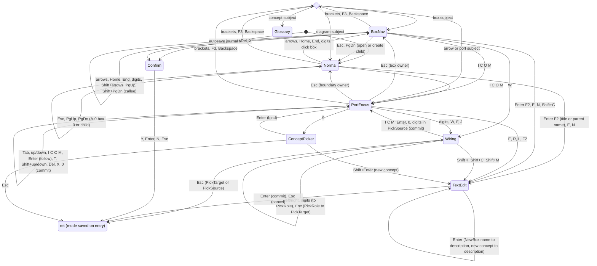
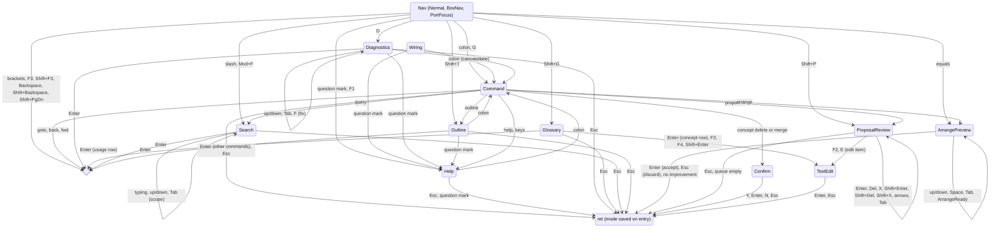

# idef0-rs Editor UX: Keyboard FSM, Keymap and Search

| Field | Value |
|---|---|
| Status | DRAFT v0.2 |
| Part of | idef0-rs spec set; index: [docs/PRD.md](../PRD.md) |
| Normative references | FIPS PUB 183 (§2.48, §3.3.2.8, §3.3.2.10; Annex C.4.4 is *informative*); WCAG 2.2; W3C UI Events (`KeyboardEvent.key`, `.code`, `.isComposing`); WICG File System Access API |
| Scope | The editor state machine, the canonical keymap, status and info lines, full-text search, accessibility, browser support, offline autosave and i18n of the idef0-rs web editor. |

Terms (BoxNav, ICOM, RenameMap, Patch, Scene, leaf, A-0 vs A0) are defined in the [glossary](../glossary.md).

---

## 1. Scope

This document specifies:
- The pure-Rust editor FSM in `idef0-core::editor` (D4): its modes, inputs, effects and invariants.
- The single canonical keymap, plus one transition table per mode.
- Mouse mapping, the status bar and the info line.
- Full-text and structural search (FR-SEARCH).
- Accessibility, browser support, offline autosave and internationalization of the Leptos UI (D1).

Out of scope, with cross-references:
- What each `Command` does to the model, including delete cascades, renumbering, undo scope and concurrency: [metamodel](metamodel.md#13-editing-semantics-fr-edit).
- Auto-Arrange's algorithm, `ReorderPorts` re-coding, themes and charsets: [layout](layout.md#12-auto-arrange).
- Diagnostic codes and severities: [validation](validation.md#7-diagnostic-registry).
- AI and agent proposals, their queue and the threat model (D15): [agents](agents.md#63-writes-pending-proposals-d15).
- The server-side PRD and code index (tantivy): [ingestion](ingestion.md#8-server-side-search-index-fr-search-02-server-part).
- The DOM adapter crate, server API, security and observability: [architecture](../architecture.md).
- CLI subcommands: [cli.md](../cli.md).

## 2. Interaction principles

| ID | Requirement |
|---|---|
| FR-UX-01 | The FSM `editor::step` is the only interaction logic. The UI only translates DOM events into `Input`s, executes `Effect`s and draws the `Scene`. |
| FR-UX-02 | Mouse input maps onto the same FSM transitions as keys (§7). A drag is a semantic command (`MoveBox`, `AddArrow`, `Retarget`), never free positioning (D5). |
| FR-UX-03 | A DOS-style status bar shows the mode badge, the diagram context, the save state, diagnostic counts, pending proposals and a hint strip. |
| FR-UX-04 | An info line above the status bar shows the focused element's reference, name and the first line of its description (FR-NAME-08). |
| FR-UX-05 | The hint strip and the Help overlay are generated from `TRANSITIONS`, so hints and docs cannot drift from behavior. |

- **Keyboard-first.** Every function is reachable from the keyboard (NFR-A11Y-01). Letters are mnemonics: `I C O M` select ICOM sides, `E` edits the focused element's description, `Enter`/`F2` renames it, and `Esc` always backs out one level.
- **Mode-local letters, few globals.** Most letters mean something only in one mode. Global keys are mostly named keys and punctuation. No global binding shares a chord with a mode-local binding (enforced by the conflict test, §13).
- **Decisions are modes.** Anything that holds a pending, uncommitted change (an arrange preview, a proposal under review, a confirmation) is its own mode. `Enter` and `Esc` there can never collide with editing keys.
- **No timers.** The FSM has no chord timeouts and no count prefixes. The same input sequence always produces the same state (D6).

**Status bar** (illustrative):

```text
 A21 Validate Order · C1 Credit Policy — A rule set that bounds credit exposure per…
 -- PORT A21 C 1/2 --  FAC A2 draft extended ●  E2 W5  ⧗2  │ Tab next  Enter follow  L label  K concept  Esc back
```

| Field | Content |
|---|---|
| Mode badge | `-- NORMAL --`, `-- BOX A21 --`, `-- PORT A21 C 1/2 --`, `-- WIRE A21.O → 3 ? --`, `-- EDIT name --`, `-- : --`, `-- CONFIRM --`, `-- SEARCH --`, `-- ARRANGE --`, `-- REVIEW 1/3 --` |
| Context | Model abbrev, diagram node number, diagram status, profile (D8) |
| Save state | `●` dirty; `○` saved; `⇡` autosaved locally only (§11); `⚠` autosave disabled |
| Diagnostics | Counts by severity (`E2 W5 I1`), glyph plus color |
| Proposals | `⧗n` when n > 0 proposals are pending (D15, FR-UX-19); hidden otherwise |
| Hint strip | Up to 8 entries for the current mode, from `TRANSITIONS` rows with a `hint` |

**Info line.** For a box: `A21 Validate Order — Checks each customer order against credit policy…`. For an arrow: `C1 Credit Policy — A rule set that bounds…`. For a diagram: node number, title and description. A missing description shows `‹no description — E to add›`. Transient messages (rejected commands, hints such as `followed call to SEC/@verify-token; Backspace returns`) replace the info line until the next input.

## 3. Key notation and key handling

### 3.1 Notation

| Notation | Meaning |
|---|---|
| `I` | The unshifted letter key (`KeyboardEvent.key == "i"`, Shift not held). Tables write letters as capitals for readability. |
| `Shift+I` | The same letter with Shift held. |
| `?`, `:`, `/`, `=`, `[`, `]`, `` ` ``, `~` | The produced character, whatever modifiers the layout needs to produce it. Shift is folded into the character. |
| `1`–`7`, `0` | Digit characters. `1`–`7` covers the profile's box limit (7 in `extended`, 6 in `fips183`). |
| `Mod+Z` | The primary modifier: `⌘` on macOS, `Ctrl` elsewhere. |
| `PgDn`, `PgUp`, `Home`, `End`, `←↑→↓`, `Tab`, `Enter`, `Esc`, `Backspace`, `Del`, `Space`, `F1`–`F12` | Named keys, matched by `KeyboardEvent.code` (`Enter` includes `NumpadEnter`). |

### 3.2 Normalization (FR-UX-06)

| ID | Requirement |
|---|---|
| FR-UX-06 | The DOM adapter normalizes each `keydown` into a `KeyChord { key: KeyId, shift, ctrl, alt, meta }`, using `key` for letters, digits and punctuation and `code` for named keys. |

Rules, in order:
1. **IME first.** If `isComposing` is true, or `keyCode == 229`, the event is ignored by the FSM and passed to the focused text control. The `Enter` that ends a composition never commits (FR-I18N-03).
2. **Named keys** (navigation, editing, F-keys): `KeyId::Named(code)`.
3. **AltGr.** If the produced `key` is a single printable character and AltGr is active (`getModifierState("AltGraph")`, or `ctrl && alt` on Windows), the chord is the bare character. This is how `[`, `]` and `\` arrive on German and Nordic layouts.
4. **Letters.** If `key` is an ASCII letter: `KeyId::Char(lowercase)`, with `shift` from the event. If `key` is a non-Latin letter (Cyrillic, Greek, Hebrew…) and `code` is `KeyA`–`KeyZ`, the letter is taken from `code` (QWERTY position). Mnemonics therefore follow the printed label on Latin layouts (AZERTY, Dvorak, QWERTZ) and the physical position elsewhere.
5. **Digits.** If `key` is `0`–`9`: that digit. Otherwise, if `code` is `Digit0`–`Digit9` or `Numpad0`–`Numpad9`: that digit, with Shift ignored. AZERTY's unshifted top row (`&é"'(`) still yields digits.
6. **Punctuation:** `KeyId::Char(key)`, with `shift` cleared.
7. **Dead keys** (`key == "Dead"`) are ignored. Keys that are dead on common layouts (`` ` ``, `~`) have F-key alternatives (`F9`, `Shift+F9`).

### 3.3 Browser-reserved chords (FR-UX-07)

| ID | Requirement |
|---|---|
| FR-UX-07 | The adapter calls `preventDefault()` for every chord the FSM consumes (including `PgUp`, `PgDn`, arrows, `Space`, `Tab` in PortFocus, `/`, `F1`, `F3`) and for no other chord. `TRANSITIONS` never binds a chord in `RESERVED`. |

`RESERVED` (normative; the conflict test fails if a transition binds one of these chords):

| Chord | Reason |
|---|---|
| `Mod+W`, `Mod+T`, `Mod+N`, `Mod+Shift+W/T/N`, `Mod+Q` | Close, open or quit tabs and windows; not preventable |
| `Mod+Tab`, `Mod+PgUp`, `Mod+PgDn`, `Mod+1`–`Mod+9` | Tab switching |
| `Mod+L`, `Alt+D`, `F6` | Address bar |
| `Alt+←`, `Alt+→`, `Mod+[`, `Mod+]` (macOS) | History navigation; not reliably preventable |
| `F5`, `Mod+R`, `Mod+Shift+R` | Reload; the `beforeunload` guard protects unsaved work (§11.3) |
| `F7`, `F10`, `F11`, `F12`, `Mod+Shift+I/J/C`, `Alt+F4` | Caret browsing, menu bar, full screen, devtools, close |
| `Mod+D`, `Mod+P`, `Mod+H`, `Mod+M` (macOS) | Bookmark, print, hide, minimize |
| `Ctrl+←/→/↑/↓`, `Ctrl+Space` (macOS) | Spaces, Mission Control, input source |

- **Back navigation** is `Backspace` in non-text modes, with `Shift+Backspace` for forward. `Alt+←` is deliberately left unbound: the browser may navigate away from the page, and the `beforeunload` guard then protects the work. No bracket chord is used, because `[`/`]` are diagnostics and `Mod+[` is browser Back on macOS.
- **Help:** `?` is primary. `F1` is an alias that some platforms intercept, for example as Safari brightness or the OS help.
- `Esc` also leaves browser full screen. That is harmless: the FSM still receives it.
- `Mod+F` opens idef0 search in navigation modes. In text-entry modes it is not consumed, so browser find still works there.

### 3.4 Text-entry isolation (FR-UX-08)

| ID | Requirement |
|---|---|
| FR-UX-08 | In every text-entry state (TextEdit, Command, Confirm, and the Search, ConceptPicker and Glossary overlays) no global key is active. Only the keys in that mode's table are consumed. |

- TextEdit, Command and the overlay filter fields are backed by **native** `<input>`/`<textarea>` elements. Clipboard, OS word navigation, IME and screen-reader editing then work natively. The adapter forwards value and selection changes as `Input::Text`. The FSM consumes only `Enter`, `Shift+Enter`, `Esc`, `Tab`, `Shift+Tab`, `↑`/`↓` and the listed F-keys.
- `Mod+Z` inside a text control is native text undo, not model undo.
- Confirm has no text field, but it is treated as text-entry so that a stray keystroke cannot fire a global command while a decision is pending.

## 4. FSM model

### 4.1 Step function

```rust
// (normative) idef0-core::editor
pub fn step(state: &EditorState, model: &Model, input: Input) -> (EditorState, Vec<Effect>);

pub struct EditorState {
    pub mode: Mode,
    pub diagram: NodeRef,            // model abbrev + NodeId of the displayed diagram
    pub render: RenderMode,          // Modern(Theme) | Retro(Charset)
    pub history: JumpHistory,        // back/forward stacks of (NodeRef, Selection), capped at 100
    pub hits: Option<HitList>,       // active search hit list for F3 / Shift+F3
    pub settings: EditorSettings,    // wrap-at-ends, verbosity of announcements, keymap overrides
}
```

`pending_count` from v0.1 is **removed**. There are no count prefixes; digits are box-number mnemonics.

### 4.2 Input

```rust
// (normative)
pub enum Input {
    Key(KeyChord),
    Text(TextChange),                    // value + selection of the focused native text control
    Mouse(MouseInput),                   // §7
    ArrangeReady(Result<ArrangePlan, ArrangeError>),   // async result of Effect::ComputeArrange
    ProposalsChanged(ProposalQueueSummary),            // server push (D15)
    External(PatchSummary),              // model changed by undo, server, another tab or MCP
}
```

Async work never runs inside `step`. Its result comes back as an `Input`, which keeps `step` pure and replayable.

### 4.3 Modes

```rust
// (normative)
pub enum Mode {
    Normal,                                                    // diagram focused, nothing selected
    BoxNav    { key: BoxKey },                                 // keys survive renumbering (D14)
    PortFocus { owner: PortOwner, side: Side, at: Option<PortItem> },
    Wiring    { op: WireOp, stage: WireStage, ret: Box<Mode> },
    TextEdit  { target: TextTarget, buf: String, sel: (usize, usize), ret: Box<Mode> },
    Command   { buf: String, hist: Option<usize>, ret: Box<Mode> },        // ':' ex-style line
    Confirm   { action: ConfirmAction, summary: String, ret: Box<Mode> },
    Overlay   { kind: OverlayKind, ret: Box<Mode> },
}
pub enum PortOwner { Box(BoxKey), Boundary }
pub enum PortItem  { Arrow(ArrowKey), BoundaryPort(BoundaryPortRef) }    // boundary ports exist without arrows
pub enum OverlayKind {
    Help        { scroll: u16 },
    Diagnostics { cursor: usize, filter: SeverityFilter },
    Glossary    { filter: String, cursor: GlossaryCursor, expanded: bool },
    ConceptPicker { arrow: ArrowKey, filter: String, cursor: usize },
    Search      { query: String, scope: SearchScope, cursor: usize },     // results are derived, not stored
    Outline     { cursor: OutlinePath },                                   // FR-UX-24, FR-A11Y-03
    ArrangePreview { plan: ArrangeState, cursor: usize, show_before: bool },
    ProposalReview { proposal: ProposalId, cursor: usize, view: ReviewView },
}
pub enum TextTarget {
    DiagramTitle, DiagramDescription, BoxName(BoxKey), BoxDescription(BoxKey),
    NewBox { after: Option<BoxKey> }, CallTarget(BoxKey), ArrowLabel(ArrowKey), ArrowRel(ArrowKey),
    ConceptName(ConceptKey), ConceptDescription(ConceptKey), ConceptProps(ConceptKey),
    NewConcept { bind: Option<ArrowKey> }, ProposalItem { id: ProposalId, item: usize, field: Field },
}
```

- **Box focus** stores the `BoxKey`, not the box number, so `MoveBox` and renumbering keep the focus on the same function.
- **PortFocus on a box** cycles the arrows at that side in rank order. **PortFocus on the boundary** cycles boundary *ports* and the unconnected parent-ICOM **stubs**. Boundary ports exist only while an arrow uses them; on a freshly decomposed child, every parent ICOM shows as a stub until an arrow is attached ([metamodel §11](metamodel.md#11-balance-fr-bal)).
- **`ret` depth** is at most 3 (example: PortFocus → ConceptPicker → TextEdit{ConceptDescription}). Overlays never stack. Opening an overlay from a panel overlay replaces it and inherits its `ret`.

### 4.4 Wiring

```rust
// (normative)
pub enum WireOp {
    Connect { from: WireSource },     // new arrow
    Fork    { arrow: ArrowKey },      // new branch off an existing arrow (shares its source)
    Join    { into: ArrowKey },       // new source merging into an existing arrow (shares its destination)
}
pub enum WireSource { BoxOutput(BoxKey), Boundary(BoundaryPortSel) }     // BoundaryPortSel: existing port or New(side)
pub enum WireStage {
    PickTarget { cursor: Target },    // Connect, Fork: Target = Box(BoxKey) | Boundary
    PickRole   { target: BoxKey },    // choose I, C or M at the target box
    PickSource { cursor: Target },    // Join: choose the box output (or boundary port) that joins `into`
}
```

| ID | Requirement |
|---|---|
| FR-UX-14 | Wiring commits exactly one `AddArrow`, `Fork` or `Join` command. It returns to PortFocus at the new arrow's **source end** with the new arrow selected. `Esc` cancels with no model change. |

- **Implied roles commit immediately.** A target of `0` (the boundary) needs no role. A box output or fork goes to the right frame as an output. A join source on the boundary takes the frame side matching the role of the destination of `into`. `O 0` is therefore a complete two-key chord.
- **Boundary port choice:** `0` (or the boundary cursor plus `Enter`) uses the lowest-coded *unconnected* boundary port on the implied side. If there is none, it creates the next code, and balance diagnostics then apply ([validation](validation.md#55-icom-balance-r-bal-01)).
- **Default role** in PickRole (`Enter`): the source side for a boundary source (I→I, C→C, M→M), and Input for a box output. Roles may differ between parent and child, so any of I, C or M is accepted (FIPS §3.3.2.8).
- **Sources:** from a box output, `W` and the digits always create a new output rank. Branching an existing arrow is `F`. From a boundary port that already has an arrow, wiring creates a branch of that arrow, because a coded boundary port carries one arrow.
- **Return mode:**
  - box source → `PortFocus{Box(src), O, new}`
  - boundary source → `PortFocus{Boundary, side, new}`
  - fork → PortFocus at the trunk's source with the new branch selected
  - join → `PortFocus{Box(chosen source), O, new}`

### 4.5 Effects

```rust
// (normative)
pub enum Effect {
    Apply(Command),                 // core::apply → Patch → undo stack → persistence
    ApplyAtomic(Vec<Command>),      // one Patch, one undo step (arrange accept, proposal accept-all)
    Undo, Redo,
    Navigate(NodeRef),              // also pushes JumpHistory when the move is a jump (§4.8)
    Save, SaveAs, OpenFile,         // §11
    Validate,                       // force full validation (server-backed when connected)
    ComputeArrange(NodeRef),        // async → Input::ArrangeReady
    CancelArrange,
    DecideProposal { id: ProposalId, items: ItemSel, accept: bool },   // D15, via server
    SetRender(RenderMode),
    CopyToClipboard(String),        // e.g. :contract
    ScrollIntoView(Subject),
    Notify(Message),                // info-line message; mirrored to the ARIA live region (§10)
}
```

### 4.6 Mode classes and key scope

| Class | Modes | Keys consumed |
|---|---|---|
| Navigation | Normal, BoxNav, PortFocus | Global keys (§6.1) plus the mode table |
| Chord | Wiring | The Wiring table, plus `:` (cancels the wire, then opens Command) and `?` (Help; returns to Wiring) |
| Panel overlay | Help, Diagnostics, Outline | The overlay table, plus `:` and `?` |
| Decision | Confirm, ArrangePreview, ProposalReview | The mode table only; globals are off (Confirm counts as text-entry for FR-UX-08). `Esc` or an explicit decision must come first. |
| Text-entry | TextEdit, Command, Search, ConceptPicker, Glossary (FR-UX-08) | The mode table only. Everything else goes to the native text control. |

### 4.7 Selection-repair invariant (FR-UX-09)

| ID | Requirement |
|---|---|
| FR-UX-09 | After every `step`, every key or index in `Mode` and `EditorState` refers to an element that exists in the current model, and `state.diagram` exists. This is property-tested (§13). |

Repair procedure, run after every applied Patch and every `Input::External`:
1. Rewrite arrow keys and port references in `Mode` through the Patch's `RenameMap` (arrow ids change on retarget; D14). Box keys never change.
2. **Box deleted:** focus the next box in diagonal order, else the previous one, else go to Normal.
3. **Arrow deleted:** select the next arrow at the same side, else `at: None`. **Port owner deleted:** go to BoxNav or Normal.
4. **Displayed diagram deleted** (for example, undoing a `Decompose`): navigate to the nearest existing ancestor and go to Normal.
5. **TextEdit, Wiring or ConceptPicker referent gone:** cancel to the repaired `ret`, with a notice.
6. **ArrangePreview stale** (the model revision changed under it): discard it, with a notice.
7. **ProposalReview stale** (the base revision changed): reload the proposal; see [agents](agents.md#64-proposal-lifecycle) for rebase rules.
8. **Undo and redo** navigate to the diagram the patch touched and select the patch's primary subject. Undo scope is defined in [metamodel](metamodel.md#136-undo-and-redo-fr-edit-17).

### 4.8 Jump history (FR-UX-10)

| ID | Requirement |
|---|---|
| FR-UX-10 | Jumps push `(diagram, selection)` onto the back stack: following a call, `Enter` on a diagnostic, search or outline hit, `]`, `[`, `F3`, `Shift+F3`, and `:goto`. `Backspace` pops it; `Shift+Backspace` moves forward. |

- `PgUp` and `PgDn` are structural moves, not jumps, and do not push history.
- **Jump target mode:** every jump lands in the selection mode of its subject. A box lands in BoxNav, an arrow or port in PortFocus, a diagram in Normal, and a concept in Overlay{Glossary} with that concept selected.

## 5. Canonical keymap

| ID | Requirement |
|---|---|
| FR-UX-11 | There is one keymap, generated from `const TRANSITIONS: &[Transition]` (`cargo xtask gen-keymap`). This table, the per-mode tables in §6, the state diagrams in §8, the hint strip and the Help overlay are all generated outputs. CI fails if the committed copies differ. |
| FR-UX-25 | **v1.x (D20), not v1.** Users may remap chords via `[ui.keymap]` in `.idef0/config.toml` or local settings. A remap is accepted only if the conflict test (§13) still passes and it binds no `RESERVED` chord. |

Until M6.4 lands, the tables below are the hand-written specification, and the generator must reproduce them.

Mode codes:
- Navigation: `Nrm` (Normal), `Box` (BoxNav), `Port` (PortFocus); **Nav** means all three.
- Other modes: `Wire` (Wiring), `Text` (TextEdit), `Cmd` (Command), `Cfm` (Confirm).
- Overlays: `Help`, `Diag`, `Glos`, `Pick` (ConceptPicker), `Srch`, `Outl`, `Arr` (ArrangePreview), `Rev` (ProposalReview).

<!-- BEGIN GENERATED keymap (from TRANSITIONS) -->

| Key | Modes | Action | FR |
|---|---|---|---|
| `PgDn` | Nav | Descend into the focused box: open its child; a caller follows its call; a leaf non-caller gets `Decompose` | FR-UX-12, FR-CALL-02 |
| `Shift+PgDn` | Nav | Follow the focused box's call arrow (possibly into another model) | FR-UX-12, FR-CALL-07 |
| `PgUp` | Nav | Ascend to the parent diagram, focusing the box just left | FR-UX-12 |
| `Backspace` | Nav | Jump back | FR-UX-10 |
| `Shift+Backspace` | Nav | Jump forward | FR-UX-10 |
| `` ` `` / `F9` | Nav | Toggle render mode: Modern SVG ⇄ Retro text | FR-UX-20 |
| `~` / `Shift+F9` | Nav | Cycle the retro charset: unicode ⇄ ascii | FR-UX-20 |
| `U` / `Mod+Z` | Nav | Undo | FR-UX-21 |
| `Shift+U` / `Mod+Y` / `Mod+Shift+Z` | Nav | Redo | FR-UX-21 |
| `Mod+S` | Nav | Save | FR-UX-21, FR-WEB-02 |
| `]` / `[` | Nav | Next / previous diagnostic (jump to its subject) | FR-UX-22 |
| `D` | Nav | Open the Diagnostics overlay | FR-UX-22 |
| `Shift+G` | Nav | Open the Glossary overlay | FR-UX-23 |
| `?` / `F1` | Nav, Wire, Help, Diag, Outl | Open Help (in Help: close) | FR-UX-05 |
| `:` | Nav, Wire, Help, Diag, Outl | Open the command line (in Wire: cancel the wire first) | FR-UX-16 |
| `G` | Nav | Open the command line pre-filled with `goto ` | FR-UX-16 |
| `=` | Nav | Compute Auto-Arrange and open ArrangePreview | FR-UX-18, FR-LAYOUT-02 |
| `/` / `Mod+F` | Nav | Open the Search overlay | FR-SEARCH-09 |
| `F3` / `Shift+F3` | Nav | Next / previous hit in the active hit list, across diagrams | FR-SEARCH-08 |
| `Shift+P` | Nav | Open ProposalReview (hint if none is pending) | FR-UX-19 |
| `Shift+T` | Nav | Open the Outline (tree) view | FR-UX-24, FR-A11Y-03 |
| `Tab` / `Shift+Tab` | Nrm, Box | Not consumed: focus moves to the next page region | FR-A11Y-05 |
| `→` / `Home` | Nrm | Focus the first box | FR-UX-12 |
| `←` / `End` | Nrm | Focus the last box | FR-UX-12 |
| `1`–`7` | Nrm, Box | Focus box k (no-op with a hint if k > n) | FR-UX-12 |
| `0` | Nrm, Box | Focus box 0 (context diagrams only) | FR-UX-12 |
| `I` / `C` / `O` / `M` | Nrm | Focus a boundary port on that frame side | FR-UX-13 |
| `I` / `C` / `O` / `M` | Box | Focus that side of the box | FR-UX-13 |
| `I` / `C` / `O` / `M` | Port | Switch side | FR-UX-13 |
| `I` / `C` / `M` | Wire | Commit with that role at the target (PickRole) | FR-UX-14 |
| `Shift+I` / `Shift+C` / `Shift+M` | Wire | Commit with that role, then edit the label (PickRole) | FR-UX-14 |
| `Enter` / `F2` | Nrm | A-0 or A-n: edit the diagram title. Elsewhere: rename the parent box. | FR-UX-15, FR-NAME-01 |
| `Enter` / `F2` | Box | Rename the box | FR-UX-15, FR-NAME-01 |
| `F2` / `L` | Port | Edit the selected arrow's label (binds or creates a concept) | FR-UX-15, FR-NAME-03 |
| `E` | Nrm | Edit the diagram description | FR-NAME-05 |
| `E` | Box | Edit the box description | FR-NAME-01 |
| `E` | Port | Edit the selected arrow's concept description | FR-NAME-02 |
| `N` | Nrm, Box | New box (at the end, or after the focused box), then its description | FR-UX-15, FR-NAME-01 |
| `→` / `←` | Box | Next / previous box (wrapping is a setting) | FR-UX-12 |
| `Home` / `End` | Box | First / last box | FR-UX-12 |
| `Shift+→` / `Shift+←` | Box | `MoveBox` along the diagonal (renumbers; RenameMap) | FR-UX-12 |
| `W` | Box | Wire from the box output (cursor) | FR-UX-14 |
| `W` | Port | Wire from this port (cursor) | FR-UX-14 |
| `Shift+C` | Box | Edit the call target (rejected on decomposed boxes) | FR-CALL-02 |
| `Del` / `X` | Box | Confirm `DeleteBox` | FR-UX-17 |
| `Del` / `X` | Port | `DeleteArrow` on the selected arrow (undoable, no confirm) | FR-UX-13 |
| `Tab` / `↓` | Port | Next arrow or port at this side (wraps) | FR-UX-13 |
| `Shift+Tab` / `↑` | Port | Previous arrow or port at this side (wraps) | FR-UX-13 |
| `Enter` | Port | Follow the selected arrow to its other end | FR-UX-13 |
| `K` | Port | Open ConceptPicker for the selected arrow | FR-UX-23 |
| `T` | Port | Toggle the tunnel at this end: `( )` at a box, `[ ]` at the boundary | FR-UX-13 |
| `R` | Port | Edit the branch relation (`all`, `kind_of`, `part_of`) | FR-NAME-04 |
| `Shift+↑` / `Shift+↓` | Port | Move the selected arrow's rank: one atomic `ReorderPorts` | FR-UX-13, FR-LAYOUT-13 |
| `1`–`7` | Port | Quick-connect from this port to box k (then pick the role) | FR-UX-14 |
| `0` | Port | Quick-connect to the boundary on the implied side (commits) | FR-UX-14 |
| `F` | Port | Fork a branch off the selected arrow | FR-UX-14 |
| `J` | Port | Join a new source into the selected arrow | FR-UX-14 |
| `Esc` | Nrm | Clear the active hit list and hit highlighting | FR-SEARCH-08 |
| `Esc` | Box | Go to Normal | FR-UX-12 |
| `Esc` | Port | Go to BoxNav (box owner) or Normal (boundary owner) | FR-UX-13 |
| `←` / `→` | Wire | Move the target or source cursor over boxes and the boundary | FR-UX-14 |
| `1`–`7` | Wire | PickTarget: choose box k (go to PickRole). PickSource: commit box k as the source. | FR-UX-14 |
| `0` | Wire | Boundary target or source (commits) | FR-UX-14 |
| `Enter` | Wire | PickTarget/PickSource: confirm the cursor. PickRole: commit the default role. | FR-UX-14 |
| `Esc` | Wire | PickRole: back to PickTarget. PickTarget/PickSource: cancel the wire. | FR-UX-14 |
| `Enter` | Text | Commit and return (for `NewBox`: chain to the description) | FR-UX-15 |
| `Shift+Enter` | Text | Insert a newline (description targets) | FR-NAME-05 |
| `Tab` | Text | Complete (verbs, concepts, call targets, relations). In an empty description: insert the ICOM draft. | FR-UX-15, FR-NAME-01 |
| `↑` / `↓` | Text | Move in the completion list (when it is open) | FR-UX-15 |
| `Esc` | Text | Cancel and return | FR-UX-15 |
| `Enter` | Cmd | Execute | FR-UX-16 |
| `Tab` | Cmd | Complete the command name or argument | FR-UX-16 |
| `↑` / `↓` | Cmd | Command history | FR-UX-16 |
| `Esc` | Cmd | Cancel | FR-UX-16 |
| `Y` / `Enter` | Cfm | Apply | FR-UX-17 |
| `N` / `Esc` | Cfm | Cancel | FR-UX-17 |
| `↑` / `↓` / `PgUp` / `PgDn` | Help | Scroll | FR-UX-05 |
| `Esc` | Help | Close | FR-UX-05 |
| `↑` / `↓` | Diag, Glos, Pick, Srch, Outl, Arr, Rev | Move the list cursor | — |
| `PgUp` / `PgDn` | Glos, Srch | Page the list | — |
| `Enter` | Diag | Jump to the diagnostic's subject | FR-UX-22 |
| `Tab` | Diag | Cycle the severity filter: all → error → warning+ → info | FR-UX-22 |
| `F` | Diag | Apply the diagnostic's fix hint, if it has one (undoable) | FR-UX-22 |
| `Esc` | Diag, Srch, Outl | Close | — |
| `Enter` | Glos | Concept row: edit the description. Usage row: jump to that arrow. | FR-UX-23, FR-SEARCH-07 |
| `F2` | Glos | Rename the concept | FR-UX-23 |
| `F4` | Glos | Edit synonyms and `kind_of`/`part_of` | FR-NAME-02 |
| `Shift+Enter` | Glos | Define a new concept named by the filter text | FR-UX-23 |
| `Tab` | Glos | Expand or collapse "where used" | FR-SEARCH-07 |
| `Esc` | Glos | Close | FR-UX-23 |
| `Enter` | Pick | Bind the selected concept to the arrow (`BindArrowConcept`) | FR-UX-23 |
| `Shift+Enter` | Pick | Define a concept named by the filter text, bind it, then edit its description | FR-UX-23 |
| `Esc` | Pick | Cancel | FR-UX-23 |
| `Tab` | Srch | Cycle the scope: model → +PRD → +code | FR-SEARCH-09 |
| `Enter` | Srch | Jump to the hit and make the results the active hit list | FR-SEARCH-08 |
| `→` / `←` | Outl | Expand / collapse the tree node | FR-A11Y-03 |
| `Home` / `End` | Outl | First / last visible node | FR-A11Y-03 |
| `Enter` | Outl | Jump to the element | FR-UX-24 |
| `Space` | Arr | Include or exclude the selected optional proposal (merge, bundle, to-all) | FR-UX-18, FR-LAYOUT-14 |
| `Tab` | Arr | Show the current diagram ⇄ the arranged preview | FR-UX-18 |
| `Enter` | Arr | Accept: one atomic Patch (`MoveBox`, `ReorderPorts` and included proposals) | FR-UX-18 |
| `Esc` | Arr | Discard (or cancel a running computation) | FR-UX-18 |
| `←` / `→` | Rev | Previous / next pending proposal | FR-UX-19 |
| `Enter` | Rev | Accept the selected item and its dependency closure | FR-UX-19 |
| `Del` / `X` | Rev | Reject the selected item and its dependents | FR-UX-19 |
| `Shift+Enter` | Rev | Accept all remaining items of this proposal | FR-UX-19 |
| `Shift+Del` / `Shift+X` | Rev | Reject all remaining items of this proposal | FR-UX-19 |
| `F2` / `E` | Rev | Edit the item's name / description before accepting | FR-UX-19 |
| `Tab` | Rev | Toggle the view: ghost overlay ⇄ item list with diff | FR-UX-19 |
| `Esc` | Rev | Close; undecided items stay pending | FR-UX-19 |

<!-- END GENERATED keymap -->

- Letters with no binding in a navigation mode show a hint (`no binding for "q" in BOX; ? for help`) and change nothing.
- **ProposalReview bulk actions** use `Shift+Enter`/`Shift+Del` rather than a bare letter such as `A`. A single unshifted letter is too easy to hit by accident for a bulk write, and the pair mirrors `Enter`/`Del`.

## 6. Per-mode transition tables

`Next` names the resulting mode. `ret` means the mode saved on entry. "Jump" means the jump target mode (§4.8).

### 6.1 Global keys (navigation modes only)

| Key | Guard | Next | Effect |
|---|---|---|---|
| `PgDn` | Focused box is decomposed | Normal on the child | `Navigate(child)` |
| `PgDn` | Focused box is a caller | BoxNav on the callee | Same as `Shift+PgDn`. Hint: `followed call to SEC/@key (A5.2); Backspace returns`. Never creates a child (FIPS §3.3.2.10). |
| `PgDn` | Focused box is a leaf without a call | Normal on the new child | `Apply(Decompose)`: 0 boxes; parent ICOMs appear as stubs on the child frame; no Auto-Arrange (D5) |
| `PgDn` | Normal on A-0 | as above, for box 0 | The single box is the implied focus |
| `PgDn` | Normal elsewhere | Normal | Hint `focus a box first` |
| `Shift+PgDn` | Focused box is a caller | BoxNav on the callee | Jump. With several alternative targets, a picker lists them. |
| `PgUp` | Not on A-0 | BoxNav on the parent | `Navigate(parent)`, focusing the box just left |
| `PgUp` | On A-0 | Normal on A-1, if it exists | Otherwise a hint |
| `Backspace` / `Shift+Backspace` | History not empty | Jump | Pop back / forward |
| `` ` `` / `F9`, `~` / `Shift+F9` | — | same | `SetRender` |
| `U` / `Mod+Z`, `Shift+U` / `Mod+Y` / `Mod+Shift+Z` | — | repaired | `Undo` / `Redo`, then navigate to the touched diagram (§4.7) |
| `Mod+S` | — | same | `Save` |
| `]` / `[` | Diagnostics exist | Jump | Message shown in the info line |
| `D`, `Shift+G`, `?`/`F1`, `/`/`Mod+F`, `Shift+T` | — | Overlay | Diagnostics, Glossary, Help, Search, Outline |
| `:` / `G` | — | Command | `G` pre-fills `goto ` |
| `=` | Diagram has ≥ 2 boxes or ≥ 2 ports on a side | Overlay ArrangePreview{Computing} | `ComputeArrange`; a progress indicator shows; `Esc` cancels |
| `F3` / `Shift+F3` | Hit list active | Jump | Wraps with the hint `search wrapped` |
| `Shift+P` | Proposals pending | Overlay ProposalReview | Opens the oldest pending proposal |

### 6.2 Normal

| Key | Next | Effect |
|---|---|---|
| `→` / `Home`, `←` / `End` | BoxNav{first / last} | — |
| `1`–`7`, `0` | BoxNav{k} | No-op with a hint if box k does not exist |
| `I` / `C` / `O` / `M` | PortFocus{Boundary, side, first port or None} | — |
| `N` | TextEdit{NewBox{after: None}} | Rejected with a hint at the profile maximum, or on A-0 (exactly one box) |
| `Enter` / `F2` | TextEdit{DiagramTitle} on context diagrams; TextEdit{BoxName(parent)} elsewhere | A child diagram's title is its parent box's name (FIPS §2.48; Annex C.4.4, informative), so the edit is `RenameBox` on the parent. Info line: `title = name of parent box A2`. |
| `E` | TextEdit{DiagramDescription} | Multi-line (FR-NAME-05) |
| `Esc` | Normal | Clears the hit list |

### 6.3 BoxNav{key}

| Key | Next | Effect |
|---|---|---|
| `→` / `←` | BoxNav{next / prev} | Wraps at the ends if `settings.wrap` (default on) |
| `Home` / `End` / `1`–`7` / `0` | BoxNav{first / last / k} | — |
| `I` / `C` / `O` / `M` | PortFocus{Box(key), side, first arrow or None} | Highlights the side and its arrows |
| `Enter` / `F2` | TextEdit{BoxName(key)} | Buffer pre-filled; `Tab` completes verbs from the lexicon |
| `E` | TextEdit{BoxDescription(key)} | Multi-line; `Tab` in an empty buffer inserts the ICOM draft (FR-NAME-01) |
| `N` | TextEdit{NewBox{after: key}} | Enter on the name commits `AddBox` (renumbers, RenameMap) and chains to TextEdit{BoxDescription(new)}; `Esc` skips the description |
| `Shift+→` / `Shift+←` | BoxNav{key} | `MoveBox` (renumbers; RenameMap) |
| `W` | Wiring{Connect{BoxOutput(key)}, PickTarget{next box}} | — |
| `Shift+C` | TextEdit{CallTarget(key)} | Fuzzy completion over workspace boxes by key, reference, name and description. Commits `SetCall` (stored by `@key`, D14). An empty buffer commits `ClearCall`. Rejected on a decomposed box (FR-CALL-02). Several `\|`-separated targets prompt for a model note. |
| `Del` / `X` | Confirm{DeleteBox(key)} | The summary shows attached arrows, child diagrams and callers ([metamodel](metamodel.md#131-deletebox-cascade-normative-order)) |
| `Esc` | Normal | — |

### 6.4 PortFocus{owner, side, at}

| Key | Guard | Next | Effect |
|---|---|---|---|
| `Tab`/`↓`, `Shift+Tab`/`↑` | — | same, next/prev item | Highlights the item's full path |
| `I` / `C` / `O` / `M` | — | PortFocus{owner, side'} | — |
| `Enter` | Arrow selected | PortFocus at the other end | Line-following with the same arrow selected; a boundary end focuses that boundary port |
| `F2` / `L` | Arrow selected | TextEdit{ArrowLabel} | An existing name or synonym binds that concept. A new name runs `DefineConcept` + `BindArrowConcept`, then chains to TextEdit{ConceptDescription}. |
| `K` | Arrow selected | Overlay ConceptPicker | — |
| `E` | Arrow selected | TextEdit{ConceptDescription} | The description is shared model-wide |
| `R` | Arrow is a branch | TextEdit{ArrowRel} | `Tab` cycles `all`, `kind_of`, `part_of` |
| `T` | Arrow selected | same | `SetTunnel`: at a box, none ⇄ `( )`; at the boundary, none ⇄ `[ ]` (the port becomes uncoded `[I1]`) |
| `Shift+↑` / `Shift+↓` | Arrow selected | same | One `ReorderPorts{box, side, order}`, the same command Auto-Arrange uses ([layout](layout.md#123-step-2-port-order-fr-layout-13)). On a decomposed box it re-codes the child boundary atomically and records port renames (`A21/I2 → A21/I1`) in the RenameMap. The info line shows the re-coding; no warning. At the boundary it reorders the parent box's ports (on A-0: box 0's). |
| `1`–`7` | owner = Box and side = O, or owner = Boundary and side ∈ {I, C, M} | Wiring{Connect, PickRole{box k}} | Otherwise a hint: `digits wire from an output or a boundary I/C/M port` |
| `0` | owner = Box and side = O | PortFocus{Box, O, new} | Commits `AddArrow` to the right boundary (§4.4) |
| `W` | Same guard as the digits | Wiring{Connect, PickTarget} | — |
| `F` | Arrow selected | Wiring{Fork{arrow}, PickTarget} | — |
| `J` | Arrow selected | Wiring{Join{into: arrow}, PickSource} | — |
| `Del` / `X` | Arrow selected | PortFocus{next} | `DeleteArrow` (undoable). On a boundary port without an arrow: hint only. |
| `Esc` | — | BoxNav{key} or Normal | Boundary owner → Normal |

### 6.5 Wiring{op, stage}

| Stage | Key | Next | Effect |
|---|---|---|---|
| PickTarget | `←` / `→` | same | Moves the cursor over boxes 1..n, then the boundary |
| PickTarget | `1`–`7` | PickRole{box k} | — |
| PickTarget | `0` | PortFocus at the source | Commit to the boundary (implied role) |
| PickTarget | `Enter` | PickRole{cursor box}, or commit if the cursor is on the boundary | SR-22 confirm key |
| PickTarget | `Esc` | `ret` | Cancel; no change |
| PickRole | `I` / `C` / `M` | PortFocus at the source, new arrow selected | `AddArrow` / `Fork`. The label is deferred: the arrow shows `?` until `L`. |
| PickRole | `Enter` | as above | Default role (§4.4) |
| PickRole | `Shift+I` / `Shift+C` / `Shift+M` | TextEdit{ArrowLabel(new)}, `ret` = PortFocus at the source | Commit, then label |
| PickRole | `O` | same | Hint: `outputs cannot receive arrows` |
| PickRole | `Esc` | PickTarget{cursor = box} | One step back |
| PickSource | `←` / `→`, `Enter` | same / commit | Join from the cursor's box output (or boundary port) |
| PickSource | `1`–`7`, `0` | PortFocus{Box(k), O, new} or PortFocus{Boundary, …} | Commit `Join` |
| PickSource | `Esc` | `ret` | Cancel |
| any | `:` | Command, `ret` = Wiring's `ret` | Cancels the wire |
| any | `?` | Overlay Help, `ret` = Wiring | — |

**Quick-connect scenarios** (normative; each is a `.keys` fixture, §13). All start in BoxNav on box 1:

| Keys | Result |
|---|---|
| `O 3 I` | Box 1's output becomes box 3's input. Ends in PortFocus{1, O, new}. |
| `O 2 C` | Box 1's output becomes a control on box 2 |
| `O 0` | Box 1's output exits to the lowest unconnected right-boundary port (else the next O code). Two keys, no `Enter`. |
| `O 3 I 4 I` | Two new outputs (O1 → 3I, then O2 → 4I). The second chord starts in PortFocus{1, O}. |
| `O ↓ F 4 I` | Forks box 1's second output arrow into box 4's input |
| `C J 2` | Box 2's output joins into box 1's first control arrow |
| `O 3 Shift+I` + `Order⏎` | Wire and label in one sequence |

### 6.6 TextEdit{target}

| Key | Next | Effect |
|---|---|---|
| (text input) | same | The native control updates `buf` and `sel` via `Input::Text` |
| `Enter` | `ret`, or the chained TextEdit | Commits the target's command (`RenameBox`, `SetDescription`, `AddBox`, `SetCall`, `SetLabel`, `RenameConcept`, `RelateConcepts`…). On a validation error (empty name, duplicate sibling name, name > 60 characters, unknown call target) it stays in TextEdit with an inline message. |
| `Shift+Enter` | same | Newline; description and `ConceptProps` targets only |
| `Tab` / `Shift+Tab` | same | Next / previous completion. In an empty description buffer: inserts the draft "*Name* transforms ‹inputs› into ‹outputs› under ‹controls›." |
| `↑` / `↓` | same | Moves in the completion list when it is open; otherwise native |
| `Esc` | `ret` | Cancels; no model change. In a chain, the earlier steps stay committed. |

### 6.7 Command{buf}

`Enter` parses and executes the command and returns to `ret` (or to the jump target). `Tab` completes. `↑`/`↓` scroll the history (per session, last 100). `Esc` cancels. An unknown command or bad argument keeps the line open with an inline error.

| Command | Effect | FR |
|---|---|---|
| `:goto <ref>` | Jump to `A21`, `A2.1`, `@key`, `FAC/A21`, `FAC/@key` or `concept:<key>` | FR-UX-10 |
| `:back`, `:fwd` | Same as `Backspace` / `Shift+Backspace` | FR-UX-10 |
| `:w`, `:saveas`, `:open` | Save, save as or download, open (§11) | FR-WEB-02 |
| `:validate` | Full validation now; server-backed (code and PRD facts) when connected | FR-UX-22 |
| `:arrange` | Same as `=` | FR-UX-18 |
| `:proposals` | Open ProposalReview (same as `Shift+P`) | FR-UX-19 |
| `:query <atom>` | Open Search with `mg:<atom>` (structural search) | FR-SEARCH-05 |
| `:outline`, `:help [topic]`, `:keys` | Outline; Help; the Help keymap page | FR-UX-24, FR-UX-05 |
| `:meta purpose\|viewpoint\|scope\|lang <text>` | `SetMeta` | FR-NAME-05, FR-I18N-02 |
| `:status working\|draft\|recommended\|publication` | Set the diagram status (gate: FR-NAME-06) | FR-NAME-06 |
| `:note <text>` | Add a model note to the current diagram | [metamodel](metamodel.md#10-notes-fr-note) |
| `:code <coderef>` / `:kind resource\|component` | Bind the selected mechanism arrow to code, or mark it non-code | [validation](validation.md#511-mechanisms-and-code-grounding-r-mech-extension) |
| `:concept delete <key>`, `:concept merge <key> <into>` | Confirm, then apply (semantics in [metamodel](metamodel.md#12-names-descriptions-and-concepts-fr-name)) | FR-UX-23 |
| `:contract [node]` | Copy the contract card (Markdown) to the clipboard | [agents](agents.md#2-contract-cards) |
| `:theme modern\|classic\|fips183`, `:charset unicode\|ascii` | `SetRender` | FR-UX-20 |
| `:set wrap on\|off`, `:set announce terse\|verbose` | Editor settings | FR-A11Y-02 |

### 6.8 Confirm{action}

| Key | Next | Effect |
|---|---|---|
| `Y` / `Enter` | `ret` (repaired) | `Apply(action)` |
| `N` / `Esc` | `ret` | — |

Confirm is used for `DeleteBox`, concept delete and merge, and the autosave restore prompt (§11.3).

### 6.9 Overlays

| Overlay | Opened by | Keys | Exit |
|---|---|---|---|
| Help | `?`, `F1`, `:help` | `↑↓ PgUp PgDn` scroll | `Esc`, `?` → `ret` |
| Diagnostics | `D` | `↑↓`, `Tab` filter, `F` fix, `Enter` jump | `Esc` → `ret`; `Enter` → Jump |
| Glossary | `Shift+G`, jump to a concept | Filter field; `↑↓ PgUp PgDn`, `Enter`, `F2`, `F4`, `Shift+Enter`, `Tab` | `Esc` → `ret`; edits → TextEdit (`ret` = Glossary); usage `Enter` → Jump |
| ConceptPicker | `K` | Filter field; `↑↓`, `Enter` bind, `Shift+Enter` new + bind | `Enter` → PortFocus; `Shift+Enter` → TextEdit{ConceptDescription}; `Esc` → `ret` |
| Search | `/`, `Mod+F`, `:query` | Query field; `↑↓ PgUp PgDn`, `Tab` scope, `Enter` | `Enter` → Jump; `Esc` → `ret` (hit list unchanged) |
| Outline | `Shift+T`, `:outline` | `↑↓ ←→ Home End`, `Enter` | `Enter` → Jump; `Esc` → `ret` |
| ArrangePreview | `=`, `:arrange` | `↑↓` items, `Space` include, `Tab` before/after | `Enter` → `ret` + `ApplyAtomic`; `Esc` → `ret` |
| ProposalReview | `Shift+P`, `:proposals` | `←→` proposal, `↑↓` item, `Enter`, `Del`/`X`, `Shift+Enter`, `Shift+Del`/`Shift+X`, `F2`/`E`, `Tab` | `Esc` → `ret`; closes automatically when the queue is empty |

**ArrangePreview** (FR-UX-18). The overlay shows:
- the arranged diagram as a ghost over the current one;
- a delta summary in the info line (`feedback arcs 3→1, crossings 7→2, bends 18→12`);
- a list of the box moves, port re-codings and optional proposals (merge, bundle, to-all; unchecked by default).

Accepting applies one atomic Patch. Box moves renumber, and `ReorderPorts` re-codes child diagrams with a RenameMap ([layout](layout.md#12-auto-arrange)). If there is no improvement, the overlay closes with the hint `already arranged`. When the info line suggests arranging (`= arrange: −2 feedback, −5 crossings`), that suggestion is advisory only.

**ProposalReview** (FR-UX-19, D15):
- **Sources:** pending proposals come from AI decomposition, MCP `apply_patch`, and any API write marked `origin=agent`.
- **Display:** each proposal shows its origin, rationale, citations and base revision. AI proposals are shown already auto-arranged (D5).
- **Accepting** turns the accepted items into `Command`s on the normal undo stack. Accept-all is one undo step. The decision is sent to the server (`DecideProposal`), which records it.
- **Dependencies:** an arrow depends on its endpoint boxes and its concept. Accepting an item accepts its dependency closure, and rejecting an item rejects its dependents. The info line lists them before the action.
- **Editing:** `F2`/`E` edit the proposal item, not the model.
- **Offline:** in standalone mode there is no proposal queue, and the indicator and `Shift+P` are inert.
- Queue storage, rebase and the `auto_accept` opt-out are specified in [agents](agents.md#64-proposal-lifecycle).

## 7. Mouse mapping (FR-UX-02)

| Mouse input | FSM transition |
|---|---|
| Click on a box | → BoxNav{box} |
| Click on an arrow or port | → PortFocus{owner at the nearer end, side, arrow} |
| Click on an empty canvas | → Normal |
| Double-click on a box | → TextEdit{BoxName} |
| Double-click on an arrow label | → TextEdit{ArrowLabel} |
| Double-click on the diagram title | Same as `Enter` in Normal |
| Drag from an output port, or from a boundary I/C/M port | → Wiring{Connect, PickTarget}; the hovered box or side sets the cursor. Dropping on a box side commits with that side's role; dropping on the frame commits to the boundary; dropping elsewhere is `Esc`. |
| Drag a box past a neighbor's center | `MoveBox`. Smaller drags snap back; whether bounded nudges are stored as LayoutHints is defined in [layout](layout.md). |
| Drag an arrow end to another port | `Retarget` (one command; RenameMap) |
| Wheel, pinch, middle-drag | View pan and zoom only; outside the FSM, with no model effect |
| Click on a status-bar hint | The same `Input::Key` as the hint's chord |

Every drag has a keyboard equivalent (WCAG 2.5.7). Hit targets for ports and arrow ends are at least 24×24 CSS px (WCAG 2.5.8).

## 8. State diagrams

These diagrams are generated from `TRANSITIONS` (FR-UX-11). "Ret" stands for the mode saved on entry, and "Jump" is the jump-target choice (§4.8).

**8.1 Editing modes**



**8.2 Global, command and overlay transitions.** `Nav` stands for any of Normal, BoxNav or PortFocus.



## 9. Full-text search (FR-SEARCH)

Search finds things across a model instantly, from the keyboard, and combines text with structure.

| ID | Requirement |
|---|---|
| FR-SEARCH-01 | **Scope.** In the model: box names and descriptions; diagram titles and descriptions; concept names, synonyms, descriptions and examples; arrow labels; model and reader notes; node numbers and references (`A21`, `FAC/A2.1`, `@key`); ICOM codes; call targets; model metadata. When the server is connected, scope adds tagged PRD sections and code refs. |
| FR-SEARCH-02 | **Offline in the browser.** The model index (`idef0-core::search`) is pure Rust and wasm-safe, uses no external service, and updates incrementally from each `Patch`. Query results after any sequence of patches equal the results of a full rebuild. |
| FR-SEARCH-03 | **Matching:** case- and accent-insensitive; Unicode word segmentation; stemming when `meta.lang` has a `rust-stemmers` algorithm; prefix matching on the last token; typo tolerance (Levenshtein ≤ 1 for 4–7 characters, ≤ 2 for 8+, none under 4) via `levenshtein_automata` DFAs; quoted phrases. |
| FR-SEARCH-04 | **Query language:** free text plus filters. Filters: `kind:box\|arrow\|concept\|diagram\|note\|prd\|code`, `name:`, `desc:`, `label:`, `node:A2*` (subtree), `role:input\|control\|output\|mechanism\|call`, `status:`, `concept:`, `is:leaf\|decomposed\|caller\|ungrounded\|undescribed`, `has:diagnostic`, `model:FAC`. Filters combine with AND (juxtaposition), `OR` and `-` (negation). |
| FR-SEARCH-05 | **Structural search via Mangle.** A query of the form `mg:<atom>` (UI; `:query <atom>` is sugar for it) or `idef0 search --mangle '<atom>'` runs the atom over the derived facts, including project rules. Results are listed as navigable hits. `is:` filters are built-in Mangle queries, so text and deductive search share one result model. `mg:` cannot be mixed with text terms. |
| FR-SEARCH-06 | **Ranking** is deterministic: BM25 (k1 = 1.2, b = 0.75) with field weights (name, concept name and synonym 3.0; label 2.0; description 1.0; notes 0.8). An exact phrase scores ×2. An exact node-number or key match ranks first. Ties break by node order, then element key (D6). |
| FR-SEARCH-07 | **Where used.** A concept hit expands to every arrow carrying it, across diagrams, with node number and ICOM code (`Budget: A-0 C1 → A0 C1 → A2 C3`). |
| FR-SEARCH-08 | **Navigation.** `Enter` on a hit jumps (§4.8) and makes the result list the **active hit list**. `F3`/`Shift+F3` step through it across diagrams, wrapping with a hint. Hits on the current diagram are highlighted on the canvas. `Esc` in Normal clears the list. A new `Enter` search replaces it. |
| FR-SEARCH-09 | **Surfaces:** the UI overlay (`/`, `Mod+F`); CLI `idef0 search` ([cli](../cli.md)); HTTP `GET /api/search` ([architecture](../architecture.md)); MCP `search_model` ([agents](agents.md)). |
| FR-SEARCH-10 | **Performance:** ≤ 16 ms per keystroke for a 60-diagram model (about 2k boxes and arrows, 1k concepts) in wasm; index build ≤ 50 ms; incremental update ≤ 1 ms per patch. The server-side PRD and code index and its budget are owned by [ingestion](ingestion.md#8-server-side-search-index-fr-search-02-server-part). |

**Index design** (SR-45):

```rust
// (illustrative) idef0-core::search
pub struct SearchIndex {
    docs:     BTreeMap<DocId, DocMeta>,                // DocId = (element kind, element key, field)
    postings: BTreeMap<TermId, Vec<Posting>>,          // sorted by DocId
    terms:    TermDict,                                // see below
    stats:    FieldStats,                              // lengths for BM25
}
pub struct TermDict {
    base:  Vec<Box<str>>,                              // sorted, immutable between rebuilds
    delta: BTreeSet<Box<str>>,                         // terms added since the last rebuild
}
```

- **Terms.** The term dictionary is brute force: a sorted base array plus an in-memory `BTreeSet` delta.
  - Prefix lookups binary-search the base and range-scan the delta.
  - Fuzzy lookups build a `levenshtein_automata` DFA (transpositions cost 1) and evaluate it against every term. About 10k terms take well under 1 ms.
  - Terms whose postings become empty are filtered at query time.
  - The delta is merged into the base when it exceeds 1,024 terms or 25% of the base, or at idle.
  - Results never depend on merge timing.
- **No `fst` in v1.** `fst` maps are immutable, and the brute-force path meets FR-SEARCH-10 at model scale. If benchmarks show a term count above about 50k, `TermDict` may switch to an `fst::Set` base with the same delta, behind the same API. fst's own Levenshtein feature is not used.
- **Normalization:** NFKD, strip combining marks, lowercase, then `unicode-segmentation` word bounds.
- **Cross-platform scores.** IDF uses the `libm` crate on both targets. Scores are quantized to fixed point (`round(score × 10⁶) as i64`) before sorting, so native and wasm rank identically (D6).
- **Merged results.** Server PRD and code hits are not score-comparable with model hits. The overlay groups results as Model, PRD and Code, each ranked by its own engine.
- **`is:leaf`** uses the structural leaf definition in [metamodel](metamodel.md#51-leaf-structural-definition) (no child diagram), never the theme's drop shadow. `is:caller` is separate, so `is:leaf -is:caller` excludes callers.

**Overlay UX.** A DOS-style panel shows the query line and a results list grouped by source.
- Each row shows the node number, a kind glyph (`□` box, `→` arrow, `◆` concept, `¶` PRD, `ƒ` code) and a snippet with the matches highlighted.
- Keys are in §6.9. Text editing follows the TextEdit rules (FR-UX-08).

## 10. Accessibility

| ID | Requirement |
|---|---|
| FR-A11Y-01 | Target: WCAG 2.2 level AA for the editor UI, across the supported browsers (§11). |
| FR-A11Y-02 | One ARIA live region (`role="status"`, `aria-live="polite"`) mirrors mode changes, the info line and notices, debounced 150 ms. Rejected commands use `role="alert"`. `:set announce verbose` also reads ICOM summaries on focus. |
| FR-A11Y-03 | An Outline view (`role="tree"`, the WAI-ARIA tree pattern) presents diagrams → boxes → ICOMs by side as an alternative to the SVG canvas and the retro `<pre>`. |
| FR-A11Y-04 | Contrast: text ≥ 4.5:1; arrows, box borders, focus and selection indicators ≥ 3:1 in every theme. Selection and severity are never conveyed by color alone. A high-contrast theme ships. |
| FR-A11Y-05 | No keyboard trap (WCAG 2.1.2). In Normal and BoxNav, `Tab` leaves the canvas. `Esc` always backs out. Focus is visible and never obscured by the status bar (2.4.11). |
| FR-A11Y-06 | `prefers-reduced-motion` disables ghost-preview animation, smooth scrolling and the blinking retro cursor. Nothing flashes more than 3 times per second. |

- **Outline content.** Each diagram shows its node number, title and status. Each box shows its number, name, description, and decomposed/leaf/caller state. Each ICOM shows its code, concept name and counterpart (`I1 Customer Order, from boundary I1`; `O1 Validated Order, to A22 I1`).
- **Outline behavior (FR-UX-24).** The Outline is an FSM overlay. `Enter` jumps to the element and closes it, and `Shift+T` reopens it at the current selection. Screen-reader users can do all editing through the Outline plus the normal mode keys, with no pointer.
- **SVG:** every box and arrow has `<title>`/`<desc>` from its name and description (FR-NAME-08). The root has `role="group"` with `aria-roledescription="IDEF0 diagram"`. Rendered Markdown is sanitized ([architecture](../architecture.md#81-requirements)).
- **Retro view:** the `<pre>` has `role="img"` with `aria-label="<title>, retro view; Shift+T for outline"`.
- **Zoom:** the UI chrome reflows at 200% text zoom. The canvas zoom is independent.
- **Testing:** CDP accessibility-tree assertions ([testing](../testing.md#72-end-to-end-chromiumoxide)).

## 11. Browser support and offline operation

### 11.1 Support matrix

| ID | Requirement |
|---|---|
| FR-WEB-01 | The editor supports the browsers below at the stated levels. Unsupported browsers get a banner and a read-only view. |

| Browser (latest 2 major versions) | Level | File open | File save | Autosave store |
|---|---|---|---|---|
| Chrome, Edge (desktop) | Full | File System Access API (`showOpenFilePicker`) | In place (`FileSystemFileHandle.createWritable`) | IndexedDB |
| Firefox (desktop) | Degraded | `<input type=file>` | Download (`<a download>` blob) | IndexedDB |
| Safari (macOS) | Degraded | `<input type=file>` | Download | IndexedDB |
| Mobile browsers | Not supported in v1 | — | — | — |

- The degraded levels apply only to **standalone** mode. With `idef0 serve`, persistence goes through the server in every supported browser.
- `web-sys` exposes File System Access bindings only with `RUSTFLAGS=--cfg=web_sys_unstable_apis`. The build flag is owned by [architecture](../architecture.md#131-files). The adapter feature-detects `window.showOpenFilePicker` at runtime.
- Safari on Mac keyboards sends F-keys only with `fn`. Every F-key binding has a letter or punctuation equivalent (`F1`→`?`, `F2`→`Enter`/`L`, `F3`→the `/` overlay, `F9`→`` ` ``), except Glossary `F4`, which has `:concept` commands.

### 11.2 Open and save

| ID | Requirement |
|---|---|
| FR-WEB-02 | `Mod+S`/`:w` saves in place when a file handle or server connection exists. Otherwise it downloads `<abbrev>.idef0`. `:saveas` always prompts or downloads. `:open` uses the picker or the file input. A file that fails to parse opens read-only with diagnostics and is never overwritten ([metamodel](metamodel.md#14-persistence-and-workspace-fr-ws)). |

### 11.3 Offline autosave

| ID | Requirement |
|---|---|
| FR-WEB-03 | Every applied `Command` is journaled to IndexedDB within 500 ms. A crash or a closed tab loses at most the last 500 ms of edits. |
| FR-WEB-04 | A `beforeunload` guard is registered whenever there are changes not yet saved to the file or acknowledged by the server. |
| FR-WEB-05 | On load, if a journal exists for the opened document with entries newer than its base, a Confirm prompt offers restore (`Y`) or discard (`N`). |
| FR-WEB-06 | On quota exhaustion, autosave degrades visibly (`⚠` in the status bar plus an alert) and never fails silently. |

- **Store.** The IndexedDB database is `idef0-autosave`. It is keyed by document identity: the model abbrev plus the file name, or the server workspace path. Each entry holds:
  - a **base**: canonical DSL text, its blake3 hash and the server `rev` if any;
  - a **journal**: an append-only list of `{seq, command, patch_hash}`.

  It stores Commands rather than Patches, so a restore can re-apply them onto a changed base, as a rebase. The rebase rules are in [architecture §6.2](../architecture.md#62-conflicts-and-rebase-sr-23).
- **Compaction.** Every 200 entries or 30 s idle, write a new base and truncate the journal. The database is per origin, and entries untouched for 30 days are pruned.
- **Quota.** On first write, call `navigator.storage.persist()` and check `navigator.storage.estimate()`. On `QuotaExceededError`: prune other documents' stale entries, retry once, then disable autosave and alert (`autosave disabled: storage full — save now (Mod+S)`).
- **Restore.** The prompt shows the change count and time (`Restore 14 unsaved changes from 14:03?`). If the base hash differs from the file now opened, restore replays the Commands and reports any that fail. The journal is kept until the user saves or discards, and nothing is silently overwritten.
- **Server mode.** The journal holds patches not yet acknowledged by the server. On reconnect they are re-sent and rebased on a `409`.
- OPFS is not used in v1. IndexedDB is available in every supported browser, including private windows, where it is session-scoped. When it is session-scoped, the restore prompt does not survive a restart, and the status bar shows `⇡ private window`.

## 12. Internationalization

| ID | Requirement |
|---|---|
| FR-I18N-01 | UI strings are English in v1. They live in one module (`idef0-wasm::strings`) keyed by message id, so they can be localized later. |
| FR-I18N-02 | Model content may be in any language (UTF-8). `meta.lang` is a BCP 47 tag, default `en`. |
| FR-I18N-03 | Key events with `isComposing` are ignored by the FSM (§3.2). Committed text arrives through the native control's `input` event. |
| FR-I18N-04 | Language-specific checks are disabled when `meta.lang` is not English: `L-TITLE-01` (verb lexicon), the genus check in `L-DESC-02`, and English stemming in search. They are not run in a degraded form. |

- Display width and grapheme handling for labels (`unicode-width`, grapheme clusters) are specified in [layout](layout.md#33-text-metrics-sr-49).
- Right-to-left text in labels is stored, searched and rendered as given, but v1 performs no bidirectional shaping (D20; deferred to v2). Diagram layout is left to right per FIPS.

## 13. FSM testing

| Test | Requirement |
|---|---|
| Table-driven | One test per `TRANSITIONS` row: set up the mode and guard, send the chord, assert the next mode and the effects. |
| Conflict test | For every mode and chord, at most one row matches. Overlapping rows must have guards from a declared partition (for example `Decomposed \| Caller \| LeafNoCall` for `PgDn`). No global chord equals a mode-local chord in a navigation mode. Text-entry modes bind no unmodified printable character except `Y`/`N` in Confirm. No row binds a `RESERVED` chord (§3.3). Keymap remaps (FR-UX-25) run the same check. |
| Generated docs | `cargo xtask gen-keymap --check` fails if §5, §6, §8 or the Help text differ from the generator output. |
| Key normalization | `KeyboardEvent` → `KeyChord` cases for US, AZERTY, QWERTZ, Dvorak, Russian (code fallback), AltGr brackets, dead keys, numpad digits and IME composition. |
| proptest | 10k cases of 200 random inputs (keys, text, mouse, `External` patches) over random valid models from the model generator ([testing](../testing.md#3-random-valid-model-generator)). Asserts: no panic; the selection invariant FR-UX-09; `ret` depth ≤ 3; text-entry modes emit no `Apply` except on `Enter`; `undo^k ∘ do^k` is the identity on the model; the same inputs give the same states (no hidden time or randomness). |
| Scenarios | `fixtures/fsm/*.keys`: one chord sequence per line (`O 3 I`, `PgDn`, `N "Check Credit" Enter Esc`), with the start model and the expected model and mode. They include every quick-connect scenario in §6.5 and the SR-22 cases: `PgDn` on a caller follows the call; `Enter` on a child diagram renames the parent; `Shift+↓` on a decomposed box re-codes the child. |
| e2e | `chromiumoxide` drives the real UI: `O 3 I` renders an arrow; on the dogfood fixture, `/diagnostics` then `Enter` selects the Diagnostics arrow on A0, and `F3` advances to the next hit across diagrams; autosave restore after a reload; Firefox open and download fallbacks ([testing](../testing.md#7-dom-smoke-and-end-to-end-tests)). |

## 14. Requirement summary

| IDs | Section |
|---|---|
| FR-UX-01..05 | §2 Interaction principles |
| FR-UX-06..08 | §3 Key handling |
| FR-UX-09..10 | §4 FSM invariants |
| FR-UX-11, FR-UX-25 | §5 Canonical keymap |
| FR-UX-12..23 | §6 Mode tables: navigation (12), ports (13), wiring (14), text (15), command (16), confirm (17), arrange preview (18), proposal review (19), render (20), undo/save (21), diagnostics (22), glossary/picker (23) |
| FR-UX-24 | §10 Outline view |
| FR-SEARCH-01..10 | §9 |
| FR-A11Y-01..06 | §10 |
| FR-WEB-01..06 | §11 |
| FR-I18N-01..04 | §12 |
